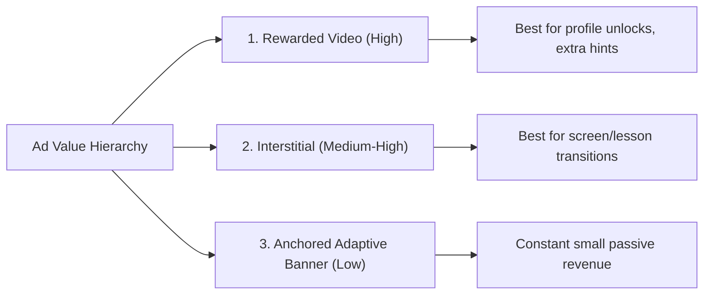

# Strategic Roadmap: Scaling Nextsem Academy to Rs. 65,000/Month Solely via Ads

To sustain a monthly budget of **Rs. 65,000** (Rs. 40,000 for your team of 4 + Rs. 25,000 for yourself), we need to generate approximately **$780 USD** per month in ad revenue. 

This document breaks down the exact traffic math, monetization strategies, and traffic acquisition channels required to hit this target solely using Google AdSense (Web) and Google AdMob (Mobile).

---

## 1. The Monetization Math (How Ad Revenue is Calculated)

Ad revenue is driven by **RPM** (Revenue Per Mille, or earnings per 1,000 impressions). 

$$\text{Monthly Earnings} = \frac{\text{Monthly Ad Impressions} \times \text{Average RPM}}{1000}$$

### Average RPM Comparison by Region:
* **Developing Markets (India/South Asia):** Average RPM ranges from **$0.50 to $2.00** due to lower local advertiser competition.
* **Premium Markets (US/UK/Canada/Germany):** Average RPM ranges from **$8.00 to $25.00+** because advertisers bid aggressively for high-value users.

### The Target Breakdown:
To earn **$780/month** ($26/day):

| Target Market | Avg. RPM | Required Monthly Impressions | Required Daily Impressions | Estimated Daily Active Users (DAU)* |
| :--- | :--- | :--- | :--- | :--- |
| **India-Only** | $1.50 | 520,000 | 17,333 | **2,300 DAU** |
| **Global Mix (50% US / 50% IN)** | $6.00 | 130,000 | 4,333 | **570 DAU** |
| **Premium-Only (US/Europe)** | $15.00 | 52,000 | 1,733 | **230 DAU** |

*\*Assumes each user views 5 screens and sees an average of 1.5 ads per screen (7.5 ad impressions/session).*

---

## 2. High-Yield Ad Formats (Optimizing Ad Placement)

Banners have the lowest engagement and payment rates. To hit your revenue goals, optimize for high-impact ad units:

1. **Rewarded Video Ads (AdMob Only):** 
   * **RPM:** $15.00 - $35.00.
   * **Implementation:** Keep the *Classroom Premium Badge* feature active. Introduce other rewarded features, such as "Watch Ad to Unlock Cheat Sheet PDFs" or "Watch Ad for Project Code Templates."
2. **Interstitial Ads (AdMob Only):**
   * **RPM:** $8.00 - $18.00.
   * **Implementation:** The *Mark Lesson as Complete* ad is perfect. Add interstitials when transitioning between main course phases (e.g., completing the HTML course and starting CSS).
3. **Adaptive Banners (Web & App):**
   * **RPM:** $0.50 - $2.50.
   * **Implementation:** Keep them anchored at the bottom of dashboard lists.

---

## 3. The "Zero to Hero" Job-Oriented Curriculum Strategy

To attract premium users and retain them, the curriculum must deliver real value:

* **Project-First Syllabus:** Instead of syntax memorization, structure lessons around building **10 Production-Ready Projects** (e.g., a SaaS Landing Page, a Dev Portfolio, a Weather App using APIs).
* **Git & Deployment Training:** Make GitHub, Vercel/Netlify hosting, and portfolio building core modules. If students can show live links on their resumes, they will share your app organically.
* **Resume & Job Prep Modules:** Add visual checksheets for resume formats, mock interview questions, and LinkedIn optimizations.

---

## 4. Traffic Acquisition: Getting Users for Free (Organic Marketing)

To keep acquisition costs at zero, focus on these three organic channels:

### 1. YouTube Search SEO (The Content Engine)
* **Strategy:** Have one of your hired team members create short, highly focused YouTube tutorials (e.g., *"How to build a responsive navbar in 5 mins"* or *"Easiest way to master CSS Flexbox"*).
* **CTA:** In the video description and pinned comment, link directly to Nextsem Academy: *"Practice this module interactively on our app!"*
* YouTube search traffic is highly qualified and has an extremely long shelf life.

### 2. LinkedIn "Build in Public"
* **Strategy:** Share daily screenshots of user progress, dashboard certificates, and app feature updates on LinkedIn. 
* Share stories of students who completed the curriculum and built portfolios. This attracts career switchers who are ready to dedicate hours to study.

### 3. Google Search SEO (Web Content)
* Optimize the `nextsem.online` website. 
* Publish free, text-light cheat sheets (e.g., *"Modern CSS Grid Cheat Sheet"*). Users searching Google for quick references will land on your site, see the AdSense ads, and download your Android app.

---

## 5. Recommended Action Plan for Your Team of 4

| Team Member | Role / Responsibilities | Weekly Output Goal |
| :--- | :--- | :--- |
| **Member 1 (Curriculum)** | Writes job-oriented MDX modules and practical coding assignments. | 3 new high-quality lessons/projects per week. |
| **Member 2 (Visual Designer)** | Designs the interactive UI elements, illustrations, and promo banners. | 10 custom visual assets and social post images. |
| **Member 3 (Developer)** | Works with you on code features, bug fixes, and testing. | Syncing platforms, UI polishing, and analytics integrations. |
| **Member 4 (Content & SEO)** | Creates short YouTube videos, writes LinkedIn posts, and manages SEO content. | 2 YouTube shorts/videos + 3 LinkedIn posts per week. |
| **You (Product Manager)** | Guides curriculum direction, manages ad placements, and monitors revenue. | Directing monetization sprints and optimizing RPM targets. |
