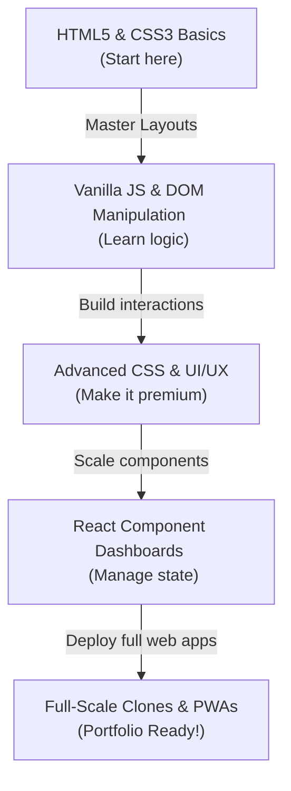

# 🚀 105 Front-End Web Developer Projects Catalog

Welcome to the ultimate directory of practical front-end projects! This catalog is designed to take you from a complete beginner (HTML/CSS) to a portfolio-ready developer (React/PWAs/Integrations).

> 💡 **Developer Tip:** Reading tutorials is like watching someone else lift weights. You won't get stronger until you write the code yourself! 🏋️‍♂️

---

## 📂 Phase 1: HTML5 & CSS3 Basics (Beginner - 20 Projects)
*Focus: Semantics, Layouts (Flexbox/Grid), Typography, Forms, and Responsive Design.*

| # | Project Name | Description & Tech | Emojis & Highlights |
|---|---|---|---|
| 1 | **Personal Profile Card** | A simple bio card featuring your photo, skills list, and social links. Uses Flexbox. | 👤 Clean UI |
| 2 | **Tribute Page** | A basic biography page dedicated to someone you admire (e.g. Alan Turing). | 🏛️ HTML5 Semantics |
| 3 | **Recipe Layout Page** | A beautifully formatted food recipe showing ingredients and step-by-step instructions. | 🍕 Lists & Formatting |
| 4 | **Survey Form** | An input-heavy form with checkboxes, radio buttons, dropdowns, and text fields. | 📋 Form Validation |
| 5 | **Technical Documentation** | A clean, searchable sidebar page documenting basic programming concepts. | 📖 Grid Layout Sidebar |
| 6 | **Product Landing Page** | A high-converting product sales page with floating nav, pricing grids, and promo videos. | 🛍️ Landing Page |
| 7 | **CSS-Only Tooltip Widget** | Tooltips that appear on hover using only CSS `:hover` states and pseudo-elements. | 💬 No JS Hover |
| 8 | **Custom Accordion FAQ** | Frequently Asked Questions list that expands and collapses. | ➕ Details Tag |
| 9 | **Vertical Timeline UI** | A chronological timeline showing milestones, career paths, or history logs. | 📅 Career Tracking |
| 10 | **Comparison Pricing Table** | Interactive card layout showing plans (Basic, Pro, Enterprise) with CSS hover scales. | 💰 Interactive Cards |
| 11 | **Parallax Scrolling Webpage** | A background layout where images move slower than foreground content on scroll. | 🌌 Visual Depth |
| 12 | **Modal Popup Box** | An overlay modal that darkens the background and displays a newsletter form. | 🪟 CSS Popup |
| 13 | **CSS Animation Showcase** | A playground of spinning icons, bouncing dots, and morphing shapes. | 🌀 Keyframes Mastery |
| 14 | **Responsive Navigation Bar** | A hamburger menu navigation that collapses cleanly on mobile viewports. | 🍔 Mobile Friendly |
| 15 | **Nested Dropdown Menu** | Multi-level dropdown options for website headers and dashboards. | ▾ Hover Menus |
| 16 | **CSS Grid Photo Gallery** | Masonry-like image layout that reflows automatically based on screen widths. | 🖼️ Grid Auto-Fit |
| 17 | **Glassmorphism Card UI** | Modern dashboard cards with frosted-glass transparent backdrops. | 🧊 Premium Modern Style |
| 18 | **Interactive Footer Bar** | A comprehensive 4-column footer containing newsletter forms and copyright text. | 📝 Site Links Navigation |
| 19 | **Dark/Light Mode Theme Sheet** | A simple static page that switches colors based on user system preferences. | 🌓 CSS Variables |
| 20 | **Neumorphic Buttons Panel** | UI elements styled with soft inner/outer shadows to look raised or sunken. | 🔘 Soft Shadow Styling |

---

## 📂 Phase 2: Vanilla JavaScript & DOM Manipulation (Beginner/Intermediate - 30 Projects)
*Focus: Event Listeners, Logic, Array Methods, Async API Fetching, and LocalStorage.*

> 📝 **Developer Joke:** Why did the JavaScript developer go to therapy? Because they had too many callback functions and couldn't resolve their promises! 🧠⛓️

```
DOM Event Lifecycle:
[ User Action (Click/Type) ] ──> [ Event Listener ] ──> [ JS Logic Update ] ──> [ DOM Node Mutation ]
```

| # | Project Name | Core APIs / Learning Focus | Emojis & Highlights |
|---|---|---|---|
| 21 | **Interactive Click Counter** | State increment, decrement, and reset bound to DOM buttons. | 🔢 Counter Logic |
| 22 | **Color Palette Flipper** | Generates random HEX color codes and applies them as CSS backgrounds. | 🎨 Randomizer Math |
| 23 | **Quote of the Day Generator**| Displays a random quote from a local array, with a copy-to-clipboard button. | 💬 Text Manipulation |
| 24 | **Digital Clock Widget** | JavaScript `setInterval()` updates showing real-world system times. | ⏰ Real-time UI |
| 25 | **Precise Stopwatch** | Millisecond counter with Start, Pause, and Lap tracking. | ⏱️ Timer Loops |
| 26 | **Vanilla JS Calculator** | Mathematical parsing of user inputs with a clean button interface. | 🧮 Math Parser |
| 27 | **Basic To-Do List** | Add, toggle status, and delete items from an active array checklist. | 📝 State Management |
| 28 | **LocalStorage Notes App** | Markdown text editor that automatically saves drafts to browser cache. | 💾 Persistent Storage |
| 29 | **Virtual Drum Kit** | Keydown event listeners playing corresponding drum sounds. | 🥁 Keyboard Audio |
| 30 | **Tic-Tac-Toe Game** | 3x3 grid tracking X/O turns and evaluating winning coordinates. | ❌ Game Coordinates |
| 31 | **Rock Paper Scissors** | User versus computer random choosing with score keeping. | ✊ Math.random() Play |
| 32 | **Memory Flip Cards** | Board matching pairs of hidden icons with card-flip animations. | 🧠 Card State Logic |
| 33 | **Hangman Word Game** | Word letter guessing with custom SVG stick-figure rendering on error. | 💀 Guess Loops |
| 34 | **Whack-a-Mole Game** | Fast clicking on randomly emerging items with a countdown timer. | 🔨 Reflex Clicker |
| 35 | **Timed Quiz App** | Multiple-choice quiz displaying results and score review pages. | 🎓 Exam Progress |
| 36 | **Password Generator Tool** | Custom password output options (capital letters, numbers, symbols). | 🔑 String Generation |
| 37 | **Live Markdown Previewer** | Parses markdown input on the fly and renders formatted HTML on screen. | 📝 String Parsing |
| 38 | **Word & Character Counter** | Computes reading speeds, spaces, and letter densities from textarea inputs. | ✍️ Text Diagnostics |
| 39 | **BMI Calculator Widget** | Weight/height parameters calculated and classified dynamically. | ⚖️ Metric Math |
| 40 | **Personal Expense Tracker** | Tracks transactions, updates balance, and displays categorized budgets. | 💵 Ledger System |
| 41 | **Weather App (API)** | Fetches weather variables from OpenWeather API using custom input parameters. | 🌦️ Fetch Request |
| 42 | **GitHub User Explorer** | Queries GitHub REST API to display avatar profiles, stars, and repos. | 🐙 API Integration |
| 43 | **Recipe Finder Hub** | Connects to Edamam API to retrieve ingredients based on search terms. | 🍳 Food Search |
| 44 | **Movie Database App** | Pulls film covers, descriptions, and ratings from TMDB database. | 🎬 Media Query |
| 45 | **Wikipedia Mini-Search Engine**| Uses Wikipedia API to show results with brief reading previews. | 🔍 Search Query |
| 46 | **Live Currency Converter** | Fetches live exchange ratios to convert values between currencies. | 💱 Live Rates |
| 47 | **HTML Canvas Drawing Pad** | Canvas stroke listeners supporting custom color brushes and sizes. | 🎨 Graphics Painter |
| 48 | **On-Screen Virtual Keyboard** | Clickable keys that inject characters into an active textarea. | ⌨️ DOM Injection |
| 49 | **Morse Code Translator** | Converts text strings to dots and dashes and plays matching sound tones. | 📡 Audio Synthesis |
| 50 | **Custom Video Player** | HTML5 video tag bound to customized play, scrub, and volume UI bars. | 🎥 Media Interface |

---

## 📂 Phase 3: Advanced CSS & UI/UX Interactions (Intermediate - 15 Projects)
*Focus: Animation Physics, Themes, Drag/Drop APIs, Complex Forms, and Micro-interactions.*

| # | Project Name | Description & Technical Focus | Emojis & Highlights |
|---|---|---|---|
| 51 | **Custom Theme Switcher** | Smooth CSS transitions changing colors across the page with local variables. | 🌓 Switcher Toggle |
| 52 | **Glassmorphism Dashboard** | Highly polished dashboard layout using HSL custom colors and box-shadow layers. | 📊 Glass Panel Layout |
| 53 | **Interactive Multi-Step Form**| Progress bars, slide-in step animations, and user confirmation states. | 📝 Form Stepper |
| 54 | **Infinite Scroll Image Grid**| Automatically fetches and appends images when scroll reaches the bottom. | 🔄 Intersection Observer |
| 55 | **Drag & Drop File Upload** | File hover detections, progress animations, and upload summary states. | 📦 Drag/Drop API |
| 56 | **Custom Audio Player UI** | Custom playlists, progress seeking, track scrubbing, and album covers. | 🎵 Custom Audio Nodes |
| 57 | **Typing Speed Test Tool** | Timer showing Words Per Minute (WPM) and letter accuracy indicators. | ⌨️ Character Tracking |
| 58 | **Scroll Progress Indicator**| Top bar that fills up dynamically based on user scroll percentages. | 📏 Scroll Event Math |
| 59 | **Image Magnifier Widget** | Zoom glass window that displays details of hovered image zones. | 🔍 Mousemove Coordinates |
| 60 | **Typewriter Script Generator**| Configures timing outputs to generate customized CSS typing keyframes. | ✍️ String Keyframes |
| 61 | **Skeleton Loading Screens** | Pulsing gray element blocks shown while awaiting simulated data. | 💀 Skeleton Animations |
| 62 | **Custom Context Menu** | Replaces default right-click menus with a custom list of options. | 🖱️ Context Menu API |
| 63 | **Tinder-Style Swipe Cards** | Tinder-like swipe gestures to approve or reject item cards. | 🃏 Touch Gesture Math |
| 64 | **Interactive SVG Map** | Map segments that highlight and show data cards on mouse hover. | 🗺️ Interactive Vectors |
| 65 | **Floating Action Menu** | Sticky bottom menu that expands on click into multiple actions. | 🎈 Micro-Animations |

---

## 📂 Phase 4: React & Component-based UI (Intermediate/Advanced - 20 Projects)
*Focus: Hooks (`useState`, `useEffect`, `useRef`), Custom Hooks, Global Context, and State Routers.*

```
React Component Flow:
[ Parent State ] ──(Props)──> [ Child Component ] ──(Trigger Event)──> [ State Setter ] ──(Re-render)
```

| # | Project Name | Core Technical Architecture | Emojis & Highlights |
|---|---|---|---|
| 66 | **Crypto Live Dashboard** | Fetches coin tickers every 10s and renders visual changes. | 🪙 CoinGecko API |
| 67 | **E-Commerce Shopping Cart**| Global `Context` managing product listings, counts, and pricing sheets. | 🛒 Global Cart State |
| 68 | **Habit Tracker Calendar** | Streak calculations, check toggles, and LocalStorage caching. | 📅 Streak Tracking |
| 69 | **Interactive Kanban Board** | Multiple task columns (To Do, Doing, Done) supporting drag cards. | 📋 Column Drag/Drop |
| 70 | **Interactive Expense Chart**| Category forms linked to Chart.js showing budget divisions. | 📊 Data Visualizer |
| 71 | **Recipe Box & Search Hub** | Dynamic filters sorting recipes based on dietary flags (e.g. vegan). | 🍳 Dynamic Filters |
| 72 | **Movie Watchlist Manager** | Add movies to custom watched/unwatched buckets using LocalStorage. | 🎬 Media State Arrays |
| 73 | **Markdown Note Editor** | Split screen editor showing raw text and formatted live previews. | 📝 MD parser |
| 74 | **Flashcard Learning Deck** | Interactive card flips and progress bars tracking study goals. | 🧠 State Flips |
| 75 | **GitHub Repo Explorer** | Dynamic repository searches showing stars, issues, and readmes. | 🐙 REST API Queries |
| 76 | **Social Media Dashboard** | Profile metrics, followers counts, and charts showing interactions. | 📈 Layout Metrics |
| 77 | **Interactive Quiz App** | Timer hooks, option locks, and final score summary metrics. | ⏱️ Timer Loops |
| 78 | **Music Playlist Builder** | Search song tracks, preview audio clips, and compile playlists. | 🎵 Playlist Arrays |
| 79 | **Job Listings Portal** | Filters jobs by role, level, languages, and locations. | 💼 Filter Logic |
| 80 | **Weather Station Dashboard** | 7-day forecast cards, humidity dials, and responsive layouts. | 🌦️ Forecast API |
| 81 | **Drawing Pad (Canvas)** | Custom brushes, line widths, and undo/redo state stacks. | 🎨 Vector Canvas Drawing |
| 82 | **Pokedex Explorer App** | Fetches Pokemon data cards from PokeAPI, with search and filter. | 👾 Pokemon API Search |
| 83 | **Word Puzzle Game** | Letter grid verification matching dictionary words. | 🔠 Word Arrays |
| 84 | **Task Manager with Timers**| Pomodoro timer integrated with task checklists. | ⏱️ Pomodoro Loop |
| 85 | **Interactive Survey Maker** | Custom builder to create question forms and review submissions. | 📋 Dynamic Form Builder |

---

## 📂 Phase 5: Full-Scale Front-End Web Apps & Clones (Advanced - 20 Projects)
*Focus: Clones, Firebase integration, PWAs, custom layouts, and highly polished premium applications.*

| # | Project Name | Technical Architecture & Features | Emojis & Highlights |
|---|---|---|---|
| 86 | **Trello Workspace Clone** | Drag and drop tasks across columns, add boards, and write cards. | 📋 react-beautiful-dnd |
| 87 | **Slack Workspace UI Clone**| Real-time messaging, channels listing, and authentication. | 💬 React + Firebase Auth |
| 88 | **Netflix Dashboard Clone** | Video sliders, banner previews, and movie details cards. | 🎬 TMDB API + Video embeds |
| 89 | **Spotify Player UI Clone** | Music playback, search tracks, and display user playlists. | 🎵 Spotify SDK |
| 90 | **Airbnb Cards UI Clone** | Property listing cards, map views, and interactive filters. | 🗺️ Mapbox + Grid |
| 91 | **Notion Workspace Clone** | Rich text document builder, nested pages, and drag structures. | 📝 Document Block Editor |
| 92 | **Twitter/X Feed UI Clone** | Create posts, like, retweet, and display user profiles. | 🐦 Real-time Feed State |
| 93 | **YouTube Video Portal UI** | Sidebar nav, categories, custom video grid, and search bar. | 🎥 YouTube REST API |
| 94 | **Google Drive UI Clone** | File folders grid, drag-upload dropzones, and document previews. | 💾 Firebase Storage |
| 95 | **Stripe Checkout Flow Mock**| Multi-step checkout form, card inputs, and success screens. | 💳 Stripe Integration |
| 96 | **Collaborative Text Editor**| Real-time multi-user document collaboration. | 🤝 Socket.io Integration |
| 97 | **Portfolio Builder App** | Choose layout styles and generate a custom portfolio page. | 🛠️ Page Builder Logic |
| 98 | **AI Recipe Assistant App** | Prompts ChatGPT API to suggest cooking steps based on ingredients. | 🤖 OpenAI API Integration |
| 99 | **Code Editor Playbox** | Write HTML, CSS, and JS and view the compiled preview instantly. | 💻 Monaco Code Editor |
| 100| **Weather App PWA** | Installable application supporting offline weather caching. | 🌦️ Offline Service Workers |
| 101| **Blogger MDX CMS** | Multi-author blog publishing system reading localized markdown files. | 📖 Next.js + gray-matter |
| 102| **⊞ Windows 11 Simulator UI** | Drag-drop folder windows, start menu, calendar widget, and terminal. | 🪟 Windows OS Desktop UI |
| 103| **Crypto Portfolios Tracker**| Live balance meters and trend line charts showing historical prices. | 📈 Coingecko + ChartJS |
| 104| **Travel Planner Dashboard**| Travel budget charts, routes map, packing list, and itinerary. | ✈️ Leaflet JS Maps |
| 105| **BCA Student Portal App** | Homework checklists, semester schedules, and quiz trackers. | 🎓 Student Dashboard |

---

## 🏆 Project Progression Roadmap

To get the most out of this list, proceed in a structured sequence:



> 🌟 **Ready to deploy?** Use `npm run deploy:prod` to push your changes live to Firebase Hosting and showcase your creations to the world!
