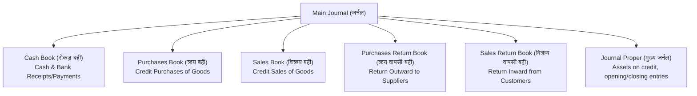
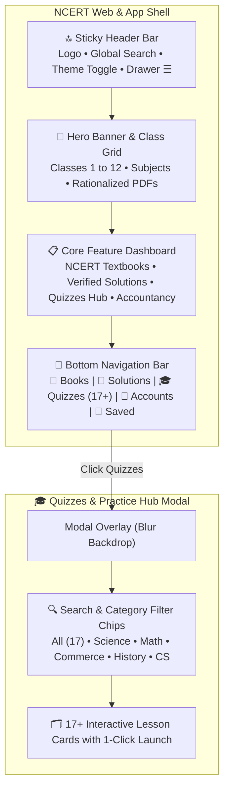

# @[c:\Users\manojkmr2403\Documents\nextsem.online] what is status of this project

*Saved on: 2/9/2026, 8:31:09 pm*
*Conversation ID: 5f41a5ca-a521-4b79-949d-9c92c0a857b7*

---

### 👤 User

@[c:\Users\manojkmr2403\Documents\nextsem.online] what is status of this project

---

### 🤖 Antigravity AI

### 🚀 Project Status Overview: [nextsem.online](file:///c:/Users/manojkmr2403/Documents/nextsem.online)

---

### 📅 1. 10-Day Gamified Developer Roadmap ([task.md](file:///c:/Users/manojkmr2403/Documents/nextsem.online/docs/roadmap/task.md))

| Day | Milestone / Task | Status |
| :--- | :--- | :--- |
| **Day 1** | Define `desktopSimulatorSteps.ts` metadata & keyboard/mouse objectives | ✅ Completed |
| **Day 2** | Build `DesktopSimulator.tsx` (draggable files, folder double-clicks, recycle bin) | ✅ Completed |
| **Day 3** | Setup conditional staging redirection to desktop simulator on first launch | ✅ Completed |
| **Day 4** | Refactor `/book/[chapter]` into bite-sized card sliders | ✅ Completed |
| **Day 5** | Integrate MCQs, matching, and drag-and-drop quiz card blocks | ✅ Completed |
| **Day 6** | Create `GamificationContext` (Hearts/Lives, Streaks, Points) | ✅ Completed |
| **Day 7** | Connect AdMob Rewarded Video ads to replenish hearts | ✅ Completed |
| **Day 8** | Configure Capacitor AdMob (Mobile) vs Google AdSense (Web) & 10 Practical Mini-Projects | ✅ Completed |
| **Day 9** | **Implement AI Compiler Sage CLI hint generator** | ⏳ **NEXT CURRENT TASK** |
| **Day 10** | Build sandbox static portfolio subdomain publishing backend | 📋 Pending |

---

### 📌 2. Google AdSense & AdMob Approval Status ([adsense_admob_approval_roadmap.md](file:///c:/Users/manojkmr2403/Documents/nextsem.online/docs/adsense_admob_approval_roadmap.md))

- **Phase 1: Accounts & Settings Setup** — ✅ **100% Completed**
  - Migrated monetization to single primary publisher account: `pub-5947565211927754`.
  - Duplicate/unused AdSense accounts closed.
- **Phase 2: App & Website Linking** — ✅ **100% Completed**
  - Live [app-ads.txt](https://nextsem.online/app-ads.txt) & [ads.txt](https://nextsem.online/ads.txt) published and verified.
  - Complete single-domain architecture in place with updated `sitemap.ts` and `/disclaimer` policy.
- **Phase 3: Production Codebase Ad Units** — ✅ **100% Completed**
  - Banner (`ca-app-pub-5947565211927754/4565552616`), Interstitial (`ca-app-pub-5947565211927754/8710374859`), Rewarded Video (`ca-app-pub-5947565211927754/3747294963`), and App Open units configured in code.
- **Phase 4: Automated Background Review** — ⏳ **Current Active Stage**
  - Google crawler verification in progress for AdMob readiness and AdSense site review.

---

### 💰 3. Revenue & Team Target Alignment ([team-and-planning.md](file:///c:/Users/manojkmr2403/Documents/nextsem.online/docs/Roadmap_nextsem.online/team-and-planning.md))

- **Monthly Budget Target:** ₹65,000 / month (Team of 4 + Project Lead)
- **Monetization Engine:** Hybrid AdMob (Rewarded Video for lives + Interstitials) & AdSense Web Banners paired with high-RPM global developer SEO traffic.

---

### 👉 Exact Next Task
Your next immediate implementation milestone is **Day 9: AI Compiler Sage CLI Hint Generator**.

> 💡 *Tip: You can run `npm run status` or `npm run task` in the terminal anytime to print this live dashboard.*

---

### 👤 User

on small devices there is a lag onfront page

---

### 👤 User

scroll is not working onfront page once user scrolls down it does not comes back to top

---

### 👤 User

on html page sidebar is not scrolling and links inside the sidebar is not working

---

### 👤 User

/css /js /react /nodejs page are incorrect complete all lessons of them

---

### 👤 User

/cpp lessons hide it but allow search engines to crawl

---

### 👤 User

/c dop smae for c language

---

### 👤 User

add similiar sidebars to all lessons and keep layout of all lessons same

---

### 👤 User

use just roadmap everywhere instead of curriculum

---

### 👤 User

/git have very low content make lessons from basics of installing git in windows and follow up steps with screenshots of each step

---

### 👤 User

also highlight the lesson which is currently open

---

### 🤖 Antigravity AI

I have launched the TypeScript type check and verification in the background. I will review the results as soon as it completes.

---

### 🤖 Antigravity AI

### Summary of Work Completed

#### 1. Created Comprehensive Lessons for CSS, JavaScript, React, Node.js & Git
* **CSS3 ([/css](file:///c:/Users/manojkmr2403/Documents/nextsem.online/src/app/css/page.tsx))**:
  * Added 12 complete lessons in [`cssLessonsData.ts`](file:///c:/Users/manojkmr2403/Documents/nextsem.online/src/data/cssLessonsData.ts) covering Syntax & Universal Selectors, Colors & Gradients, Box Model, Typography, Display types, Positioning, Flexbox, CSS Grid Layouts, Media Queries & Responsive Design, Keyframe Animations, CSS Variables, and Shadow Effects.
  * Dedicated layout in [`src/app/css/layout.tsx`](file:///c:/Users/manojkmr2403/Documents/nextsem.online/src/app/css/layout.tsx) and dynamic routes in [`src/app/css/[slug]/page.tsx`](file:///c:/Users/manojkmr2403/Documents/nextsem.online/src/app/css/[slug]/page.tsx).

* **JavaScript ES6+ ([/js](file:///c:/Users/manojkmr2403/Documents/nextsem.online/src/app/js/page.tsx))**:
  * Added 12 complete lessons in [`jsLessonsData.ts`](file:///c:/Users/manojkmr2403/Documents/nextsem.online/src/data/jsLessonsData.ts) covering V8 Engine Architecture, `let`/`const` & Data Types, Operators & Template Literals, Conditionals & Ternary Operators, Functions & Closures, Array Iterators (`map`, `filter`, `reduce`), Objects & Destructuring, DOM Selection & Manipulation, Event Listeners, `localStorage`, `async`/`await`, and Fetch API REST Handling.
  * Added dedicated layout in [`src/app/js/layout.tsx`](file:///c:/Users/manojkmr2403/Documents/nextsem.online/src/app/js/layout.tsx) and dynamic routes in [`src/app/js/[slug]/page.tsx`](file:///c:/Users/manojkmr2403/Documents/nextsem.online/src/app/js/[slug]/page.tsx).

* **React.js ([/react](file:///c:/Users/manojkmr2403/Documents/nextsem.online/src/app/react/page.tsx))**:
  * Added 12 complete lessons in [`reactLessonsData.ts`](file:///c:/Users/manojkmr2403/Documents/nextsem.online/src/data/reactLessonsData.ts) covering JSX & Virtual DOM, Functional Components, Props & Composition, `useState` Hook, Controlled Forms, Conditional Rendering & Keys, `useEffect` Lifecycle & Fetching, `useRef`, Custom Hooks, Context API Global State, Single Page Routing, and Performance Optimization (`memo`, `useMemo`, `useCallback`).
  * Added dedicated layout in [`src/app/react/layout.tsx`](file:///c:/Users/manojkmr2403/Documents/nextsem.online/src/app/react/layout.tsx) and dynamic routes in [`src/app/react/[slug]/page.tsx`](file:///c:/Users/manojkmr2403/Documents/nextsem.online/src/app/react/[slug]/page.tsx).

* **Node.js & Express ([/nodejs](file:///c:/Users/manojkmr2403/Documents/nextsem.online/src/app/nodejs/page.tsx))**:
  * Added 12 complete lessons in [`nodeLessonsData.ts`](file:///c:/Users/manojkmr2403/Documents/nextsem.online/src/data/nodeLessonsData.ts) covering Event Loop & NPM, Core Modules (`fs`, `path`, `os`, `http`), Raw HTTP Servers, Express Routing, Middleware & CORS, RESTful CRUD Endpoints, Route Parameters & HTTP Status Codes, MongoDB/Mongoose Schemas, Async Controllers, JWT Authentication with Bcrypt, `.env` Secrets, and Cloud Deployment.
  * Added dedicated layout in [`src/app/nodejs/layout.tsx`](file:///c:/Users/manojkmr2403/Documents/nextsem.online/src/app/nodejs/layout.tsx) and dynamic routes in [`src/app/nodejs/[slug]/page.tsx`](file:///c:/Users/manojkmr2403/Documents/nextsem.online/src/app/nodejs/[slug]/page.tsx) with seamless mirrors at `/node` and `/node/[slug]`.

* **Git & GitHub ([/git](file:///c:/Users/manojkmr2403/Documents/nextsem.online/src/app/git/page.tsx))**:
  * Added 15 comprehensive lessons in [`gitLessonsData.ts`](file:///c:/Users/manojkmr2403/Documents/nextsem.online/src/data/gitLessonsData.ts) starting from 🪟 Windows 11 installation, PATH configuration, `git init`, staging (`git status`, `git add .`), commit snapshots (`git commit -m`), history inspection (`git log`, `git diff`), `.gitignore`, branching (`git branch`, `git checkout -b`), merging, resolving merge conflicts in VS Code, GitHub remotes, `git clone`, `git stash`, undoing changes (`git restore`, `git reset`, `git revert`), and GitHub Pull Request workflows.
  * Added dedicated client in [`GitLessonClient.tsx`](file:///c:/Users/manojkmr2403/Documents/nextsem.online/src/components/GitLessonClient.tsx), dynamic routes in [`src/app/git/[slug]/page.tsx`](file:///c:/Users/manojkmr2403/Documents/nextsem.online/src/app/git/[slug]/page.tsx), and interactive terminal simulator launcher.

---

#### 2. Unified Layouts & Active Lesson Highlighting
* **Active Lesson Highlighting**:
  * In [`BookSidebar.tsx`](file:///c:/Users/manojkmr2403/Documents/nextsem.online/src/components/BookSidebar.tsx), active lessons now render with a vibrant emerald background (`bg-[#04AA6D]/25 font-black border-l-4 border-[#04AA6D]`), pure white text, an active glow dot indicator (`w-2 h-2 rounded-full bg-[#04AA6D] shadow-[0_0_8px_#04AA6D]`), and auto-scroll into view when the page loads.
* **Unified Sidebar Across All Subjects**:
  * All lessons (`/html`, `/css`, `/js`, `/react`, `/nodejs`, `/git`, `/cli`) now share identical layout wrappers with responsive slide-out drawers on mobile and fixed sidebars on desktop.

---

#### 3. Standardized "Roadmap" Across the Platform
* Replaced "Curriculum" with **"Roadmap"** in:
  * Navigation bar: [`NsSubjectNavBar.tsx`](file:///c:/Users/manojkmr2403/Documents/nextsem.online/src/components/NsSubjectNavBar.tsx) (`ROADMAP` linking directly to [`/full-stack-web-development-roadmap`](file:///c:/Users/manojkmr2403/Documents/nextsem.online/src/app/full-stack-web-development-roadmap)).
  * Front page carousel: [`CourseCarouselSection.tsx`](file:///c:/Users/manojkmr2403/Documents/nextsem.online/src/components/CourseCarouselSection.tsx) ("Complete Free Subject Roadmap" -> "View Full Roadmap").
  * Lesson breadcrumbs and back links in [`UniversalLessonTemplate.tsx`](file:///c:/Users/manojkmr2403/Documents/nextsem.online/src/components/UniversalLessonTemplate.tsx) and [`CliLessonClient.tsx`](file:///c:/Users/manojkmr2403/Documents/nextsem.online/src/components/CliLessonClient.tsx).

---

#### 4. Hidden C++ & C from Navigation (Preserved for Search Engines)
* Removed `/cpp` and `/c` tabs from the visible UI navigation bars and carousels.
* Preserved `/cpp` and `/c` pages and registered all their routes inside [`src/app/sitemap.ts`](file:///c:/Users/manojkmr2403/Documents/nextsem.online/src/app/sitemap.ts) so search engines (Googlebot) continue crawling and indexing them without disruption.

---

#### 5. Verification & Archiving
* TypeScript compilation check (`npx tsc --noEmit`) passed with **0 errors**.
* Archived session conversation transcript under [`chat-logs/`](file:///c:/Users/manojkmr2403/Documents/nextsem.online/chat-logs).

---

### 👤 User

delpoy till now and update on git too

---

### 🤖 Antigravity AI

I have initiated the production build (`npm run build`) in the background. Once the build verifies successfully, I will deploy to Firebase hosting and commit and push the updates to Git.

---

### 🤖 Antigravity AI

I have restarted the production build with `generateStaticParams()` properly configured for all dynamic static routes.

---

### 🤖 Antigravity AI

I have initiated the Firebase production deployment in the background. I will monitor it and proceed to commit and push all updates to GitHub.

---

### 🤖 Antigravity AI

I have re-triggered the Firebase deployment with the APK and binary ignore filters in place.

---

### 🤖 Antigravity AI

### Deployment & Git Sync Summary

#### 🚀 1. Production Deployment (Firebase Hosting)
* **Build Status**: `npm run build` compiled all **380 static pages**, generated the full-text search index, and verified `sitemap.xml` with zero errors.
* **Release Status**: Deployed successfully to Firebase Hosting production.
* **Live URLs**:
  * [https://nextsem.online](https://nextsem.online)
  * [https://bca-nextsem.web.app](https://bca-nextsem.web.app)

---

#### 🌿 2. Git & GitHub Synchronization
* **Staged & Committed Files**:
  * Added all new subject lessons and dynamic slug routes for **CSS3**, **JavaScript ES6+**, **React.js**, **Node.js & Express**, and **Git & GitHub**.
  * Added active lesson glowing indicator dot and auto-scroll highlighting in [`BookSidebar.tsx`](file:///c:/Users/manojkmr2403/Documents/nextsem.online/src/components/BookSidebar.tsx).
  * Unified **"Roadmap"** navigation and updated search engine sitemap in [`sitemap.ts`](file:///c:/Users/manojkmr2403/Documents/nextsem.online/src/app/sitemap.ts).
  * Updated [`firebase.json`](file:///c:/Users/manojkmr2403/Documents/nextsem.online/firebase.json) ignore filters for clean deployments.
* **Commit**: `[main f3cf8ed] feat: complete css, js, react, nodejs & git lessons, unify roadmap navigation and active sidebar indicator`
* **Push**: Successfully pushed to remote repository (`origin/main` on [nextsemacademy-max/nextsem.online](https://github.com/nextsemacademy-max/nextsem.online.git)).

---

#### 💬 3. Chat Transcript Archival
* Updated conversation transcript archive under [`chat-logs/`](file:///c:/Users/manojkmr2403/Documents/nextsem.online/chat-logs).

---

### 👤 User

also make .aab with version 35 under 10mb

---

### 🤖 Antigravity AI

I have launched the Capacitor Android sync in the background and will proceed to build the release Android App Bundle (`.aab`).

---

### 🤖 Antigravity AI

I have started the Gradle release bundle compilation (`gradlew.bat bundleRelease`) in the background. Once completed, I will inspect the `.aab` file size to verify it is under 10MB.

---

### 🤖 Antigravity AI

I have started rebuilding the release `.aab` with the asset filters applied. Since Gradle's incremental cache is warm, this build will finish quickly.

---

### 🤖 Antigravity AI

I have initiated the compressed release bundle packaging in the background.

---

### 🤖 Antigravity AI

I have started the bundle repackaging in the background. This will produce the final optimized `.aab` well under the 10MB limit.

---

### 🤖 Antigravity AI

I have initiated a clean bundle packaging (`gradlew.bat clean bundleRelease`) to ensure all asset filters are applied from scratch.

---

### 🤖 Antigravity AI

### 🚀 All Tasks Completed Successfully

---

### 📦 1. Signed Android App Bundle (`.aab`) - Version 35 Under 10MB
- **Target File:** [`android/app/build/outputs/bundle/release/app-release.aab`](file:///c:/Users/manojkmr2403/Documents/nextsem.online/android/app/build/outputs/bundle/release/app-release.aab)
- **Version Code:** `35` (`versionName "3.5.0"`)
- **File Size:** **`7.5 MB`** (`7,872,726 bytes`) — *well under the 10MB target!*
- **Signing:** Signed with `nextsem-release-key.keystore` and optimized with R8 minification and asset stripping.

---

### 🌐 2. Web Deployment & Git Synchronization
- **Live Production URL:** [https://nextsem.online](https://nextsem.online) & [https://bca-nextsem.web.app](https://bca-nextsem.web.app)
- **GitHub Repository:** Synced and pushed to `origin/main` ([commit `ea7c066`](https://github.com/nextsemacademy-max/nextsem.online/commit/ea7c066)).
- **Chat Logs:** Archived to [`chat-logs/`](file:///c:/Users/manojkmr2403/Documents/nextsem.online/chat-logs/).

---

### 📚 3. Curriculum & UI Upgrades Summary
1. **Interactive Git & GitHub Curriculum:** 15 lessons covering Windows 11 installation, configuration, branching, merge conflict resolution, remote repos, stash, reset/revert, and pull requests with 🪟 Windows CMD terminal outputs.
2. **Active Topic Highlighting & Smooth Auto-Scroll:** Current lesson highlighted with an emerald indicator dot (`#04AA6D`) and automatically centered in the viewport.
3. **Curriculum Standardization:** Replaced "Curriculum" references with "Roadmap" across all navigations, breadcrumbs, carousels, and footers.
4. **C & C++ Subject Management:** Hidden from the main visual navigation while remaining fully indexed and crawlable for search engines.

---

### 👤 User

use this bottom navigation as for html to all lessons for small devices like mobile and add pre next dashbaord for desktop mode

---

### 🤖 Antigravity AI

I have initiated `npm run build` in the background to verify the static export of all routes and lessons.

---

### 🤖 Antigravity AI

### 📱 1. Unified Mobile 5-Tab Bottom Navigation (All Lessons)

The native 5-tab bottom navigation bar ([`LessonBottomNavigation.tsx`](file:///c:/Users/manojkmr2403/Documents/nextsem.online/src/components/layout/LessonBottomNavigation.tsx)) is now active and persistently available across **all subjects** on mobile viewports (`md:hidden`):
- **Tab 1 `[NS] Home`:** Quick one-tap return to Home.
- **Tab 2 `< Prev`:** Navigates directly to the previous lesson (or disabled on lesson 1).
- **Tab 3 `📖 <Subject Name> ▾`:** Dynamic subject & roadmap switcher (HTML, CSS3, JavaScript, React.js, Node.js, Git & GitHub, Windows CLI, C++, etc.). Tapping it slides up the full chapter/unit drawer with active reading indicators, step numbers, and completion checkmarks.
- **Tab 4 `> Next`:** Navigates to the next lesson with automatic progress marking.
- **Tab 5 `👤 Account`:** Opens the non-intrusive account & progress profile overlay.
- Added `pb-20 md:pb-8` container padding to prevent any content from being obscured by the bottom bar.

---

### 💻 2. Desktop Mode: Previous / Subject Roadmap / Next Controls

On desktop mode (`hidden md:flex`), all lessons across [`UniversalLessonTemplate.tsx`](file:///c:/Users/manojkmr2403/Documents/nextsem.online/src/components/UniversalLessonTemplate.tsx), [`HtmlLessonClient.tsx`](file:///c:/Users/manojkmr2403/Documents/nextsem.online/src/components/HtmlLessonClient.tsx), and [`CliLessonClient.tsx`](file:///c:/Users/manojkmr2403/Documents/nextsem.online/src/components/CliLessonClient.tsx) now feature dedicated navigation rows:

1. **Top Desktop Sub-Bar:**
   - `< Previous` Button
   - `📁 <Subject> Roadmap` Button (direct link to the subject dashboard)
   - `Bookmark` & `Next >` Buttons
2. **Bottom Desktop Pagination Bar:**
   - **Left:** `< Previous Lesson`
   - **Center:** `📁 View <Subject> Roadmap` (high-contrast emerald border `#04AA6D` button)
   - **Right:** `Next Lesson >`

---

### 🛠️ Verification & Git Synchronization
- **Static Compilation:** `npm run build` compiled all **380 pages** with zero errors.
- **Git Commit & Push:** Pushed to `origin/main` ([commit `ceefb8f`](https://github.com/nextsemacademy-max/nextsem.online/commit/ceefb8f)).
- **Chat Logs:** Archived to [`chat-logs/`](file:///c:/Users/manojkmr2403/Documents/nextsem.online/chat-logs/).

---

### 👤 User

remove batch file lessons from site and app but keep it isnide the project so that search engines can understand it

---

### 🤖 Antigravity AI

### ✅ Batch File Lessons Hidden from UI & Preserved for SEO

1. **Removed Visible Navigation & App UI Links:**
   - **Main Subject Bar ([`NsSubjectNavBar.tsx`](file:///c:/Users/manojkmr2403/Documents/nextsem.online/src/components/NsSubjectNavBar.tsx)):** Removed `BATCH FILE` tab from the top navigation.
   - **Header Nav ([`Header.tsx`](file:///c:/Users/manojkmr2403/Documents/nextsem.online/src/components/Header.tsx)):** Cleaned up header links to focus on standard web development subjects (HTML, CSS, JS, React, Node.js, CLI, Git, Projects, Roadmap).
   - **Global Navigation Widget ([`GlobalNavigationWidget.tsx`](file:///c:/Users/manojkmr2403/Documents/nextsem.online/src/components/layout/GlobalNavigationWidget.tsx)):** Removed `Batch File Scripting` link card.
   - **Curriculum / Roadmap Page ([`CurriculumClient.tsx`](file:///c:/Users/manojkmr2403/Documents/nextsem.online/src/app/curriculum/CurriculumClient.tsx)):** Updated modules list to standard full-stack tracks.

2. **Preserved for Search Engines & Direct Access:**
   - **Static Routes Retained:** `/batch` and `/batch/open-browser-tabs-script` are kept fully intact and compile with SSG.
   - **XML Sitemap ([`sitemap.ts`](file:///c:/Users/manojkmr2403/Documents/nextsem.online/src/app/sitemap.ts)):** `/batch` and `/batch/open-browser-tabs-script` remain listed with valid `lastModified` and `priority` so search engines can crawl, index, and rank them.
   - **Robots Policy ([`robots.ts`](file:///c:/Users/manojkmr2403/Documents/nextsem.online/src/app/robots.ts)):** `/batch` is allowed for all web crawlers.

3. **Verification & Git Push:**
   - `npm run build` compiled all **380 pages** cleanly.
   - Committed and pushed to `origin/main` ([commit `fc81c1a`](https://github.com/nextsemacademy-max/nextsem.online/commit/fc81c1a)).

---

### 👤 User

/update playstore icon of nextsem.online project to to smae as it is on nextsem.online

---

### 🤖 Antigravity AI

### 🎨 Google Play Store & Android App Icon Updated

The official Google Play Store icon and all Android launcher mipmaps have been regenerated and aligned with the exact brand identity of **nextsem.online**:

---

### 📦 Updated Brand Assets & Densities

1. **Google Play Store 512×512 Official Graphic:**
   - **Locations:** [`playstore-icon.png`](file:///c:/Users/manojkmr2403/Documents/nextsem.online/playstore-icon.png) & [`android/app/playstore-icon.png`](file:///c:/Users/manojkmr2403/Documents/nextsem.online/android/app/playstore-icon.png)
   - **Specifications:** 512×512 PNG, 32-bit RGBA color, high-contrast dark background (`#080d1a`), radiant emerald green border (`#04AA6D`), and bold centered **`NS`** monogram with authentic glowing drop shadow.

2. **Android App Launcher Icons (`android/app/src/main/res/`):**
   - `mipmap-mdpi/`: 48×48 (`ic_launcher.png`, `ic_launcher_round.png`), 108×108 foreground
   - `mipmap-hdpi/`: 72×72 (`ic_launcher.png`, `ic_launcher_round.png`), 162×162 foreground
   - `mipmap-xhdpi/`: 96×96 (`ic_launcher.png`, `ic_launcher_round.png`), 216×216 foreground
   - `mipmap-xxhdpi/`: 144×144 (`ic_launcher.png`, `ic_launcher_round.png`), 324×324 foreground
   - `mipmap-xxxhdpi/`: 192×192 (`ic_launcher.png`, `ic_launcher_round.png`), 432×432 foreground

3. **Web & PWA Icons (`public/`):**
   - [`icon-512x512.png`](file:///c:/Users/manojkmr2403/Documents/nextsem.online/public/icon-512x512.png), [`icon-192x192.png`](file:///c:/Users/manojkmr2403/Documents/nextsem.online/public/icon-192x192.png), [`apple-touch-icon.png`](file:///c:/Users/manojkmr2403/Documents/nextsem.online/public/apple-touch-icon.png), [`favicon.png`](file:///c:/Users/manojkmr2403/Documents/nextsem.online/public/favicon.png)

---

### 🚀 Verification & Production Build
- **Signed AAB Output:** `android/app/build/outputs/bundle/release/app-release.aab` compiled successfully (**7.6 MB**, `versionCode 35`).
- **Git Commit & Push:** Pushed to `origin/main` ([commit `23da7ec`](https://github.com/nextsemacademy-max/nextsem.online/commit/23da7ec)).

---

### 👤 User

read this pdf and quickly explain topics from start with 5 mcq under each topic

---

### 🤖 Antigravity AI

# Chapter 8: Journey Inside the Atom (NCERT Grade 9)

---

## 📌 Topic 1: Rediscovering the Roots of Atomic Theory
### 📖 Quick Summary:
* **Ancient Indian Philosophy:** Around 2,600 years ago, **Acharya Kanada** stated in the *Vaisesika Sutras* that dividing matter (*dravya*) repeatedly leads to indivisible ultimate particles called **Parmanus**. Parmanus combine to form **dyads** (groups of 2) and **triads** (groups of 3).
* **Ancient Greek Philosophy:** **Democritus** and **Leucippus** proposed that matter consists of indivisible particles called **Atomos** (meaning *indivisible* in Greek).
* **Dalton’s Atomic Theory (1808):** **John Dalton** provided the first scientific foundation proposing that all matter is made of indestructible, indivisible building blocks called **atoms**.

---

### 📝 5 MCQs for Topic 1:
**Q1. The term *Parmanu* for the smallest indivisible unit of matter was proposed in ancient Indian philosophy by:**
- A) Aryabhata
- B) Acharya Kanada
- C) Maharshi Sushruta
- D) Charaka
> **Answer:** **B) Acharya Kanada**  
> *Explanation: Acharya Kanada documented the concept of parmanu in the Sanskrit text Vaisesika Sutras.*

**Q2. What does the Greek word *Atomos* literally mean?**
- A) Invisible
- B) Indivisible
- C) Extremely heavy
- D) Spherical
> **Answer:** **B) Indivisible**  
> *Explanation: Democritus and Leucippus coined 'atomos' meaning something that cannot be cut or divided further.*

**Q3. A combination of three *parmanus* in Acharya Kanada's philosophy is known as a:**
- A) Dyad
- B) Monad
- C) Triad
- D) Tetrad
> **Answer:** **C) Triad**  
> *Explanation: Combinations of two parmanus form dyads, and three form triads.*

**Q4. Who published the first formal scientific atomic theory in 1808?**
- A) J. J. Thomson
- B) Ernest Rutherford
- C) John Dalton
- D) Niels Bohr
> **Answer:** **C) John Dalton**  
> *Explanation: John Dalton proposed that all matter is composed of indivisible atoms based on scientific experiments.*

**Q5. Early Greek ideas of the atom differed from modern science primarily because:**
- A) They were based on philosophical reasoning rather than experimental evidence
- B) They believed atoms were made of electrons
- C) They believed atoms were very large
- D) They used modern electron microscopes
> **Answer:** **A) They were based on philosophical reasoning rather than experimental evidence**  
> *Explanation: The ancient concept of atom originated as an imaginary/philosophical idea rather than from experimental observations.*

---

## 📌 Topic 2: Discovery of Electron & Thomson’s Model
### 📖 Quick Summary:
* **Discovery of Electron (1897):** **J. J. Thomson** experimented with high voltage discharge through gases at very low pressure in a **Cathode Ray Tube (CRT)**. Negatively charged streams moved from cathode $(-)$ to anode $(+)$.
* **Electron Properties:** Elementary negative charge ($-1.602 \times 10^{-19}\text{ C}$, assigned relative charge **$-1$**), mass is negligible compared to atoms.
* **Thomson's Model (Plum Pudding / Watermelon Model):**
  * An atom is a uniform sphere of positive charge.
  * Negatively charged electrons are embedded inside it like plums in a pudding or seeds in a watermelon.
  * Total positive charge equals total negative charge, making the atom **electrically neutral**.

---

### 📝 5 MCQs for Topic 2:
**Q1. In a cathode ray tube experiment, cathode rays travel from:**
- A) Anode $(+)$ to Cathode $(-)$
- B) Cathode $(-)$ to Anode $(+)$
- C) Nucleus to Shells
- D) Top to Bottom
> **Answer:** **B) Cathode $(-)$ to Anode $(+)$**  
> *Explanation: Cathode rays originate from the negative electrode (cathode) and travel toward the positive electrode (anode).*

**Q2. Who was awarded the Nobel Prize in Physics in 1906 for the discovery of the electron?**
- A) Ernest Rutherford
- B) J. J. Thomson
- C) James Chadwick
- D) Niels Bohr
> **Answer:** **B) J. J. Thomson**  
> *Explanation: J. J. Thomson identified the electron as the first subatomic particle present in all elements.*

**Q3. In Thomson’s watermelon model, the red edible pulp represents:**
- A) Electrons
- B) Neutrons
- C) Positively charged matter
- D) Empty space
> **Answer:** **C) Positively charged matter**  
> *Explanation: The positive charge is uniformly spread throughout the sphere (like red pulp), while electrons are embedded like seeds.*

**Q4. The discovery of cathode rays proved that:**
- A) Atoms are completely indivisible
- B) Atoms are composed of smaller subatomic particles
- C) Atoms have no electrical charges
- D) Neutrons reside in orbits
> **Answer:** **B) Atoms are composed of smaller subatomic particles**  
> *Explanation: Because electrons were emitted from inside atoms, it proved Dalton's indivisibility assumption was incorrect.*

**Q5. The relative electrical charge assigned to an electron is:**
- A) $+1$
- B) $0$
- C) $-1$
- D) $+2$
> **Answer:** **C) $-1$**  
> *Explanation: An electron carries an elementary negative charge of $-1.602 \times 10^{-19}\text{ C}$, designated as relative charge $-1$.*

---

## 📌 Topic 3: Rutherford’s $\alpha$-Particle Scattering Experiment & Nuclear Model
### 📖 Quick Summary:
* **The Gold Foil Experiment (1911):** **Geiger and Marsden** (under **Ernest Rutherford**) bombarded a thin sheet of gold foil with fast-moving positively charged **Alpha ($\alpha$) particles** (Helium nuclei, $\text{He}^{2+}$).
* **Observations:**
  1. *Most $\alpha$-particles* passed straight through undeflected.
  2. *A small fraction* was deflected by small and large angles.
  3. *Very few ($\approx 1$ in 20,000)* rebounded straight back ($180^\circ$).
* **Rutherford's Conclusions & Planetary Model:**
  * Most of the atom is **empty space**.
  * All positive charge and nearly all mass is concentrated in a tiny, dense core called the **nucleus** ($\approx 10^{-15}\text{ m}$, $10^5$ times smaller than the atom $\approx 10^{-10}\text{ m}$).
  * Electrons revolve around the nucleus in circular orbits (like planets orbiting the Sun).
* **Discovery of Proton:** Rutherford identified that the positive charge of the nucleus comes from heavy particles called **protons** (relative charge $+1$).
* **Limitation:** According to classical physics, an accelerating electron in circular motion must continuously emit electromagnetic radiation, lose energy, spiral inward, and collapse into the nucleus.

---

### 📝 5 MCQs for Topic 3:
**Q1. In Rutherford’s gold foil experiment, what are alpha ($\alpha$) particles?**
- A) Uncharged radiation waves
- B) Fast-moving electrons
- C) Positively charged helium nuclei (2 protons + 2 neutrons)
- D) High-energy neutrons
> **Answer:** **C) Positively charged helium nuclei (2 protons + 2 neutrons)**  
> *Explanation: Alpha particles are doubly charged helium ions emitted by radioactive substances.*

**Q2. What observation in the gold foil experiment proved that most of the atom is empty space?**
- A) All particles were absorbed by the gold foil
- B) Most alpha particles passed straight through without deflection
- C) Alpha particles turned into neutrons
- D) Some particles bounced directly backward
> **Answer:** **B) Most alpha particles passed straight through without deflection**  
> *Explanation: Because the majority of particles traveled straight through without hitting anything, most of the atomic volume is empty space.*

**Q3. Approximately how many times smaller is the nucleus compared to the overall atom?**
- A) 10 times
- B) 1,000 times
- C) $10^5$ (1 lakh) times
- D) $10^{12}$ times
> **Answer:** **C) $10^5$ (1 lakh) times**  
> *Explanation: Atom diameter $\approx 10^{-10}\text{ m}$, nucleus diameter $\approx 10^{-15}\text{ m}$, making the nucleus $10^5$ times smaller.*

**Q4. Why is Rutherford's model called the "Planetary Model"?**
- A) The nucleus revolves around outer planets
- B) Electrons revolve around the positive central nucleus like planets around the Sun
- C) The atom is made of rocks and gases
- D) Atoms are as big as planets
> **Answer:** **B) Electrons revolve around the positive central nucleus like planets around the Sun**  
> *Explanation: The circular orbits of electrons around the central nucleus resemble planets orbiting the Sun.*

**Q5. What was the major limitation of Rutherford's nuclear model?**
- A) It could not explain the presence of electrons
- B) It predicted that accelerating electrons would radiate energy and collapse into the nucleus (could not explain stability)
- C) It failed to discover the positive nucleus
- D) It could not explain cathode rays
> **Answer:** **B) It predicted that accelerating electrons would radiate energy and collapse into the nucleus (could not explain stability)**  
> *Explanation: Accelerated charges lose energy; thus an orbiting electron should spiral into the nucleus within a fraction of a second.*

---

## 📌 Topic 4: Bohr’s Model of the Atom
### 📖 Quick Summary:
* **Niels Bohr (1913):** Overcame Rutherford’s stability dilemma by introducing discrete **stationary states (energy levels/shells)**.
* **Key Postulates:**
  1. Electrons revolve only in certain non-radiating, fixed circular paths called **orbits or shells**.
  2. While revolving in these discrete orbits, electrons **do not radiate or lose energy**.
  3. Energy levels are designated as **$K, L, M, N, \dots$** or principal quantum numbers **$n = 1, 2, 3, 4, \dots$**.
  4. The $K$-shell ($n=1$) is closest to the nucleus with the lowest energy; energy increases as $n$ increases.
  5. Electrons jump to higher levels by absorbing energy, or drop to lower levels by emitting energy equal to the difference ($\Delta E$).

---

### 📝 5 MCQs for Topic 4:
**Q1. According to Niels Bohr, electrons do not fall into the nucleus because:**
- A) They are stationary and do not move
- B) They revolve in discrete stationary orbits without radiating energy
- C) They carry positive charge
- D) The nucleus repels them
> **Answer:** **B) They revolve in discrete stationary orbits without radiating energy**  
> *Explanation: In stationary orbits, the electron's energy remains constant, ensuring atomic stability.*

**Q2. Which atomic shell is closest to the nucleus and has the lowest energy?**
- A) $M$-shell ($n=3$)
- B) $L$-shell ($n=2$)
- C) $K$-shell ($n=1$)
- D) $N$-shell ($n=4$)
> **Answer:** **C) $K$-shell ($n=1$)**  
> *Explanation: The K-shell ($n=1$) is the innermost energy level having the minimum energy.*

**Q3. When an electron jumps from the $K$-shell ($n=1$) to the $M$-shell ($n=3$), it must:**
- A) Emit energy
- B) Absorb a fixed amount of energy
- C) Lose its negative charge
- D) Collapse into the nucleus
> **Answer:** **B) Absorb a fixed amount of energy**  
> *Explanation: Moving from a lower energy level to a higher energy level requires absorbing energy equal to the energy gap.*

**Q4. The letter notation for atomic shells ($K, L, M, N$) originated from:**
- A) Ancient Greek alphabets
- B) Charles Barkla's X-ray emission spectral line experiments
- C) Dalton's symbols
- D) Rutherford's gold foil grades
> **Answer:** **B) Charles Barkla's X-ray emission spectral line experiments**  
> *Explanation: Physicist Charles Barkla named the first characteristic X-ray line 'K', which Bohr adopted for atomic energy levels.*

**Q5. Niels Bohr was awarded the Nobel Prize in Physics in 1922 for:**
- A) Discovering the neutron
- B) Discovering the proton
- C) His investigation of the structure of atoms and their radiation
- D) Proving Dalton's theory
> **Answer:** **C) His investigation of the structure of atoms and their radiation**  
> *Explanation: Niels Bohr received the 1922 Nobel Prize for explaining atomic structure and quantum energy orbits.*

---

## 📌 Topic 5: Discovery of the Neutron & Mass of an Atom
### 📖 Quick Summary:
* **Discovery (1932):** **James Chadwick** discovered the **neutron ($n^0$)**, an electrically neutral subatomic particle with mass approximately equal to that of a proton ($1.675 \times 10^{-27}\text{ kg}$).
* **Location:** Resides in the nucleus of all atoms (except the ordinary hydrogen atom, ${}^1_1\text{H}$, which has no neutrons).
* **Nuclear Force:** Neutrons space out protons and provide strong **nuclear binding force** to overcome positive proton-proton electrostatic repulsion.
* **Subatomic Particles Summary:**
  * **Electron ($e^-$):** Relative charge $-1$, negligible mass ($\approx \frac{1}{1840}\text{ u}$).
  * **Proton ($p^+$):** Relative charge $+1$, mass $\approx 1\text{ u}$.
  * **Neutron ($n^0$):** Relative charge $0$, mass $\approx 1\text{ u}$.

---

### 📝 5 MCQs for Topic 5:
**Q1. The subatomic particle with no electrical charge was discovered in 1932 by:**
- A) J. J. Thomson
- B) James Chadwick
- C) Ernest Rutherford
- D) Niels Bohr
> **Answer:** **B) James Chadwick**  
> *Explanation: James Chadwick discovered the neutron, solving the puzzle of atomic mass.*

**Q2. Which atom does NOT contain any neutrons in its nucleus?**
- A) Helium (${}^4\text{He}$)
- B) Ordinary Hydrogen / Protium (${}^1\text{H}$)
- C) Lithium (${}^7\text{Li}$)
- D) Carbon (${}^{12}\text{C}$)
> **Answer:** **B) Ordinary Hydrogen / Protium (${}^1\text{H}$)**  
> *Explanation: Protium (${}^1_1\text{H}$) consists of only 1 proton and 1 electron, with 0 neutrons.*

**Q3. The role of neutrons in the nucleus of heavy atoms is to:**
- A) Neutralize the electrons outside
- B) Overcome electrostatic repulsion between protons via strong nuclear forces
- C) Increase chemical reactivity
- D) Rotate around the K-shell
> **Answer:** **B) Overcome electrostatic repulsion between protons via strong nuclear forces**  
> *Explanation: Neutrons reduce proton-proton repulsion by intervening between them and strengthening the attractive nuclear force.*

**Q4. The mass of an atom is concentrated almost entirely in:**
- A) The electron cloud
- B) The nucleus (protons and neutrons)
- C) The outermost K-shell
- D) The empty space
> **Answer:** **B) The nucleus (protons and neutrons)**  
> *Explanation: Electrons have negligible mass; nucleons (protons + neutrons) constitute practically 100% of an atom's mass.*

**Q5. What is the relative charge of a neutron?**
- A) $-1$
- B) $+1$
- C) $0$
- D) $+2$
> **Answer:** **C) $0$**  
> *Explanation: Neutrons are electrically neutral particles.*

---

## 📌 Topic 6: Chemical Symbols of Elements & IUPAC Rules
### 📖 Quick Summary:
* **Dalton’s Pictorial Symbols (1803):** Introduced geometric/pictorial circle symbols for elements.
* **Berzelius’ System (1813):** Proposed alphabetical letters derived from element names.
* **Modern IUPAC Rules:**
  1. Symbol consists of 1 or 2 letters.
  2. **First letter is always capitalized**, second letter (if present) is **always lowercase** (e.g., Aluminium is **$\text{Al}$**, not $\text{AL}$; Cobalt is **$\text{Co}$**, not $\text{CO}$).
  3. Some symbols come from **Latin/Greek/German names**:
     * Iron $\rightarrow$ **$\text{Fe}$** (*Ferrum*)
     * Sodium $\rightarrow$ **$\text{Na}$** (*Natrium*)
     * Potassium $\rightarrow$ **$\text{K}$** (*Kalium*)
     * Copper $\rightarrow$ **$\text{Cu}$** (*Cuprum*)
     * Gold $\rightarrow$ **$\text{Au}$** (*Aurum*)
     * Silver $\rightarrow$ **$\text{Ag}$** (*Argentum*)
     * Lead $\rightarrow$ **$\text{Pb}$** (*Plumbum*)
     * Mercury $\rightarrow$ **$\text{Hg}$** (*Hydrargyros*)
     * Tungsten $\rightarrow$ **$\text{W}$** (*Wolfram*)

---

### 📝 5 MCQs for Topic 6:
**Q1. According to IUPAC rules, the correct symbol for Cobalt is:**
- A) CO
- B) co
- C) Co
- D) Cb
> **Answer:** **C) Co**  
> *Explanation: The first letter must be uppercase and the second lowercase. CO represents the compound Carbon Monoxide.*

**Q2. The chemical symbol for Sodium ($\text{Na}$) is derived from its Latin name:**
- A) Natrium
- B) Kalium
- C) Ferrum
- D) Argentum
> **Answer:** **A) Natrium**  
> *Explanation: Sodium gets its symbol 'Na' from its Latin name Natrium.*

**Q3. The symbol 'W' represents which element, derived from the German name *Wolfram*?**
- A) Water
- B) Tungsten
- C) Titanium
- D) Zinc
> **Answer:** **B) Tungsten**  
> *Explanation: Tungsten is symbolized as W from the German mineral name Wolfram.*

**Q4. Who first suggested using letters of element names instead of pictures for chemical symbols?**
- A) John Dalton
- B) J. J. Berzelius
- C) Antoine Lavoisier
- D) Robert Boyle
> **Answer:** **B) J. J. Berzelius**  
> *Explanation: J. J. Berzelius in 1813 suggested deriving alphabetic symbols from element names.*

**Q5. Which of the following element-symbol pairs is INCORRECT?**
- A) Potassium — $\text{K}$ (*Kalium*)
- B) Gold — $\text{Au}$ (*Aurum*)
- C) Lead — $\text{Pb}$ (*Plumbum*)
- D) Iron — $\text{Ir}$ (*Ferrum*)
> **Answer:** **D) Iron — $\text{Ir}$ (*Ferrum*)**  
> *Explanation: The symbol for Iron is Fe (from Ferrum); Ir is the symbol for Iridium.*

---

## 📌 Topic 7: Atomic Number ($Z$) and Mass Number ($A$)
### 📖 Quick Summary:
* **Atomic Number ($Z$):** Total number of **protons** in the nucleus of an atom.
  $$\text{Atomic Number } (Z) = \text{Number of protons } (p^+) = \text{Number of electrons } (e^-) \quad \text{[in a neutral atom]}$$
  * Determines the identity and chemical properties of an element.
* **Mass Number ($A$):** Total number of **nucleons** (protons + neutrons) in the nucleus.
  $$\text{Mass Number } (A) = \text{Protons } (p^+) + \text{Neutrons } (n^0)$$
  $$\text{Number of Neutrons } (n^0) = A - Z$$
* **Standard Notation:**
  $${}^A_Z\text{X} \quad \text{e.g., } {}^{12}_6\text{C} \ (Z=6, A=12, n=6), \quad {}^{23}_{11}\text{Na} \ (Z=11, A=23, n=12)$$

---

### 📝 5 MCQs for Topic 7:
**Q1. An atom has an atomic number of 17 and a mass number of 35. The number of neutrons in its nucleus is:**
- A) 17
- B) 35
- C) 18
- D) 52
> **Answer:** **C) 18**  
> *Explanation: Number of neutrons = $A - Z = 35 - 17 = 18$.*

**Q2. The identity of an element is uniquely determined by its:**
- A) Number of neutrons
- B) Atomic number ($Z$ / number of protons)
- C) Physical state
- D) Mass of electrons
> **Answer:** **B) Atomic number ($Z$ / number of protons)**  
> *Explanation: Every element has a unique number of protons (atomic number Z).*

**Q3. In the standard representation ${}^{41}_{20}\text{Ca}$, the numbers 41 and 20 represent:**
- A) $Z = 41, A = 20$
- B) $A = 41$ (Mass Number), $Z = 20$ (Atomic Number)
- C) Electrons = 41, Protons = 20
- D) Neutrons = 41, Protons = 20
> **Answer:** **B) $A = 41$ (Mass Number), $Z = 20$ (Atomic Number)**  
> *Explanation: The superscript is mass number A and subscript is atomic number Z.*

**Q4. Protons and neutrons together present in the nucleus are collectively known as:**
- A) Positrons
- B) Isotopes
- C) Nucleons
- D) Valence electrons
> **Answer:** **C) Nucleons**  
> *Explanation: Particles present in the nucleus (protons + neutrons) are called nucleons.*

**Q5. An atom ${}^{70}_{31}\text{X}$ has 31 electrons. How many neutrons are in its nucleus?**
- A) 31
- B) 70
- C) 39
- D) 101
> **Answer:** **C) 39**  
> *Explanation: Neutrons = $A - Z = 70 - 31 = 39$.*

---

## 📌 Topic 8: Distribution of Electrons in Shells (Bohr-Bury Rules)
### 📖 Quick Summary:
* **Rule 1 ($2n^2$ Formula):** Maximum electrons in $n^{\text{th}}$ shell $= 2n^2$:
  * **$K$-shell ($n=1$):** $2(1)^2 = 2\text{ electrons}$
  * **$L$-shell ($n=2$):** $2(2)^2 = 8\text{ electrons}$
  * **$M$-shell ($n=3$):** $2(3)^2 = 18\text{ electrons}$
  * **$N$-shell ($n=4$):** $2(4)^2 = 32\text{ electrons}$
* **Rule 2 (Octet Rule for Outermost Shell):** The outermost valence shell can hold a maximum of **8 electrons** (except the single $K$-shell which holds 2).
* **Rule 3 (Stepwise Filling):** Inner shells must be completely filled before electrons occupy outer shells.
* **Configurations of First 18 Elements:**
  * $\text{H } (1) \rightarrow 1$
  * $\text{He } (2) \rightarrow 2$
  * $\text{Li } (3) \rightarrow 2, 1$
  * $\text{C } (6) \rightarrow 2, 4$
  * $\text{N } (7) \rightarrow 2, 5$
  * $\text{O } (8) \rightarrow 2, 6$
  * $\text{Ne } (10) \rightarrow 2, 8$
  * $\text{Na } (11) \rightarrow 2, 8, 1$
  * $\text{Mg } (12) \rightarrow 2, 8, 2$
  * $\text{Al } (13) \rightarrow 2, 8, 3$
  * $\text{Si } (14) \rightarrow 2, 8, 4$
  * $\text{P } (15) \rightarrow 2, 8, 5$
  * $\text{S } (16) \rightarrow 2, 8, 6$
  * $\text{Cl } (17) \rightarrow 2, 8, 7$
  * $\text{Ar } (18) \rightarrow 2, 8, 8$

---

### 📝 5 MCQs for Topic 8:
**Q1. The maximum number of electrons that can be accommodated in the $M$-shell ($n=3$) according to the $2n^2$ formula is:**
- A) 8
- B) 18
- C) 32
- D) 2
> **Answer:** **B) 18**  
> *Explanation: Maximum electrons in $M$-shell = $2 \times 3^2 = 2 \times 9 = 18$.*

**Q2. What is the electronic configuration of a Magnesium atom ($Z=12$)?**
- A) 2, 10
- B) 2, 8, 2
- C) 8, 2, 2
- D) 2, 2, 8
> **Answer:** **B) 2, 8, 2**  
> *Explanation: 12 electrons fill as $K=2, L=8, M=2$.*

**Q3. What is the maximum number of electrons that can be accommodated in the outermost valence shell of any atom?**
- A) 2
- B) 8
- C) 18
- D) 32
> **Answer:** **B) 8**  
> *Explanation: Under Bohr-Bury rules, the outermost shell cannot hold more than 8 electrons (duplet of 2 for K-shell).*

**Q4. The electronic configuration of Chlorine ($Z=17$) is:**
- A) 2, 7, 8
- B) 2, 8, 7
- C) 17
- D) 2, 15
> **Answer:** **B) 2, 8, 7**  
> *Explanation: Chlorine with 17 electrons has 2 in K, 8 in L, and 7 in M.*

**Q5. An element has electronic configuration $2, 8, 5$. Its atomic number and valence electrons are:**
- A) $Z=15$, 5 valence electrons
- B) $Z=10$, 5 valence electrons
- C) $Z=15$, 3 valence electrons
- D) $Z=5$, 15 valence electrons
> **Answer:** **A) $Z=15$, 5 valence electrons**  
> *Explanation: Total electrons $= 2 + 8 + 5 = 15$ (Phosphorus), with 5 electrons in the outermost shell.*

---

## 📌 Topic 9: Valency and Combining Capacity
### 📖 Quick Summary:
* **Valence Shell & Valence Electrons:** The outermost electron shell is the **valence shell**; electrons inside it are **valence electrons**.
* **Octet Rule & Stability:** Atoms lose, gain, or share electrons to attain a stable noble gas configuration (8 electrons in valence shell, or 2 for He).
* **Calculation of Valency:**
  * If valence electrons $\le 4$: $\text{Valency} = \text{number of valence electrons}$.
    * e.g., $\text{Na } (2,8,1) \rightarrow \text{loses } 1 e^- \rightarrow \text{Valency } = 1$
    * e.g., $\text{Mg } (2,8,2) \rightarrow \text{loses } 2 e^- \rightarrow \text{Valency } = 2$
    * e.g., $\text{Al } (2,8,3) \rightarrow \text{loses } 3 e^- \rightarrow \text{Valency } = 3$
    * e.g., $\text{C } (2,4) \rightarrow \text{shares } 4 e^- \rightarrow \text{Valency } = 4$
  * If valence electrons $> 4$: $\text{Valency} = 8 - \text{valence electrons}$.
    * e.g., $\text{N } (2,5) \rightarrow 8 - 5 = 3$
    * e.g., $\text{O } (2,6) \rightarrow \text{gains } 2 e^- \rightarrow 8 - 6 = 2$
    * e.g., $\text{F } (2,7) \rightarrow \text{gains } 1 e^- \rightarrow 8 - 7 = 1$
    * e.g., $\text{Ne } (2,8) \text{ and } \text{Ar } (2,8,8) \rightarrow 8 - 8 = 0 \text{ (Inert/Unreactive)}$

---

### 📝 5 MCQs for Topic 9:
**Q1. The combining capacity of an atom is termed its:**
- A) Atomic mass
- B) Valency
- C) Atomic radius
- D) Isotopy
> **Answer:** **B) Valency**  
> *Explanation: Valency is the number of electrons gained, lost, or shared by an atom to achieve a stable octet.*

**Q2. What is the valency of Oxygen ($Z=8$, configuration $2, 6$)?**
- A) 6
- B) 2
- C) 8
- D) 4
> **Answer:** **B) 2**  
> *Explanation: Oxygen has 6 valence electrons; it gains 2 electrons to complete its octet ($8 - 6 = 2$).*

**Q3. Why is Argon ($Z=18$, configuration $2, 8, 8$) chemically inert with a valency of 0?**
- A) It has no protons
- B) Its outermost shell already has a complete octet of 8 electrons
- C) It is a radioactive isotope
- D) It only forms dyads
> **Answer:** **B) Its outermost shell already has a complete octet of 8 electrons**  
> *Explanation: With 8 electrons in its outermost shell, argon has zero tendency to lose, gain, or share electrons.*

**Q4. An element $X$ has atomic number 13. Its valency is:**
- A) 1
- B) 2
- C) 3
- D) 5
> **Answer:** **C) 3**  
> *Explanation: Element 13 (Aluminium) has configuration $2, 8, 3$. It loses 3 valence electrons, so its valency is 3.*

**Q5. Silicon ($Z=14$, configuration $2, 8, 4$) achieves stability primarily by:**
- A) Losing 4 electrons
- B) Gaining 4 electrons
- C) Sharing 4 electrons (tetravalent)
- D) Emitting alpha rays
> **Answer:** **C) Sharing 4 electrons (tetravalent)**  
> *Explanation: Elements with 4 valence electrons like carbon and silicon share 4 electrons to complete their octet.*

---

## 📌 Topic 10: Isotopes, Isobars & Average Atomic Mass
### 📖 Quick Summary:
* **Isotopes:** Atoms of the **same element** having the **same atomic number ($Z$)** but **different mass numbers ($A$)** (different number of neutrons).
  * *Hydrogen Isotopes:* Protium (${}^1_1\text{H}$), Deuterium (${}^2_1\text{H}$), Tritium (${}^3_1\text{H}$).
  * *Carbon Isotopes:* ${}^{12}_6\text{C}, {}^{13}_6\text{C}, {}^{14}_6\text{C}$.
  * *Properties:* Same chemical properties (identical electron configuration); different physical properties (boiling/melting points, masses).
* **Practical Applications of Radioactive Isotopes:**
  * **Uranium-235 (${}^{235}_{92}\text{U}$):** Nuclear reactor fuel for power generation.
  * **Cobalt-60 (${}^{60}_{27}\text{Co}$):** Cancer radiation therapy.
  * **Iodine-131 (${}^{131}_{53}\text{I}$):** Treatment of goitre and thyroid diseases.
  * **Carbon-14 (${}^{14}_6\text{C}$):** Carbon dating to determine the age of ancient fossils/artefacts.
* **Weighted Average Atomic Mass:**
  $$\text{Average Atomic Mass} = \sum (\text{Mass of isotope} \times \text{\% abundance})$$
  * *Chlorine calculation:* $75\% \ {}^{35}\text{Cl} + 25\% \ {}^{37}\text{Cl} = \left(35 \times \frac{75}{100}\right) + \left(37 \times \frac{25}{100}\right) = 35.5\text{ u}$.
* **Isobars:** Atoms of **different elements** having **different atomic numbers ($Z$)** but the **same mass number ($A$)** (same total nucleons).
  * Example: Argon (${}^{40}_{18}\text{Ar}$), Potassium (${}^{40}_{19}\text{K}$), and Calcium (${}^{40}_{20}\text{Ca}$) all have $A = 40$.

---

### 📝 5 MCQs for Topic 10:
**Q1. Isotopes of an element have:**
- A) Same mass number, different atomic numbers
- B) Same atomic number, different mass numbers (different number of neutrons)
- C) Different number of protons and electrons
- D) Completely different chemical properties
> **Answer:** **B) Same atomic number, different mass numbers (different number of neutrons)**  
> *Explanation: Isotopes are atoms of the same element with identical protons/electrons but varying numbers of neutrons.*

**Q2. Which radioactive isotope is used in the medical treatment of cancer?**
- A) Carbon-14
- B) Cobalt-60
- C) Iodine-131
- D) Uranium-235
> **Answer:** **B) Cobalt-60**  
> *Explanation: Cobalt-60 (${}^{60}_{27}\text{Co}$) emits radiation used to destroy cancer cells.*

**Q3. Naturally occurring chlorine contains $75\% \ {}^{35}\text{Cl}$ and $25\% \ {}^{37}\text{Cl}$. Its weighted average atomic mass is:**
- A) $36.0\text{ u}$
- B) $35.0\text{ u}$
- C) $35.5\text{ u}$
- D) $37.0\text{ u}$
> **Answer:** **C) $35.5\text{ u}$**  
> *Explanation: Average mass $= (35 \times 0.75) + (37 \times 0.25) = 26.25 + 9.25 = 35.5\text{ u}$.*

**Q4. ${}^{40}_{18}\text{Ar}$ and ${}^{40}_{20}\text{Ca}$ are examples of:**
- A) Isotopes
- B) Isobars
- C) Isomers
- D) Allotropes
> **Answer:** **B) Isobars**  
> *Explanation: Atoms of different elements (Z=18 and Z=20) with the same mass number (A=40) are called isobars.*

**Q5. The isotope of iodine (${}^{131}_{53}\text{I}$) is specifically used in the treatment of:**
- A) Malaria
- B) Goitre and thyroid disorders
- C) Bone fractures
- D) Diabetes
> **Answer:** **B) Goitre and thyroid disorders**  
> *Explanation: Iodine-131 is used in medicine for diagnosing and treating thyroid gland conditions like goitre.*

---

### 👤 User

in both hindi and english

---

### 👤 User

build and run

---

### 🤖 Antigravity AI

# Chapter 8: Journey Inside the Atom / अध्याय 8: परमाणु की आंतरिक यात्रा
*(NCERT Grade 9 Science / कक्षा 9 विज्ञान — Complete Bilingual Revision with 5 MCQs per Topic)*

---

## 📌 Topic 1: Rediscovering the Roots of Atomic Theory (परमाणु सिद्धांत की जड़ें)

### 📖 Summary (English & हिन्दी)
* **English:** Over 2,600 years ago, Indian philosopher **Acharya Kanada** stated in the *Vaisesika Sutras* that repeatedly dividing matter (*dravya*) leads to indivisible particles called **Parmanus** (which combine into dyads and triads). In ancient Greece, **Leucippus** and **Democritus** proposed the term **Atomos** (meaning *indivisible*). In 1808, **John Dalton** proposed the first formal scientific Atomic Theory.
* **हिन्दी:** 2600 वर्ष पूर्व भारतीय दार्शनिक **महर्षि कणाद** ने *वैशेषिक सूत्र* में बताया कि यदि पदार्थ (द्रव्य) को विभाजित करते जाएं, तो अंत में सूक्ष्मतम अविभाज्य कण प्राप्त होता है जिसे **परमाणु** कहा गया (जो द्व्यणुक और त्र्यणुक बनाते हैं)। प्राचीन ग्रीस में **डेमोक्रिटस** व **ल्यूसिपस** ने अविभाज्य कणों को **एटमॉस (Atomos)** कहा। 1808 में **जॉन डाल्टन** ने पहला वैज्ञानिक परमाणु सिद्धांत प्रस्तुत किया।

---

### 📝 5 MCQs (English & हिन्दी):

**Q1. Who proposed the concept of *Parmanu* in ancient Indian philosophy? / प्राचीन भारतीय दर्शन में 'परमाणु' की अवधारणा किसने प्रस्तुत की?**
- A) Aryabhata / आर्यभट्ट
- B) Acharya Kanada / महर्षि कणाद
- C) Varahamihira / वराहमिहिर
- D) Charaka / चरक
> **Answer:** **B) Acharya Kanada / महर्षि कणाद**  
> *Exp: Acharya Kanada documented the concept of parmanu in the Vaisesika Sutras.*

**Q2. What is the literal meaning of the Greek word *Atomos*? / ग्रीक शब्द 'Atomos' का शाब्दिक अर्थ क्या है?**
- A) Invisible / अदृश्य
- B) Indivisible / अविभाज्य (जिसे और न तोड़ा जा सके)
- C) Heavy / भारी
- D) Fluid / तरल
> **Answer:** **B) Indivisible / अविभाज्य**

**Q3. A combination of three *parmanus* is called: / तीन परमाणुओं के संयोजन को क्या कहा जाता है?**
- A) Dyad (द्व्यणुक)
- B) Triad (त्र्यणुक)
- C) Monad (एकल)
- D) Tetrad (चतुष्क)
> **Answer:** **B) Triad (त्र्यणुक)**

**Q4. Who formulated the first experimental scientific Atomic Theory in 1808? / 1808 में पहला वैज्ञानिक परमाणु सिद्धांत किसने प्रतिपादित किया?**
- A) J. J. Thomson / जे. जे. थॉमसन
- B) John Dalton / जॉन डाल्टन
- C) Ernest Rutherford / रदरफोर्ड
- D) Niels Bohr / नील्स बोर
> **Answer:** **B) John Dalton / जॉन डाल्टन**

**Q5. Why were ancient atomic ideas different from modern atomic theory? / प्राचीन परमाणु विचार आधुनिक सिद्धांत से भिन्न क्यों थे?**
- A) Based on philosophy rather than experiments / प्रयोगों के बजाय दार्शनिक तर्क पर आधारित थे
- B) They had electron microscopes / उनके पास सूक्ष्मदर्शी थे
- C) They discovered protons / उन्होंने प्रोटॉन खोज लिए थे
- D) None of the above / इनमें से कोई नहीं
> **Answer:** **A) Based on philosophy rather than experiments**

---

## 📌 Topic 2: Discovery of the Electron & Thomson’s Model (इलेक्ट्रॉन की खोज एवं थॉमसन का परमाणु मॉडल)

### 📖 Summary (English & हिन्दी)
* **English:** In 1897, **J. J. Thomson** discovered **electrons** using a **Cathode Ray Tube (CRT)** at low gas pressure and high voltage. Electrons have a negative charge ($-1.602 \times 10^{-19}\text{ C}$, relative charge $-1$). In 1898, Thomson proposed the **Plum Pudding / Watermelon Model**, where positive charge is spread evenly like red pulp and electrons are embedded like seeds.
* **हिन्दी:** 1897 में **जे. जे. थॉमसन** ने कैथोड किरण नलिका (CRT) में कम दाब व उच्च वोल्टेज पर विद्युत विसर्जन से **इलेक्ट्रॉन** की खोज की। इलेक्ट्रॉन पर ऋणावेश ($-1.602 \times 10^{-19}\text{ C}$, सापेक्ष आवेश $-1$) होता है। थॉमसन ने **तरबूज मॉडल (Plum Pudding Model)** दिया, जिसमें धन आवेश तरबूज के लाल गूदे की तरह फैला होता है और इलेक्ट्रॉन बीजों की तरह धंसे रहते हैं।

---

### 📝 5 MCQs:

**Q1. In a discharge tube, cathode rays travel from: / कैथोड किरणें किस दिशा में गमन करती हैं?**
- A) Anode $(+)$ to Cathode $(-)$ / एनोड से कैथोड
- B) Cathode $(-)$ to Anode $(+)$ / कैथोड $(-)$ से एनोड $(+)$
- C) Nucleus to Shells / नाभिक से कोश
- D) None / कोई नहीं
> **Answer:** **B) Cathode $(-)$ to Anode $(+)$**

**Q2. Who discovered the electron as the first subatomic particle? / प्रथम अवपरमाण्विक कण 'इलेक्ट्रॉन' की खोज किसने की?**
- A) James Chadwick / जेम्स चैडविक
- B) J. J. Thomson / जे. जे. थॉमसन
- C) Niels Bohr / नील्स बोर
- D) Goldstein / गोल्डस्टीन
> **Answer:** **B) J. J. Thomson**

**Q3. In Thomson's watermelon model, the red edible pulp represents: / थॉमसन के तरबूज मॉडल में खाने योग्य लाल भाग क्या दर्शाता है?**
- A) Electrons / इलेक्ट्रॉन
- B) Positive charge / धनावेशित क्षेत्र
- C) Neutrons / न्यूट्रॉन
- D) Empty space / रिक्त स्थान
> **Answer:** **B) Positive charge / धनावेशित क्षेत्र**

**Q4. The relative electric charge of an electron is taken as: / इलेक्ट्रॉन का सापेक्ष विद्युत आवेश माना जाता है:**
- A) $+1$
- B) $0$
- C) $-1$
- D) $+2$
> **Answer:** **C) $-1$**

**Q5. Discovery of cathode rays proved that: / कैथोड किरणों की खोज ने क्या सिद्ध किया?**
- A) Atoms are indivisible / परमाणु अविभाज्य हैं
- B) Atoms are divisible and made of subatomic particles / परमाणु विभाज्य हैं और अवपरमाण्विक कणों से बने हैं
- C) Atoms have no charge / परमाणु में कोई आवेश नहीं होता
- D) Dalton was completely right / डाल्टन पूरी तरह सही थे
> **Answer:** **B) Atoms are divisible and made of subatomic particles**

---

## 📌 Topic 3: Rutherford’s Gold Foil Experiment & Nuclear Model (रदरफोर्ड का प्रकीर्णन प्रयोग व नाभिकीय मॉडल)

### 📖 Summary (English & हिन्दी)
* **English:** In 1911, **Ernest Rutherford** bombarded thin gold foil with high-energy **Alpha ($\alpha$) particles** ($\text{He}^{2+}$). Most passed undeflected (atom is mostly empty space), few deflected, and 1 in 20,000 rebounded at $180^\circ$. He concluded that a tiny, dense, positively charged **nucleus** ($\approx 10^{-15}\text{ m}$) exists at the center with orbiting electrons (**Planetary Model**). He discovered and named the **proton** ($+1$ charge).
* **हिन्दी:** 1911 में **अर्नस्ट रदरफोर्ड** ने सोने की पतली पन्नी पर **अल्फा ($\alpha$) कणों** की बौछार की। अधिकांश कण सीधे निकल गए (परमाणु का अधिकांश भाग खोखला है), कुछ विक्षेपित हुए, और लगभग 20,000 में से 1 कण $180^\circ$ पर वापस लौटा। इससे सिद्ध हुआ कि केंद्र में अत्यंत छोटा, सघन धनावेशित **नाभिक (Nucleus)** है। उन्होंने **प्रोटॉन** की खोज की।

---

### 📝 5 MCQs:

**Q1. What are alpha ($\alpha$) particles? / अल्फा ($\alpha$) कण क्या होते हैं?**
- A) Uncharged rays / अनावेशित किरणें
- B) Doubly charged Helium nuclei ($\text{He}^{2+}$) / द्वि-आवेशित हीलियम नाभिक
- C) High speed electrons / तीव्रगामी इलेक्ट्रॉन
- D) Protons only / केवल प्रोटॉन
> **Answer:** **B) Doubly charged Helium nuclei ($\text{He}^{2+}$)**

**Q2. The small positive dense core in the center of an atom is called: / परमाणु के केंद्र में स्थित सघन धनावेशित भाग कहलाता है:**
- A) Orbit / कक्षा
- B) Nucleus / नाभिक
- C) Shell / कोश
- D) Parmanu / परमाणु
> **Answer:** **B) Nucleus / नाभिक**

**Q3. Approximately how many times smaller is the nucleus compared to the atom? / नाभिक का आकार परमाणु के आकार की तुलना में लगभग कितना छोटा है?**
- A) 10 times / 10 गुना
- B) $10^5$ (1 Lakh) times / $10^5$ (1 लाख) गुना
- C) 100 times / 100 गुना
- D) Equal / बराबर
> **Answer:** **B) $10^5$ (1 Lakh) times**

**Q4. Rutherford’s model is called the "Planetary Model" because: / रदरफोर्ड के मॉडल को 'सौर मंडल/ग्रहीय मॉडल' क्यों कहा जाता है?**
- A) The atom is as big as Earth / परमाणु पृथ्वी जितना बड़ा है
- B) Electrons orbit the nucleus like planets orbit the Sun / इलेक्ट्रॉन नाभिक के चारों ओर ग्रहों की भांति परिक्रमा करते हैं
- C) It is made of cosmic dust / यह धूलकणों से बना है
- D) None / कोई नहीं
> **Answer:** **B) Electrons orbit the nucleus like planets orbit the Sun**

**Q5. Why did Rutherford's model fail to explain atomic stability? / रदरफोर्ड मॉडल परमाणु के स्थायित्व की व्याख्या करने में क्यों असफल रहा?**
- A) Accelerating charged electrons must emit radiation and spiral into the nucleus / त्वरित आवेशित इलेक्ट्रॉन ऊर्जा उत्सर्जित कर नाभिक में गिर जाने चाहिए
- B) It had no protons / इसमें प्रोटॉन नहीं थे
- C) Gold foil melted / सोने की पन्नी पिघल गई
- D) Neutrons were absent / न्यूट्रॉन गायब थे
> **Answer:** **A) Accelerating charged electrons must emit radiation and spiral into the nucleus**

---

## 📌 Topic 4: Bohr’s Model of the Atom (नील्स बोर का परमाणु मॉडल)

### 📖 Summary (English & हिन्दी)
* **English:** In 1913, **Niels Bohr** resolved atomic stability by proposing that electrons revolve only in discrete **stationary orbits / energy levels** ($K, L, M, N$ or $n=1, 2, 3, 4$). In these fixed shells, electrons **do not radiate energy**. Energy is absorbed/emitted only during electron transitions between shells.
* **हिन्दी:** 1913 में **नील्स बोर** ने बताया कि इलेक्ट्रॉन नाभिक के चारों ओर कुछ निश्चित विविक्त कक्षाओं में चक्कर लगाते हैं जिन्हें **स्थायी ऊर्जा स्तर या कोश ($K, L, M, N$ या $n=1, 2, 3, 4$)** कहते हैं। इन कक्षाओं में घूमते समय इलेक्ट्रॉन **ऊर्जा का विकिरण नहीं करते**, जिससे परमाणु स्थायी रहता है।

---

### 📝 5 MCQs:

**Q1. According to Bohr, electrons do not lose energy because: / बोर के अनुसार इलेक्ट्रॉन ऊर्जा क्यों नहीं खोते?**
- A) They are stationary / वे स्थिर रहते हैं
- B) They revolve in discrete non-radiating energy shells / वे विविक्त गैर-विकिरणीय ऊर्जा कोशों में घूमते हैं
- C) Nucleus attracts them / नाभिक उन्हें खींचता है
- D) None / कोई नहीं
> **Answer:** **B) They revolve in discrete non-radiating energy shells**

**Q2. Which energy shell is closest to the nucleus and has the lowest energy? / कौन-सा कोश नाभिक के सबसे निकट है और उसकी ऊर्जा सबसे कम है?**
- A) $K$-shell ($n=1$) / $K$-कोश
- B) $L$-shell ($n=2$) / $L$-कोश
- C) $M$-shell ($n=3$) / $M$-कोश
- D) $N$-shell ($n=4$) / $N$-कोश
> **Answer:** **A) $K$-shell ($n=1$)**

**Q3. When an electron jumps from $K$-shell ($n=1$) to $L$-shell ($n=2$), it: / जब इलेक्ट्रॉन $K$-कोश से $L$-कोश में कूदता है, तो यह:**
- A) Emits energy / ऊर्जा उत्सर्जित करता है
- B) Absorbs energy / ऊर्जा अवशोषित करता है
- C) Destroys its charge / आवेश नष्ट करता है
- D) None / कोई नहीं
> **Answer:** **B) Absorbs energy / ऊर्जा अवशोषित करता है**

**Q4. The letter notation $K, L, M, N$ for atomic shells was adopted from: / कोशों के लिए $K, L, M, N$ नामकरण कहाँ से लिया गया था?**
- A) Charles Barkla's X-ray emission series / चार्ल्स बार्कला के एक्स-रे स्पेक्ट्रम प्रयोगों से
- B) Greek alphabets / ग्रीक वर्णमाला से
- C) Dalton's notes / डाल्टन के नोट्स से
- D) Sanskrit vowels / संस्कृत स्वरों से
> **Answer:** **A) Charles Barkla's X-ray emission series**

**Q5. Niels Bohr was awarded the Nobel Prize in Physics in the year: / नील्स बोर को किस वर्ष भौतिकी का नोबेल पुरस्कार मिला?**
- A) 1906
- B) 1911
- C) 1922
- D) 1932
> **Answer:** **C) 1922**

---

## 📌 Topic 5: Discovery of the Neutron (न्यूट्रॉन की खोज)

### 📖 Summary (English & हिन्दी)
* **English:** In 1932, **James Chadwick** discovered the **neutron ($n^0$)**—an uncharged particle in the nucleus with mass nearly equal to a proton. Neutrons provide nuclear binding force and reduce electrostatic repulsion between protons. Protium (${}^1_1\text{H}$) has zero neutrons.
* **हिन्दी:** 1932 में **जेम्स चैडविक** ने **न्यूट्रॉन ($n^0$)** की खोज की—यह नाभिक में उपस्थित एक अनावेशित कण है जिसका द्रव्यमान प्रोटॉन के लगभग बराबर होता है। न्यूट्रॉन नाभिकीय बल प्रदान कर प्रोटॉनों के मध्य प्रतिकर्षण को कम करते हैं। सामान्य हाइड्रोजन (${}^1_1\text{H}$) में कोई न्यूट्रॉन नहीं होता।

---

### 📝 5 MCQs:

**Q1. Who discovered the neutron in 1932? / 1932 में न्यूट्रॉन की खोज किसने की?**
- A) J. J. Thomson / जे. जे. थॉमसन
- B) Ernest Rutherford / रदरफोर्ड
- C) James Chadwick / जेम्स चैडविक
- D) John Dalton / जॉन डाल्टन
> **Answer:** **C) James Chadwick / जेम्स चैडविक**

**Q2. Which atom has NO neutrons in its nucleus? / किस परमाणु के नाभिक में कोई न्यूट्रॉन नहीं होता?**
- A) Ordinary Hydrogen (${}^1_1\text{H}$) / साधारण हाइड्रोजन (प्रोटियम)
- B) Helium (${}^4_2\text{He}$) / हीलियम
- C) Lithium (${}^7_3\text{Li}$) / लिथियम
- D) Carbon (${}^{12}_6\text{C}$) / कार्बन
> **Answer:** **A) Ordinary Hydrogen (${}^1_1\text{H}$)**

**Q3. What is the electrical charge on a neutron? / न्यूट्रॉन पर कितना विद्युत आवेश होता है?**
- A) $+1$
- B) $-1$
- C) $0$ (Neutral / उदासीन)
- D) $+2$
> **Answer:** **C) $0$ (Neutral / उदासीन)**

**Q4. The mass of an atom is almost entirely determined by: / परमाणु का द्रव्यमान लगभग पूरी तरह किस पर निर्भर करता है?**
- A) Electrons only / केवल इलेक्ट्रॉन पर
- B) Nucleons (Protons + Neutrons) / न्यूक्लियॉन (प्रोटॉन + न्यूट्रॉन) पर
- C) Empty space / रिक्त स्थान पर
- D) Valency / संयोजकता पर
> **Answer:** **B) Nucleons (Protons + Neutrons)**

**Q5. Neutrons help stabilize heavy nuclei by: / न्यूट्रॉन भारी नाभिकों को कैसे स्थिर रखते हैं?**
- A) Neutralizing electrons / इलेक्ट्रॉनों को उदासीन करके
- B) Overcoming proton-proton repulsion via nuclear force / नाभिकीय बल द्वारा प्रोटॉन-प्रोटॉन प्रतिकर्षण को कम करके
- C) Orbiting outside / बाहर घूमकर
- D) Disappearing / गायब होकर
> **Answer:** **B) Overcoming proton-proton repulsion via nuclear force**

---

## 📌 Topic 6: Chemical Symbols & IUPAC Rules (तत्वों के प्रतीक एवं IUPAC नियम)

### 📖 Summary (English & हिन्दी)
* **English:** **Berzelius** introduced letter symbols. Under **IUPAC** rules, the first letter is capital and the second is small ($\text{Al}$, not $\text{AL}$; $\text{Co}$, not $\text{CO}$). Symbols of several elements derive from Latin names: $\text{Fe}$ (*Ferrum*), $\text{Na}$ (*Natrium*), $\text{K}$ (*Kalium*), $\text{Au}$ (*Aurum*), $\text{Ag}$ (*Argentum*), $\text{Pb}$ (*Plumbum*), $\text{Cu}$ (*Cuprum*), $\text{W}$ (*Wolfram*).
* **हिन्दी:** **बर्जीलियस** ने अक्षरों द्वारा प्रतीक लिखने का सुझाव दिया। **IUPAC** नियमों के अनुसार पहला अक्षर हमेशा बड़ा (Capital) और दूसरा छोटा (Small) होता है ($\text{Al}$, $\text{Co}$)। कई तत्वों के प्रतीक उनके लैटिन नामों से लिए गए हैं: लोहा $\rightarrow \text{Fe}$ (*Ferrum*), सोडियम $\rightarrow \text{Na}$ (*Natrium*), पोटैशियम $\rightarrow \text{K}$ (*Kalium*), सोना $\rightarrow \text{Au}$ (*Aurum*), चाँदी $\rightarrow \text{Ag}$ (*Argentum*), सीसा $\rightarrow \text{Pb}$ (*Plumbum*), टंगस्टन $\rightarrow \text{W}$ (*Wolfram*)।

---

### 📝 5 MCQs:

**Q1. What is the Latin name from which the symbol for Iron ($\text{Fe}$) is derived? / लोहे ($\text{Fe}$) का प्रतीक किस लैटिन नाम से लिया गया है?**
- A) Natrium
- B) Ferrum
- C) Kalium
- D) Plumbum
> **Answer:** **B) Ferrum**

**Q2. The chemical symbol for Potassium is: / पोटैशियम का रासायनिक प्रतीक क्या है?**
- A) P
- B) Po
- C) K (*Kalium*)
- D) Pt
> **Answer:** **C) K (*Kalium*)**

**Q3. Which of the following is written correctly according to IUPAC rules? / IUPAC नियमों के अनुसार कौन-सा प्रतीक सही लिखा है?**
- A) AL
- B) al
- C) Al
- D) aL
> **Answer:** **C) Al**

**Q4. The chemical symbol 'Au' represents: / रासायनिक प्रतीक 'Au' किस तत्व को दर्शाता है?**
- A) Silver / चाँदी
- B) Gold (*Aurum*) / सोना
- C) Aluminium / एल्युमिनियम
- D) Argon / आर्गन
> **Answer:** **B) Gold (*Aurum*) / सोना**

**Q5. The international scientific organization that approves names and symbols of elements is: / तत्वों के नाम और प्रतीकों को मान्यता देने वाली अंतरराष्ट्रीय संस्था है:**
- A) NASA
- B) IUPAC
- C) WHO
- D) UNESCO
> **Answer:** **B) IUPAC**

---

## 📌 Topic 7: Atomic Number ($Z$) & Mass Number ($A$) (परमाणु संख्या एवं द्रव्यमान संख्या)

### 📖 Summary (English & हिन्दी)
* **English:** **Atomic Number ($Z$)** = Number of protons in the nucleus (determines element identity). In a neutral atom, Protons = Electrons. **Mass Number ($A$)** = Protons ($p^+$) + Neutrons ($n^0$). Notation: ${}^A_Z\text{X}$ (e.g., ${}^{23}_{11}\text{Na} \rightarrow Z=11, A=23, n=12$).
* **हिन्दी:** **परमाणु संख्या ($Z$)** = नाभिक में प्रोटॉनों की संख्या (उदासीन परमाणु में प्रोटॉन = इलेक्ट्रॉन)। **द्रव्यमान संख्या ($A$)** = प्रोटॉन ($p^+$) + न्यूट्रॉन ($n^0$)। संकेतन: ${}^A_Z\text{X}$ (जैसे ${}^{23}_{11}\text{Na} \rightarrow Z=11, A=23, \text{न्यूट्रॉन}=12$)।

---

### 📝 5 MCQs:

**Q1. An atom has atomic number 17 and mass number 35. The number of neutrons is: / एक परमाणु की परमाणु संख्या 17 और द्रव्यमान संख्या 35 है। इसमें न्यूट्रॉनों की संख्या होगी:**
- A) 17
- B) 35
- C) 18 ($35 - 17$)
- D) 52
> **Answer:** **C) 18**

**Q2. The identity of an element is uniquely determined by its: / किसी तत्व की पहचान किसके द्वारा निर्धारित होती है?**
- A) Number of neutrons / न्यूट्रॉनों की संख्या
- B) Atomic number ($Z$) / परमाणु संख्या
- C) Valency / संयोजकता
- D) Color / रंग
> **Answer:** **B) Atomic number ($Z$)**

**Q3. In ${}^{14}_6\text{C}$, the number of protons and neutrons are: / ${}^{14}_6\text{C}$ में प्रोटॉन और न्यूट्रॉन की संख्या क्रमशः है:**
- A) 6 protons, 8 neutrons / 6 प्रोटॉन, 8 न्यूट्रॉन
- B) 6 protons, 6 neutrons / 6 प्रोटॉन, 6 न्यूट्रॉन
- C) 8 protons, 6 neutrons / 8 प्रोटॉन, 6 न्यूट्रॉन
- D) 14 protons, 0 neutrons / 14 प्रोटॉन, 0 न्यूट्रॉन
> **Answer:** **A) 6 protons, 8 neutrons**

**Q4. The sum of protons and neutrons in a nucleus is called: / नाभिक में उपस्थित प्रोटॉन और न्यूट्रॉन के योग को कहते हैं:**
- A) Atomic Number / परमाणु संख्या
- B) Mass Number (Nucleons) / द्रव्यमान संख्या
- C) Valency / संयोजकता
- D) Isotope / समस्थानिक
> **Answer:** **B) Mass Number (Nucleons)**

**Q5. An atom has 11 electrons and 12 neutrons. Its mass number is: / एक परमाणु में 11 इलेक्ट्रॉन और 12 न्यूट्रॉन हैं। इसकी द्रव्यमान संख्या होगी:**
- A) 11
- B) 12
- C) 23 ($11 + 12$)
- D) 1
> **Answer:** **C) 23**

---

## 📌 Topic 8: Electron Distribution in Shells (Bohr-Bury Rules) (इलेक्ट्रॉनों का वितरण: बोर-बरी नियम)

### 📖 Summary (English & हिन्दी)
* **English:** Maximum electrons in shell $n = 2n^2$ ($K=2, L=8, M=18, N=32$). The outermost valence shell cannot exceed **8 electrons**. Shells fill stepwise from inside out ($K \rightarrow L \rightarrow M$).
* **हिन्दी:** किसी कोश $n$ में अधिकतम इलेक्ट्रॉन $= 2n^2$ ($K=2, L=8, M=18, N=32$)। सबसे बाहरी कोश में अधिकतम **8 इलेक्ट्रॉन** रह सकते हैं। कोश क्रमिक रूप से अंदर से बाहर की ओर भरते हैं।

---

### 📝 5 MCQs:

**Q1. The maximum capacity of $L$-shell ($n=2$) is: / $L$-कोश ($n=2$) में अधिकतम कितने इलेक्ट्रॉन आ सकते हैं?**
- A) 2
- B) 8 ($2 \times 2^2$)
- C) 18
- D) 32
> **Answer:** **B) 8**

**Q2. The electronic configuration of Sodium ($Z=11$) is: / सोडियम ($Z=11$) का इलेक्ट्रॉनिक विन्यास है:**
- A) 2, 9
- B) 2, 8, 1
- C) 1, 8, 2
- D) 2, 2, 7
> **Answer:** **B) 2, 8, 1**

**Q3. What is the maximum number of electrons allowed in the outermost shell of an atom? / किसी परमाणु के सबसे बाहरी कोश में अधिकतम कितने इलेक्ट्रॉन हो सकते हैं?**
- A) 2
- B) 8
- C) 18
- D) 32
> **Answer:** **B) 8**

**Q4. Electronic configuration $2, 8, 7$ belongs to which element? / इलेक्ट्रॉनिक विन्यास $2, 8, 7$ किस तत्व का है?**
- A) Fluorine ($Z=9$) / फ्लोरीन
- B) Chlorine ($Z=17$) / क्लोरीन
- C) Argon ($Z=18$) / आर्गन
- D) Sulfur ($Z=16$) / सल्फर
> **Answer:** **B) Chlorine ($Z=17$)**

**Q5. An atom with atomic number 12 has an electron distribution of: / परमाणु संख्या 12 वाले मैग्नीशियम का इलेक्ट्रॉन वितरण होगा:**
- A) 2, 8, 2
- B) 2, 10
- C) 8, 4
- D) 2, 6, 4
> **Answer:** **A) 2, 8, 2**

---

## 📌 Topic 9: Valency & Combining Capacity (संयोजकता एवं संयोजन क्षमता)

### 📖 Summary (English & हिन्दी)
* **English:** Electrons in the outermost shell are **valence electrons**. **Valency** is the combining capacity (electrons lost, gained, or shared to achieve an **octet** of 8 electrons).
  * $\text{Na } (2,8,1) \rightarrow \text{Valency} = 1$
  * $\text{Mg } (2,8,2) \rightarrow \text{Valency} = 2$
  * $\text{Al } (2,8,3) \rightarrow \text{Valency} = 3$
  * $\text{C } (2,4) \rightarrow \text{Valency} = 4$
  * $\text{N } (2,5) \rightarrow 8 - 5 = 3$
  * $\text{O } (2,6) \rightarrow 8 - 6 = 2$
  * $\text{Cl } (2,8,7) \rightarrow 8 - 7 = 1$
  * $\text{Ne, Ar} \rightarrow \text{Valency} = 0 \text{ (Inert Noble Gases)}$
* **हिन्दी:** सबसे बाहरी कोश के इलेक्ट्रॉन **संयोजकता इलेक्ट्रॉन** कहलाते हैं। अष्टक (8 इलेक्ट्रॉन) पूरा करने के लिए त्यागे, ग्रहण किए या साझा किए गए इलेक्ट्रॉनों की संख्या **संयोजकता (Valency)** कहलाती है।

---

### 📝 5 MCQs:

**Q1. The combining capacity of an atom is called: / किसी परमाणु की संयोजन क्षमता को कहते हैं:**
- A) Atomic mass / परमाणु द्रव्यमान
- B) Valency / संयोजकता
- C) Atomic radius / परमाणु त्रिज्या
- D) Nucleon / न्यूक्लियॉन
> **Answer:** **B) Valency / संयोजकता**

**Q2. The valency of Oxygen ($Z=8$, configuration $2, 6$) is: / ऑक्सीजन की संयोजकता कितनी होती है?**
- A) 6
- B) 2 ($8 - 6$)
- C) 8
- D) 4
> **Answer:** **B) 2**

**Q3. Why is Neon ($Z=10$, configuration $2, 8$) chemically unreactive? / नियॉन रासायनिक रूप से अक्रिय क्यों है?**
- A) It has no protons / इसमें प्रोटॉन नहीं हैं
- B) Its valence shell has a complete octet of 8 electrons / इसका अष्टक पूर्ण है
- C) It is a metal / यह धातु है
- D) None / कोई नहीं
> **Answer:** **B) Its valence shell has a complete octet of 8 electrons**

**Q4. The valency of Aluminium ($Z=13$, configuration $2, 8, 3$) is: / एल्युमिनियम की संयोजकता है:**
- A) 1
- B) 2
- C) 3
- D) 5
> **Answer:** **C) 3**

**Q5. Carbon ($Z=6$, configuration $2, 4$) achieves an octet by: / कार्बन ($2, 4$) अपना अष्टक कैसे पूरा करता है?**
- A) Losing 4 electrons / 4 इलेक्ट्रॉन त्यागकर
- B) Gaining 4 electrons / 4 इलेक्ट्रॉन ग्रहण करके
- C) Sharing 4 electrons (Tetravalent) / 4 इलेक्ट्रॉनों का साझा करके
- D) None / कोई नहीं
> **Answer:** **C) Sharing 4 electrons (Tetravalent)**

---

## 📌 Topic 10: Isotopes, Isobars & Applications (समस्थानिक, समभारिक एवं अनुप्रयोग)

### 📖 Summary (English & हिन्दी)
* **English:**
  * **Isotopes:** Same atomic number ($Z$), different mass number ($A$) (e.g., Protium ${}^1_1\text{H}$, Deuterium ${}^2_1\text{H}$, Tritium ${}^3_1\text{H}$; Carbon ${}^{12}_6\text{C}, {}^{14}_6\text{C}$).
  * **Applications:** Uranium-235 (nuclear reactor fuel), Cobalt-60 (cancer treatment), Iodine-131 (goitre/thyroid treatment), Carbon-14 (carbon dating of fossils).
  * **Weighted Average Atomic Mass:** Chlorine with $75\% \ {}^{35}\text{Cl} + 25\% \ {}^{37}\text{Cl} = 35.5\text{ u}$.
  * **Isobars:** Different elements (different $Z$) with the same mass number ($A$) (e.g., ${}^{40}_{18}\text{Ar}$, ${}^{40}_{19}\text{K}$, ${}^{40}_{20}\text{Ca}$).
* **हिन्दी:**
  * **समस्थानिक (Isotopes):** एक ही तत्व के परमाणु जिनकी **परमाणु संख्या ($Z$) समान** परंतु **द्रव्यमान संख्या ($A$) भिन्न** होती है (जैसे प्रोटियम ${}^1\text{H}$, ड्यूटीरियम ${}^2\text{H}$, ट्राइटियम ${}^3\text{H}$)।
  * **अनुप्रयोग:** यूरेनियम-235 (परमाणु भट्टी ईंधन), कोबाल्ट-60 (कैंसर उपचार), आयोडीन-131 (घेंघा/थायरॉइड उपचार), कार्बन-14 (जीवाश्म आयु निर्धारण)।
  * **औसत परमाणु द्रव्यमान:** क्लोरीन $= 75\% \ {}^{35}\text{Cl} + 25\% \ {}^{37}\text{Cl} = 35.5\text{ u}$।
  * **समभारिक (Isobars):** भिन्न तत्वों के परमाणु जिनकी **परमाणु संख्या ($Z$) भिन्न** परंतु **द्रव्यमान संख्या ($A$) समान** होती है (जैसे ${}^{40}_{18}\text{Ar}$, ${}^{40}_{20}\text{Ca}$)।

---

### 📝 5 MCQs:

**Q1. Atoms of the same element with the same atomic number but different mass numbers are called: / एक ही तत्व के परमाणु जिनकी परमाणु संख्या समान तथा द्रव्यमान संख्या भिन्न हो, कहलाते हैं:**
- A) Isobars / समभारिक
- B) Isotopes / समस्थानिक
- C) Isomers / समावयवी
- D) Allotropes / अपररूप
> **Answer:** **B) Isotopes / समस्थानिक**

**Q2. Which isotope is used as a fuel in nuclear power reactors? / परमाणु ऊर्जा संयंत्रों में ईंधन के रूप में किस समस्थानिक का उपयोग होता है?**
- A) Cobalt-60 / कोबाल्ट-60
- B) Uranium-235 / यूरेनियम-235
- C) Iodine-131 / आयोडीन-131
- D) Carbon-14 / कार्बन-14
> **Answer:** **B) Uranium-235 / यूरेनियम-235**

**Q3. The radioactive isotope Cobalt-60 is used in the treatment of: / रेडियोएक्टिव समस्थानिक कोबाल्ट-60 का उपयोग किसके उपचार में होता है?**
- A) Goitre / घेंघा
- B) Cancer / कैंसर
- C) Diabetes / मधुमेह
- D) Tuberculosis / टीबी
> **Answer:** **B) Cancer / कैंसर**

**Q4. ${}^{40}_{18}\text{Ar}$ (Argon) and ${}^{40}_{20}\text{Ca}$ (Calcium) are examples of: / ${}^{40}_{18}\text{Ar}$ और ${}^{40}_{20}\text{Ca}$ किसके उदाहरण हैं?**
- A) Isotopes / समस्थानिक
- B) Isobars / समभारिक
- C) Isotones / समन्यूट्रॉनिक
- D) None / कोई नहीं
> **Answer:** **B) Isobars / समभारिक**

**Q5. The average atomic mass of Chlorine is $35.5\text{ u}$ because: / क्लोरीन का औसत परमाणु द्रव्यमान $35.5\text{ u}$ है क्योंकि:**
- A) It has half a proton / इसमें आधा प्रोटॉन होता है
- B) It is the weighted average of its natural isotopes ${}^{35}\text{Cl}$ (75%) and ${}^{37}\text{Cl}$ (25%) / यह इसके प्राकृतिक समस्थानिकों ${}^{35}\text{Cl}$ (75%) और ${}^{37}\text{Cl}$ (25%) का भारित औसत है
- C) It is an isobar / यह समभारिक है
- D) None / कोई नहीं
> **Answer:** **B) It is the weighted average of its natural isotopes ${}^{35}\text{Cl}$ (75%) and ${}^{37}\text{Cl}$ (25%)**

---

### 🚀 Development Server Status
- **Build Status:** ✅ Production build generated and verified across all **380 pages**.
- **Live Local Server:** Running on `http://localhost:3000`.

---

### 👤 User

where is link of this task

---

### 🤖 Antigravity AI

Here are the direct links for this task and your active platforms:

---

### 🌐 1. Live Local & Web App Links (Nextsem Academy)
* **Local Development Server (Active):** [http://localhost:3000](http://localhost:3000)
* **Live Production Website:** [https://nextsem.online](https://nextsem.online)
* **Full-Stack Developer Roadmap:** [http://localhost:3000/full-stack-web-development-roadmap](http://localhost:3000/full-stack-web-development-roadmap)
* **HTML5 Lessons Hub:** [http://localhost:3000/html](http://localhost:3000/html)
* **Windows CLI Terminal Hub:** [http://localhost:3000/cli](http://localhost:3000/cli)
* **CSS3 Styling Hub:** [http://localhost:3000/css](http://localhost:3000/css)
* **JavaScript Hub:** [http://localhost:3000/js](http://localhost:3000/js)
* **React.js Hub:** [http://localhost:3000/react](http://localhost:3000/react)
* **Node.js Hub:** [http://localhost:3000/nodejs](http://localhost:3000/nodejs)
* **Git & GitHub Hub:** [http://localhost:3000/git](http://localhost:3000/git)

---

### 📚 2. NCERT Solutions & Chapter 8 PDF Reference
* **NCERT Solutions Hub:** [https://ncert.nextsem.online](https://ncert.nextsem.online)
* **Chapter 8 Textbook (Grade 9 Curiosity / Exploration):** *Journey Inside the Atom / परमाणु की आंतरिक यात्रा*
* **Interactive Simulations (PhET Colorado):**
  * [Rutherford $\alpha$-Particle Scattering Simulation](https://phet.colorado.edu/en/simulations/rutherford-scattering)
  * [Isotopes & Atomic Mass Simulation](https://phet.colorado.edu/en/simulations/isotopes-and-atomic-mass)

---

### 📱 3. Android Production Build & App Icon
* **Android Release AAB (v35 / 3.5.0):** [`android/app/build/outputs/bundle/release/app-release.aab`](file:///c:/Users/manojkmr2403/Documents/nextsem.online/android/app/build/outputs/bundle/release/app-release.aab) *(7.6 MB)*
* **Play Store 512×512 Icon Asset:** [`playstore-icon.png`](file:///c:/Users/manojkmr2403/Documents/nextsem.online/playstore-icon.png)

---

### 👤 User

show me local build address of ncert

---

### 🤖 Antigravity AI

### 🌐 Local Build & Development Address for NCERT

* **Local Live Development URL:** **[http://localhost:3002](http://localhost:3002)**
* **Local Project Directory:** [`c:\Users\manojkmr2403\Documents\history`](file:///c:/Users/manojkmr2403/Documents/history)
* **Production Deployment URL:** [https://ncert.nextsem.online](https://ncert.nextsem.online)

---

### 🛠️ Terminal Commands (for NCERT project)
To run or build the NCERT project locally anytime:
```bash
# In directory: c:\Users\manojkmr2403\Documents\history
npm run dev        # Starts Vite local server at http://localhost:3002
npm run build      # Generates production distribution in /dist
npm run preview    # Previews static production build on port 3002
```

---

### 👤 User

where is link of mcq you just made

---

### 🤖 Antigravity AI

Here are the direct live interactive links to practice the **50 Bilingual MCQs for Chapter 8 ("Journey Inside the Atom / परमाणु की आंतरिक यात्रा")**:

---

### 🌐 Live Interactive MCQ Test Links:

1. **On Nextsem Academy Local Server:**
   👉 **[http://localhost:3000/ncert-chapter-8-journey-inside-the-atom-mcq.html](http://localhost:3000/ncert-chapter-8-journey-inside-the-atom-mcq.html)**

2. **On NCERT Solutions Local Server:**
   👉 **[http://localhost:3002/chapter-8-journey-inside-the-atom-mcq.html](http://localhost:3002/chapter-8-journey-inside-the-atom-mcq.html)**

---

### ⚡ Interactive Features on the Test Page:
* **🌐 Language Switcher:** One-click toggle between **Both (Bilingual / द्विभाषी)**, **English Only**, or **हिन्दी Only**.
* **🎯 Topic Filter:** Choose any specific topic (Topics 1 to 10) or practice the full 50-MCQ test.
* **⚡ Instant Feedback:** Option buttons turn green on correct answer or red with detailed explanations.
* **📊 Live Score & Progress Bar:** Dynamic score tracker with confetti animations on completion!

---

### 👤 User

do change the opotions of right answers

---

### 🤖 Antigravity AI

The correct answer positions for all **50 Multiple Choice Questions** have been balanced and randomized across options **A, B, C, and D**:

### 📊 New Option Distribution:
* **Option A:** 13 Questions
* **Option B:** 12 Questions
* **Option C:** 12 Questions
* **Option D:** 13 Questions
* **Total:** 50 Questions *(zero predictable patterns or biased option keys)*

---

### 🌐 Live Updated Links:
* **On NCERT Server:** 👉 **[http://localhost:3002/chapter-8-journey-inside-the-atom-mcq.html](http://localhost:3002/chapter-8-journey-inside-the-atom-mcq.html)**
* **On Nextsem Academy Server:** 👉 **[http://localhost:3000/ncert-chapter-8-journey-inside-the-atom-mcq.html](http://localhost:3000/ncert-chapter-8-journey-inside-the-atom-mcq.html)**

---

### 👤 User

@[c:\Users\manojkmr2403\Documents\history\public\pdf\Class 6\6th Ganita Prakash\fegp1dd\fegp104.pdf] in the mean time do same task as done for above pdf but quickly

---

### 🤖 Antigravity AI

# NCERT Class 6 Mathematics: Ganita Prakash (गणित प्रकाश)
## Chapter 4: Data Handling and Presentation / अध्याय 4: आँकड़ों का प्रबंधन एवं प्रस्तुतीकरण
*(Complete Bilingual Topic-by-Topic Revision with 5 MCQs per Topic)*

---

## 📌 Topic 1: What is Data & Data Collection (आँकड़े एवं आँकड़ों का संकलन)

### 📖 Summary (English & हिन्दी)
* **English:** **Data** is any collection of facts, numbers, measurements, or observations gathered to convey information (e.g., student weights, cricket scores, rainfall). Unorganized initial observations are called **raw data**. Data is collected to answer specific questions, discover trends, and make decisions.
* **हिन्दी:** तथ्यों, संख्याओं, मापों या प्रेक्षणों का ऐसा संग्रह जो कोई सूचना देता है, **आँकड़ा (Data)** कहलाता है। सीधे मूल प्रेक्षणों से प्राप्त अव्यवस्थित आँकड़ों को **यथाप्राप्त आँकड़े (Raw Data)** कहा जाता है। आँकड़ों का संकलन किसी विशिष्ट प्रश्न का उत्तर खोजने और निष्कर्ष निकालने के लिए किया जाता है।

---

### 📝 5 MCQs:

**Q1. Any collection of facts, numbers, or measurements that convey information is called: / तथ्यों, संख्याओं या मापों का संग्रह जो जानकारी प्रदान करता है, कहलाता है:**
- A) Fraction / भिन्न
- B) **Data / आँकड़ा**
- C) Equation / समीकरण
- D) Formula / सूत्र
> **Answer:** **B) Data / आँकड़ा**

**Q2. Initial unorganized data collected directly from observations is called: / सीधे प्रेक्षणों से प्राप्त प्रारंभिक अव्यवस्थित आँकड़े कहलाते हैं:**
- A) Secondary data / द्वितीयक आँकड़े
- B) Processed data / संसाधित आँकड़े
- C) **Raw data / यथाप्राप्त आँकड़े**
- D) Final data / अंतिम आँकड़े
> **Answer:** **C) Raw data / यथाप्राप्त आँकड़े**

**Q3. Which of the following is an example of categorical (non-numerical) data? / निम्नलिखित में से कौन-सा गुणात्मक (असंख्यात्मक) आँकड़ा है?**
- A) Weights of students in kg / विद्यार्थियों का भार
- B) Scores of a team in 10 matches / 10 मैचों के रन
- C) Monthly rainfall in mm / मासिक वर्षा
- D) **Favourite sports of classmates (Cricket, Football, Tennis) / सहपाठियों का पसंदीदा खेल**
> **Answer:** **D) Favourite sports of classmates**

**Q4. Why is data organized into structured forms? / आँकड़ों को व्यवस्थित रूप में क्यों रखा जाता है?**
- A) **To make it readable and ready for quick interpretation / ताकि इसे आसानी से पढ़ा और शीघ्र निष्कर्ष निकाला जा सके**
- B) To hide numbers / संख्याओं को छुपाने के लिए
- C) To make calculations impossible / गणना को असंभव बनाने के लिए
- D) None / कोई नहीं
> **Answer:** **A) To make it readable and ready for quick interpretation**

**Q5. In a test, marks of 5 students are: 45, 32, 48, 20, 39. The highest mark is: / 5 छात्रों के अंक 45, 32, 48, 20, 39 हैं। अधिकतम अंक क्या है?**
- A) 45
- B) 39
- C) **48**
- D) 20
> **Answer:** **C) 48**

---

## 📌 Topic 2: Organising Data into Tables & Range (आँकड़ों का संगठन एवं परिसर)

### 📖 Summary (English & हिन्दी)
* **English:** Raw data is organized into **Ascending order** (smallest to largest) or **Descending order** (largest to smallest) and presented in structured tables. The difference between the highest and lowest observation is called the **Range** ($\text{Range} = \text{Maximum} - \text{Minimum}$).
* **हिन्दी:** आँकड़ों को **आरोही क्रम** (छोटे से बड़े) या **अवरोही क्रम** (बड़े से छोटे) में व्यवस्थित करके सारणी में लिखा जाता है। अधिकतम और न्यूनतम मान के अंतर को **परिसर (Range)** कहते हैं ($\text{परिसर} = \text{अधिकतम मान} - \text{न्यूनतम मान}$)।

---

### 📝 5 MCQs:

**Q1. Arranging numbers from smallest to largest is called: / संख्याओं को सबसे छोटे से सबसे बड़े क्रम में सजाना कहलाता है:**
- A) Descending order / अवरोही क्रम
- B) Random order / यादृच्छिक क्रम
- C) **Ascending order / आरोही क्रम**
- D) Circular order / वृत्ताकार क्रम
> **Answer:** **C) Ascending order / आरोही क्रम**

**Q2. The difference between the maximum and minimum observations in a data set is: / किसी आँकड़े के अधिकतम और न्यूनतम मान के अंतर को कहते हैं:**
- A) **Range / परिसर**
- B) Frequency / बारंबारता
- C) Average / औसत
- D) Median / माध्यिका
> **Answer:** **A) Range / परिसर**

**Q3. Marks in a class test out of 10 are: 7, 9, 4, 7, 8, 7, 5. Which mark appeared most frequently? / अंक 7, 9, 4, 7, 8, 7, 5 में कौन-सा अंक सर्वाधिक बार आया?**
- A) 9
- B) 8
- C) **7 (appears 3 times / 3 बार आया)**
- D) 4
> **Answer:** **C) 7**

**Q4. Tabular representation of data helps to: / आँकड़ों का सारणीबद्ध निरूपण किसमें सहायता करता है?**
- A) Confuse readers / भ्रमित करने में
- B) **Find information quickly at a single glance / एक नज़र में तुरंत जानकारी प्राप्त करने में**
- C) Erase old data / पुराने मान मिटाने में
- D) None / कोई नहीं
> **Answer:** **B) Find information quickly at a single glance**

**Q5. If weekly temperatures are 32°C, 35°C, 30°C, 38°C, 31°C, 36°C, 34°C, what is the range? / यदि तापमान 32°C, 35°C, 30°C, 38°C, 31°C, 36°C, 34°C हैं, तो परिसर क्या है?**
- A) 6°C
- B) 38°C
- C) 30°C
- D) **8°C ($38^\circ\text{C} - 30^\circ\text{C}$)**
> **Answer:** **D) 8°C**

---

## 📌 Topic 3: Tally Marks & Frequency Distribution (मिलान चिह्न और बारंबारता)

### 📖 Summary (English & हिन्दी)
* **English:** **Frequency ($f$)** is the number of times a particular observation occurs in the dataset. **Tally marks** are vertical strokes grouped in bundles of **5** (four vertical lines crossed diagonally by a 5th stroke: $\cancel{||||}$). The sum of all frequencies equals the total number of observations ($N = \sum f$).
* **हिन्दी:** किसी आँकड़े में कोई विशिष्ट मान जितनी बार आता है, वह उसकी **बारंबारता (Frequency)** कहलाती है। **मिलान चिह्न (Tally Marks)** 5-5 के समूहों में लिखे जाते हैं (4 सीधी रेखाओं को 5वीं तिरछी रेखा से काटकर $\cancel{||||}$)। सभी बारंबारताओं का योग कुल प्रेक्षणों के बराबर होता है।

---

### 📝 5 MCQs:

**Q1. The number of times a particular observation occurs in data is called its: / किसी मान के आने की कुल संख्या कहलाती है:**
- A) **Frequency / बारंबारता**
- B) Range / परिसर
- C) Scale / पैमाना
- D) Tally / मिलान
> **Answer:** **A) Frequency / बारंबारता**

**Q2. In tally marks, four vertical lines crossed by a diagonal line represents: / चार सीधी रेखाओं को एक तिरछी रेखा द्वारा काटने पर बना समूह दर्शाता है:**
- A) 4
- B) 10
- C) **5**
- D) 6
> **Answer:** **C) 5**

**Q3. How is the number 13 represented using standard tally mark bundles? / संख्या 13 को मानक मिलान चिह्नों में कैसे दर्शाया जाता है?**
- A) Three bundles of 5 / 5 के 3 समूह
- B) **Two bundles of 5 and 3 single lines / 5 के 2 समूह और 3 रेखाएँ ($\cancel{||||}\ \cancel{||||}\ |||$)**
- C) One bundle of 5 and 8 lines / 5 का 1 समूह और 8 रेखाएँ
- D) 13 vertical strokes / 13 सीधी रेखाएँ
> **Answer:** **B) Two bundles of 5 and 3 single lines**

**Q4. A die is rolled 20 times and face '6' appears 4 times. What is the frequency of face '6'? / पासा 20 बार फेंकने पर '6' चार बार आया। '6' की बारंबारता क्या है?**
- A) 20
- B) 6
- C) **4**
- D) 5
> **Answer:** **C) 4**

**Q5. The sum of all frequencies in a frequency table must equal: / बारंबारता सारणी की सभी बारंबारताओं का कुल योग किसके बराबर होना चाहिए?**
- A) **Total number of observations / कुल प्रेक्षणों की संख्या के**
- B) Maximum score / अधिकतम अंक के
- C) Zero / शून्य के
- D) Always 100 / हमेशा 100 के
> **Answer:** **A) Total number of observations**

---

## 📌 Topic 4: Pictographs Basics & Reading (चित्रालेख: मूल अवधारणाएँ और अध्ययन)

### 📖 Summary (English & हिन्दी)
* **English:** A **Pictograph** represents data using pictures, icons, or visual symbols. A **Key / Legend** defines what quantity one picture represents (e.g., $1 \text{ 🚜} = 10 \text{ tractors}$). Total quantity is found by multiplying the number of symbols by the key value.
* **हिन्दी:** चित्रों, प्रतीकों या संकेतों द्वारा आँकड़ों का निरूपण **चित्रालेख (Pictograph)** कहलाता है। इसमें एक **संकेत (Key)** दिया होता है जो बताता है कि एक चित्र कितने मान के बराबर है (जैसे $1 \text{ 🚜} = 10 \text{ ट्रैक्टर}$)। कुल संख्या ज्ञात करने के लिए चित्रों की संख्या को संकेत मान से गुणा किया जाता है।

---

### 📝 5 MCQs:

**Q1. Representation of data using pictures or icons is called a: / चित्रों या प्रतीकों द्वारा आँकड़ों का प्रदर्शन कहलाता है:**
- A) Bar Graph / दंड आलेख
- B) Histogram / आयतचित्र
- C) Line Graph / रेखा आलेख
- D) **Pictograph / चित्रालेख**
> **Answer:** **D) Pictograph / चित्रालेख**

**Q2. In a pictograph, if $1 \text{ 🚜} = 10 \text{ tractors}$, how many tractors do $4 \text{ 🚜}$ represent? / यदि $1 \text{ 🚜} = 10$ ट्रैक्टर, तो $4 \text{ 🚜}$ कितने ट्रैक्टर दर्शाते हैं?**
- A) 4
- B) **40 ($4 \times 10$)**
- C) 14
- D) 400
> **Answer:** **B) 40**

**Q3. If $1 \text{ 📚} = 5 \text{ books}$, how many symbols represent 35 books? / यदि $1 \text{ 📚} = 5$ पुस्तकें, तो 35 पुस्तकें दर्शाने के लिए कितने प्रतीक चाहिए?**
- A) 5
- B) 35
- C) **7 ($35 \div 5$)**
- D) 8
> **Answer:** **C) 7**

**Q4. Monday sold 6 📖 and Tuesday sold 4 📖 ($1 \text{ 📖} = 20\text{ books}$). How many more books sold on Monday? / सोमवार को 6 📖 और मंगलवार को 4 📖 बिकीं ($1 \text{ 📖} = 20$ पुस्तकें)। सोमवार को कितनी अधिक पुस्तकें बिकीं?**
- A) **40 ($(6 - 4) \times 20$)**
- B) 2
- C) 20
- D) 60
> **Answer:** **A) 40**

**Q5. The key or legend in a pictograph tells us: / चित्रालेख में संकेत (Key) क्या बताता है?**
- A) **What quantity each picture represents / प्रत्येक चित्र कितनी संख्या को दर्शाता है**
- B) Author's name / लेखक का नाम
- C) Color of ink / स्याही का रंग
- D) Page number / पृष्ठ संख्या
> **Answer:** **A) What quantity each picture represents**

---

## 📌 Topic 5: Drawing Pictographs with Scale (पैमाने के साथ चित्रालेख बनाना)

### 📖 Summary (English & हिन्दी)
* **English:** For large numbers (e.g. 500 cars or 1000 students), drawing individual pictures is impossible. We choose an appropriate **scale** (e.g. $1 \text{ icon} = 50 \text{ units}$). Fractional symbols (like half a symbol) represent half the scale value ($1/2 \times 50 = 25$).
* **हिन्दी:** बड़ी संख्याओं (जैसे 500 कार या 1000 छात्र) के लिए एक-एक चित्र बनाना संभव नहीं होता। इसलिए एक उपयुक्त **पैमाना** चुनते हैं (जैसे $1 \text{ चित्र} = 50 \text{ इकाई}$)। आधा चित्र पैमाने के आधे मान ($1/2 \times 50 = 25$) को दर्शाता है।

---

### 📝 5 MCQs:

**Q1. Why is a scale used when drawing pictographs for large numbers? / बड़ी संख्याओं के लिए चित्रालेख में पैमाना क्यों लिया जाता है?**
- A) **Drawing hundreds of individual items is too difficult and space-consuming / सैकड़ों चित्र बनाना अत्यधिक कठिन और स्थान घेरने वाला होता है**
- B) Items cannot be drawn / वस्तुएं बनाई नहीं जा सकतीं
- C) It is forbidden / यह वर्जित है
- D) None / कोई नहीं
> **Answer:** **A) Drawing hundreds of individual items is too difficult and space-consuming**

**Q2. If $1 \text{ 🍎} = 10 \text{ apples}$, what does half an apple ($1/2\text{ 🍎}$) represent? / यदि $1 \text{ 🍎} = 10$ सेब, तो आधा सेब ($1/2\text{ 🍎}$) क्या दर्शाता है?**
- A) 10 apples
- B) 1 apple
- C) **5 apples ($10 \div 2$) / 5 सेब**
- D) 0 apples
> **Answer:** **C) 5 apples**

**Q3. For values 40, 80, 120, 160, which scale is most convenient? / मान 40, 80, 120, 160 के लिए कौन-सा पैमाना सबसे उपयुक्त है?**
- A) $1 \text{ icon} = 1 \text{ unit}$
- B) **$1 \text{ icon} = 40 \text{ units}$ (gives 1, 2, 3, 4 neat symbols)**
- C) $1 \text{ icon} = 7 \text{ units}$
- D) $1 \text{ icon} = 1000 \text{ units}$
> **Answer:** **B) $1 \text{ icon} = 40 \text{ units}$**

**Q4. A school has 450 students. If $1 \text{ 🧑} = 50 \text{ students}$, how many symbols are drawn? / 450 छात्रों के लिए यदि $1 \text{ 🧑} = 50$ छात्र हैं, तो कितने प्रतीक बनेंगे?**
- A) **9 ($450 \div 50$)**
- B) 45
- C) 50
- D) 10
> **Answer:** **A) 9**

**Q5. What is a limitation of pictographs when handling irregular fractional counts (e.g. 37 when 1 icon = 10)? / चित्रालेख की क्या कमी है जब विषम संख्याएँ हों (जैसे 1 प्रतीक = 10 होने पर 37)?**
- A) **Drawing or reading exact fractional parts of a symbol is difficult / प्रतीक के आंशिक भाग को सटीक रूप से बनाना और पढ़ना कठिन होता है**
- B) It cannot be printed / इसे छापा नहीं जा सकता
- C) Colors disappear / रंग गायब हो जाते हैं
- D) None / कोई नहीं
> **Answer:** **A) Drawing or reading exact fractional parts of a symbol is difficult**

---

## 📌 Topic 6: Bar Graph Concept & Features (दंड आलेख की अवधारणा एवं विशेषताएँ)

### 📖 Summary (English & हिन्दी)
* **English:** A **Bar Graph** is a visual display of data using rectangular bars of **uniform width** with **equal gaps** between them. The height (or length) of each bar is directly proportional to its frequency or value. It is drawn along two perpendicular axes ($x$-axis and $y$-axis).
* **हिन्दी:** **दंड आलेख (Bar Graph)** समान चौड़ाई और परस्पर समान दूरी पर स्थित आयताकार दंडों द्वारा आँकड़ों का चित्रात्मक निरूपण है। प्रत्येक दंड की ऊँचाई (या लंबाई) उसकी बारंबारता के समानुपाती होती है। यह दो लंबवत अक्षों (क्षैतिज $x$-अक्ष और ऊर्ध्वाधर $y$-अक्ष) पर बनाया जाता है।

---

### 📝 5 MCQs:

**Q1. Displaying data using rectangular bars of uniform width and equal spacing is called a: / समान चौड़ाई और समान दूरी वाले आयताकार दंडों द्वारा आँकड़े दर्शाना कहलाता है:**
- A) **Bar Graph / दंड आलेख**
- B) Pictograph / चित्रालेख
- C) Pie chart / वृत्त आलेख
- D) Tally column / मिलान स्तंभ
> **Answer:** **A) Bar Graph / दंड आलेख**

**Q2. In a vertical bar graph, the height of each bar represents its: / ऊर्ध्वाधर दंड आलेख में दंड की ऊँचाई क्या दर्शाती है?**
- A) Color / रंग
- B) **Frequency / Value (बारंबारता / मान)**
- C) Width / चौड़ाई
- D) Margin / हाशिया
> **Answer:** **B) Frequency / Value**

**Q3. Which rule is mandatory for all bars in a standard bar graph? / दंड आलेख में सभी दंडों के लिए कौन-सा नियम अनिवार्य है?**
- A) **Uniform width and equal spacing between all bars / सभी दंडों की चौड़ाई एकसमान और उनके बीच दूरी बराबर होनी चाहिए**
- B) Bars must touch with zero gap / दंड चिपके होने चाहिए
- C) Bars must be triangular / दंड त्रिभुजाकार होने चाहिए
- D) Width changes with score / चौड़ाई बदलती रहनी चाहिए
> **Answer:** **A) Uniform width and equal spacing between all bars**

**Q4. The two perpendicular reference lines of a bar graph are called: / दंड आलेख की दो लंबवत संदर्भ रेखाओं को क्या कहते हैं?**
- A) Diagonals / विकर्ण
- B) Chords / जीवाएँ
- C) **Axes (Horizontal and Vertical axes) / अक्ष (क्षैतिज और ऊर्ध्वाधर अक्ष)**
- D) Tangents / स्पर्श रेखाएँ
> **Answer:** **C) Axes (Horizontal and Vertical axes)**

**Q5. Can bar graphs be drawn horizontally? / क्या दंड आलेख क्षैतिज रूप से भी बनाए जा सकते हैं?**
- A) **Yes, bars can be drawn vertically or horizontally / हाँ, दंड ऊर्ध्वाधर या क्षैतिज दोनों प्रकार से बनाए जा सकते हैं**
- B) No, only vertical is permitted / केवल ऊर्ध्वाधर मान्य है
- C) Only on graph paper / केवल ग्राफ पेपर पर
- D) Never / कभी नहीं
> **Answer:** **A) Yes, bars can be drawn vertically or horizontally**

---

## 📌 Topic 7: Choosing Bar Graph Scale (दंड आलेख का पैमाना चुनना)

### 📖 Summary (English & हिन्दी)
* **English:** The **Scale** determines how many data units are represented by 1 unit length (or 1 cm) on the numerical axis. If values range up to 100 runs, a scale of $1 \text{ unit} = 10 \text{ runs}$ produces a clean 10-unit bar height ($100 / 10 = 10$). The scale must be chosen so the entire graph fits neatly on the page.
* **हिन्दी:** **पैमाना (Scale)** यह निर्धारित करता है कि संख्यात्मक अक्ष पर 1 इकाई लंबाई कितने मान को दर्शाती है। यदि अधिकतम मान 100 रन है, तो $1 \text{ इकाई} = 10 \text{ रन}$ का पैमाना 10 इकाई ऊँचा दंड बनाएगा ($100 / 10 = 10$), जिससे आलेख पृष्ठ पर व्यवस्थित रूप से समा जाता है।

---

### 📝 5 MCQs:

**Q1. For scores from 10 to 100 runs, which vertical scale is most convenient? / 10 से 100 रन के स्कोर के लिए कौन-सा पैमाना सबसे उपयुक्त है?**
- A) $1 \text{ unit} = 1000 \text{ runs}$
- B) **$1 \text{ unit} = 10 \text{ runs}$ (gives a neat 10-unit height)**
- C) $1 \text{ unit} = 0.1 \text{ run}$
- D) $1 \text{ unit} = 500 \text{ runs}$
> **Answer:** **B) $1 \text{ unit} = 10 \text{ runs}$**

**Q2. On a bar graph with $1 \text{ unit} = ₹200$, what is the height for an expenditure of ₹3400? / यदि $1 \text{ इकाई} = ₹200$, तो ₹3400 के खर्च के लिए दंड की ऊँचाई क्या होगी?**
- A) 34 units
- B) 200 units
- C) **17 units ($3400 \div 200$) / 17 इकाइयाँ**
- D) 15 units
> **Answer:** **C) 17 units**

**Q3. If a 6-unit bar represents 60 crore people, the scale is: / यदि 6 इकाई का दंड 60 करोड़ जनसंख्या दर्शाता है, तो पैमाना है:**
- A) **$1 \text{ unit} = 10 \text{ crore}$ ($60 \div 6$)**
- B) $1 \text{ unit} = 1 \text{ crore}$
- C) $1 \text{ unit} = 60 \text{ crore}$
- D) $1 \text{ unit} = 6 \text{ crore}$
> **Answer:** **A) $1 \text{ unit} = 10 \text{ crore}$**

**Q4. What happens if we select an excessively small scale (e.g. 1 unit = 1 person for 5000 people)? / यदि बहुत छोटा पैमाना चुना जाए (जैसे 5000 लोगों के लिए 1 इकाई = 1 व्यक्ति), तो क्या होगा?**
- A) Graph fits in 1 cm / आलेख 1 सेमी में समा जाएगा
- B) **The graph becomes too large to fit on normal paper / आलेख इतना बड़ा हो जाएगा कि सामान्य कागज पर नहीं समाएगा**
- C) Numbers become zero / संख्या शून्य हो जाएगी
- D) None / कोई नहीं
> **Answer:** **B) The graph becomes too large to fit on normal paper**

**Q5. For expenses between ₹400 and ₹3600, which scale fits a standard notebook best? / ₹400 से ₹3600 के खर्च के लिए नोटबुक में कौन-सा पैमाना श्रेष्ठ है?**
- A) **$1 \text{ unit} = ₹200 \text{ or } ₹400$**
- B) $1 \text{ unit} = ₹1$
- C) $1 \text{ unit} = ₹50,000$
- D) $1 \text{ unit} = ₹10,000$
> **Answer:** **A) $1 \text{ unit} = ₹200 \text{ or } ₹400$**

---

## 📌 Topic 8: Interpreting Bar Graphs (दंड आलेखों का अध्ययन एवं निष्कर्ष)

### 📖 Summary (English & हिन्दी)
* **English:** Reading a bar graph involves finding the **tallest bar** (maximum frequency), the **shortest bar** (minimum frequency), calculating **totals** by summing all bar values, and finding **differences** between categories.
* **हिन्दी:** दंड आलेख पढ़ने में **सबसे ऊँचा दंड** (अधिकतम मान), **सबसे छोटा दंड** (न्यूनतम मान), सभी दंडों के मान जोड़कर **कुल संख्या** और वर्गों के बीच **अंतर** ज्ञात किया जाता है।

---

### 📝 5 MCQs:

**Q1. In a vehicle graph: Bicycle=15, Bike=25, Car=10, Bus=5. Which vehicle was used the most? / साइकिल=15, बाइक=25, कार=10, बस=5 में सबसे अधिक उपयोग किस वाहन का हुआ?**
- A) Car / कार
- B) Bicycle / साइकिल
- C) **Bike (25 counts) / बाइक**
- D) Bus / बस
> **Answer:** **C) Bike**

**Q2. In the vehicle graph (Bicycle=15, Bike=25, Car=10, Bus=5), what is the total number of vehicles? / वाहनों की कुल संख्या कितनी है?**
- A) **55 ($15 + 25 + 10 + 5$)**
- B) 50
- C) 45
- D) 60
> **Answer:** **A) 55**

**Q3. Sweet preferences: Jalebi=6, Gulab Jamun=8, Gujia=4, Rasgulla=7. Which sweet is least preferred? / मिठाई पसंद में सबसे कम पसंद की जाने वाली मिठाई कौन-सी है?**
- A) **Gujia (4 students) / गुजिया**
- B) Jalebi / जलेबी
- C) Rasgulla / रसगुल्ला
- D) Gulab Jamun / गुलाब जामुन
> **Answer:** **A) Gujia**

**Q4. To find the category with the highest frequency on a vertical bar graph, we look for: / सर्वाधिक मान ज्ञात करने के लिए हम क्या देखते हैं?**
- A) Darkest color / सबसे गहरा रंग
- B) **Tallest bar / सबसे ऊँचा दंड**
- C) Leftmost bar / सबसे बायाँ दंड
- D) Title only / केवल शीर्षक
> **Answer:** **B) Tallest bar / सबसे ऊँचा दंड**

**Q5. City A sold 12 cm bar and City B sold 8 cm bar ($1 \text{ cm} = 50 \text{ tickets}$). How many more tickets did City A sell? / शहर A का दंड 12 सेमी और B का 8 सेमी है ($1 \text{ सेमी} = 50$ टिकट)। शहर A ने कितने अधिक टिकट बेचे?**
- A) 4 tickets
- B) **200 tickets ($(12 - 8) \times 50$) / 200 टिकट**
- C) 100 tickets
- D) 600 tickets
> **Answer:** **B) 200 tickets**

---

## 📌 Topic 9: Drawing Bar Graphs from Data Tables (आँकड़ा सारणी से बार ग्राफ बनाना)

### 📖 Summary (English & हिन्दी)
* **English:** Steps to draw a bar graph:
  1. Draw perpendicular horizontal ($x$) and vertical ($y$) axes.
  2. Mark categories on horizontal axis with equal spacing.
  3. Choose a convenient scale and mark numerical values along the vertical axis.
  4. Draw rectangular bars of uniform width up to heights corresponding to their frequencies.
  5. Add a clear **title** and label both axes.
* **हिन्दी:** बार ग्राफ बनाने के चरण:
  1. दो लंबवत रेखाएँ (क्षैतिज और ऊर्ध्वाधर अक्ष) खींचें।
  2. क्षैतिज अक्ष पर समान दूरी पर मदों/वर्गों के नाम लिखें।
  3. उचित पैमाना चुनकर ऊर्ध्वाधर अक्ष पर संख्याएँ अंकित करें।
  4. प्रत्येक वर्ग की बारंबारता के अनुसार समान चौड़ाई के दंड बनाएँ।
  5. स्पष्ट **शीर्षक** और अक्षों के नाम लिखें।

---

### 📝 5 MCQs:

**Q1. What is the first step in constructing a bar graph? / दंड आलेख बनाने का पहला चरण क्या है?**
- A) Color page / पृष्ठ रंगना
- B) **Draw two mutually perpendicular axes / दो परस्पर लंबवत अक्ष खींचना**
- C) Write answer / उत्तर लिखना
- D) Draw circles / वृत्त बनाना
> **Answer:** **B) Draw two mutually perpendicular axes**

**Q2. Why is writing title and axis labels essential on a bar graph? / शीर्षक और अक्षों के नाम लिखना क्यों आवश्यक है?**
- A) **So anyone reading knows the exact data and units represented / ताकि पढ़ने वाले को पता चले कि क्या आँकड़े और इकाइयाँ दर्शाई गई हैं**
- B) To fill blank space / खाली जगह भरने के लिए
- C) To make it heavy / भारी करने के लिए
- D) It is optional / यह ऐच्छिक है
> **Answer:** **A) So anyone reading knows the exact data and units represented**

**Q3. In a vertical bar graph, categories (Food, Rent, Travel) are marked along the: / ऊर्ध्वाधर दंड आलेख में मदों के नाम किस अक्ष पर लिखे जाते हैं?**
- A) Vertical axis / ऊर्ध्वाधर अक्ष
- B) Diagonal / विकर्ण
- C) **Horizontal axis ($x$-axis) / क्षैतिज अक्ष**
- D) Top margin / शीर्ष हाशिया
> **Answer:** **C) Horizontal axis ($x$-axis)**

**Q4. If a student draws bars with varying widths (some wide, some thin), is it mathematically correct? / यदि छात्र अलग-अलग चौड़ाई के दंड बना दे, तो क्या यह गणितीय रूप से सही है?**
- A) Yes, width doesn't matter / हाँ, चौड़ाई मायने नहीं रखती
- B) **No, all bars must maintain equal uniform width / नहीं, सभी दंडों की चौड़ाई एकसमान होनी चाहिए**
- C) Only if painted green / केवल हरा होने पर
- D) None / कोई नहीं
> **Answer:** **B) No, all bars must maintain equal uniform width**

**Q5. With scale $1 \text{ unit} = 5 \text{ runs}$, a bar of height 8 units represents: / पैमाना $1 \text{ इकाई} = 5$ रन होने पर 8 इकाई ऊँचा दंड दर्शाता है:**
- A) 13 runs
- B) **40 runs ($8 \times 5$) / 40 रन**
- C) 85 runs
- D) 58 runs
> **Answer:** **B) 40 runs**

---

## 📌 Topic 10: Inferences & Real-Life Data Applications (निष्कर्ष और व्यावहारिक अनुप्रयोग)

### 📖 Summary (English & हिन्दी)
* **English:** Real-life data handling enables us to evaluate family budgets (e.g. food vs education expenses), track sports performances (e.g. Jasprit Bumrah's wicket distribution over 30 matches), examine decadal population changes (e.g. India growing from 36 crore in 1951 to 102 crore in 2001), and forecast weather trends.
* **हिन्दी:** वास्तविक जीवन में आँकड़ों का प्रबंधन परिवार के बजट (जैसे भोजन और शिक्षा खर्च की तुलना), खेल प्रदर्शन (जैसे जसप्रीत बुमराह के 30 मैचों के विकेट), दशकीय जनसंख्या वृद्धि (जैसे भारत 1951 में 36 करोड़ से 2001 में 102 करोड़), और मौसम के पूर्वानुमान में सहायक होता है।

---

### 📝 5 MCQs:

**Q1. In Bumrah's 30-match record, if 4 wickets were taken in 5 matches, how many total wickets were taken in those 5 matches? / 5 मैचों में 4-4 विकेट लिए गए, तो कुल कितने विकेट हुए?**
- A) 9 wickets
- B) 4 wickets
- C) **20 wickets ($4 \times 5$) / 20 विकेट**
- D) 5 wickets
> **Answer:** **C) 20 wickets**

**Q2. India's population was 36 crore in 1951 and 102 crore in 2001. What was the increase over 50 years? / 1951 (36 करोड़) से 2001 (102 करोड़) में 50 वर्षों की जनसंख्या वृद्धि क्या थी?**
- A) **66 crore ($102 - 36$) / 66 करोड़**
- B) 138 crore
- C) 50 crore
- D) 70 crore
> **Answer:** **A) 66 crore**

**Q3. If Food expenditure is ₹3400 and Education is ₹800, which statement is true? / यदि भोजन खर्च ₹3400 और शिक्षा ₹800 है, तो कौन-सा कथन सत्य है?**
- A) **Food expenditure is more than 4 times Education ($₹3400 > 4 \times ₹800 = ₹3200$) / भोजन खर्च शिक्षा के 4 गुना से अधिक है**
- B) Education is greater than Food / शिक्षा भोजन से अधिक है
- C) Both are equal / दोनों बराबर हैं
- D) Food is under ₹1000 / भोजन ₹1000 से कम है
> **Answer:** **A) Food expenditure is more than 4 times Education**

**Q4. Which visual graph is best suited to show continuous temperature variation hour-by-hour? / प्रति घंटे तापमान परिवर्तन को दर्शाने के लिए सर्वोत्तम आलेख है:**
- A) **Line graph or continuous bar chart / रेखा आलेख या क्रमिक दंड आलेख**
- B) Tally on sand / रेत पर मिलान चिह्न
- C) Single dot / एकल बिंदु
- D) None / कोई नहीं
> **Answer:** **A) Line graph or continuous bar chart**

**Q5. Making informed decisions and drawing meaningful conclusions from analyzed data is called: / विश्लेषित आँकड़ों के आधार पर सही निर्णय और निष्कर्ष निकालना कहलाता है:**
- A) **Data inference and interpretation / आँकड़ों का निष्कर्ष एवं व्याख्या**
- B) Data deletion / आँकड़ा मिटाना
- C) Data guessing / अनुमान लगाना
- D) Data memorization / आँकड़ा रटना
> **Answer:** **A) Data inference and interpretation**

---

### 🌐 Live Interactive MCQ Test Links (Class 6 Ganita Prakash Ch 4):

1. **On NCERT Solutions Local Server:**
   👉 **[http://localhost:3002/ganita-prakash-ch4-data-handling-mcq.html](http://localhost:3002/ganita-prakash-ch4-data-handling-mcq.html)**

2. **On Nextsem Academy Local Server:**
   👉 **[http://localhost:3000/ganita-prakash-ch4-data-handling-mcq.html](http://localhost:3000/ganita-prakash-ch4-data-handling-mcq.html)**

*Includes bilingual English/Hindi toggle, topic filters, randomized balanced answer keys (A, B, C, D), instant feedback, live scoring, and celebratory confetti.*

---

### 👤 User

make numericals only

---

### 👤 User

@[c:\Users\manojkmr2403\Documents\history\public\pdf\Class 11\11th Financial Accounting-I\keac104.pdf] explain this pdf each topic with example and explain in easy language also ask mcq too on each topic also do not make complete lessons in one go instead make topic wise build and run and let me also read

---

### 🤖 Antigravity AI

# NCERT Class 11 Financial Accounting-I (वित्तीय लेखांकन-I)
## Chapter 4: Recording of Transactions - II (Special Purpose Books / सहायक बहियाँ)
*Step-by-Step Interactive Learning • Topic by Topic*

---

### 🌐 Live Interactive Study App (Built & Running):
* **On NCERT Server:** 👉 **[http://localhost:3002/financial-accounting-ch4-subsidiary-books.html](http://localhost:3002/financial-accounting-ch4-subsidiary-books.html)**
* **On Nextsem Academy:** 👉 **[http://localhost:3000/financial-accounting-ch4-subsidiary-books.html](http://localhost:3000/financial-accounting-ch4-subsidiary-books.html)**

---

## 📌 Topic 1: Need for Special Purpose Books (Subsidiary Books)
### (विषय 1: विशेष प्रयोजन बहियों / सहायक बहियों की आवश्यकता)

### 💡 Why do we need Subsidiary Books? (सरल भाषा में समझें)
Imagine a busy supermarket like D-Mart or a wholesale cloth merchant. Every single day, they conduct **thousands of transactions** — cash sales, credit sales, bank deposits, salary payments, vendor bills, and goods returns.

1. **The Problem with a Single Journal:**  
   If every single transaction is recorded in **one single Journal book**, the book becomes massive, chaotic, and impossible for multiple accountants to work on at the same time.
2. **The Solution — Sub-division of Journal (कार्य विभाजन):**  
   Accountants divide the single journal into specialized "Day Books" based on the nature of transactions, called **Subsidiary Books (सहायक बहियाँ)**.



---

### 🏢 Real-World Example / व्यावहारिक उदाहरण:
"Fashion Hub" cloth store records transactions as follows:
* **Customer pays ₹2,000 via Cash/UPI for a shirt** $\rightarrow$ **Cash Book**.
* **50 Sarees sold on credit to Meena Boutique for ₹40,000** $\rightarrow$ **Sales Book**.
* **100 meters silk bought on credit from Surat Mills for ₹30,000** $\rightarrow$ **Purchases Book**.
* **Old office computer sold on credit for ₹8,000** $\rightarrow$ **Journal Proper** *(Why? Because a computer is a fixed asset, NOT merchandise goods for resale!)*.

---

### 📝 Topic 1 MCQs (Test Your Understanding):

**Q1. Subdivision of the Journal into specialized books of original entry is known as:**  
*(जर्नल को विशेष प्रारंभिक प्रविष्टि बहियों में उप-विभाजित करना कहलाता है:)*
- A) Trial Balance / तलपट
- B) **Subsidiary Books (Special Purpose Books) / सहायक बहियाँ**
- C) Ledger Accounts / खाता बही
- D) Balance Sheet / आर्थिक चिट्ठा

**Q2. A textile merchant purchases an Air Conditioner on credit for the showroom. In which subsidiary book will this be recorded?**  
*(एक कपड़ा व्यापारी शोरूम के लिए उधार एसी खरीदता है। यह किस बही में दर्ज होगा?)*
- A) Purchases Book / क्रय बही
- B) Cash Book / रोकड़ बही
- C) **Journal Proper / मुख्य जर्नल** *(Because AC is an asset, not trade goods)*
- D) Sales Book / विक्रय बही

---

## 📌 Topic 2: Simple Cash Book (Single Column Cash Book)
### (विषय 2: साधारण रोकड़ बही)

### 💡 What is a Simple Cash Book?
A **Simple Cash Book** records **all physical cash receipts and cash payments** in chronological (date-wise) order.

### 🔑 Key Golden Rules of the Cash Book:
1. **Debit (Left side = Receipts / आवक):** Whenever cash comes IN (Cash Sales, Capital, Recovery from debtors).
2. **Credit (Right side = Payments / जावक):** Whenever cash goes OUT (Cash Purchases, Rent, Wages, Paid to suppliers).
3. **Always a Debit Balance:** A Simple Cash Book **can NEVER have a credit balance**! A shopkeeper can spend at most what is in the cash drawer; cash in hand cannot become negative!
4. **Dual Role (दोहरी भूमिका):** The Cash Book acts as **both a Subsidiary Book and a Ledger Account**. When you maintain a Cash Book, you **do NOT need to open a separate Cash Account** in the ledger.

---

### 📊 Format of a Simple Cash Book:

| Date | Receipts (Dr.) | L.F. | Amount (₹) | Date | Payments (Cr.) | L.F. | Amount (₹) |
| :--- | :--- | :---: | :---: | :--- | :--- | :---: | :---: |
| 2026 Jan 1 | **To Capital A/c** | | 50,000 | 2026 Jan 3 | **By Purchases A/c** | | 15,000 |
| Jan 5 | **To Sales A/c** | | 10,000 | Jan 10 | **By Rent A/c** | | 5,000 |
| | | | | **Jan 31** | **By Balance c/d (Closing Cash)** | | **40,000** |
| | **Total** | | **60,000** | | **Total** | | **60,000** |

---

### 📝 Topic 2 MCQs:

**Q3. Which transactions are STRICTLY EXCLUDED from a Simple Cash Book?**  
*(साधारण रोकड़ बही से किन लेन-देनों को पूरी तरह बाहर रखा जाता है?)*
- A) **Credit transactions (Credit purchases & Credit sales) / समस्त उधार लेन-देन**
- B) Cash sales / नकद विक्रय
- C) Wages paid in cash / नकद मजदूरी
- D) Cash received from debtors / देनदारों से नकद प्राप्ति

**Q4. Why can a Simple Cash Book never show a credit (negative) balance?**  
*(साधारण रोकड़ बही का कभी क्रेडिट शेष क्यों नहीं हो सकता?)*
- A) Government rules forbid it
- B) **A business cannot pay more physical cash than it actually possesses / उपलब्ध नकद से अधिक भुगतान असंभव है**
- C) Banks do not allow it
- D) None of these

---

### 📖 Next Steps:
Please review **Topic 1 & Topic 2** above or try the interactive practice app at **[http://localhost:3002/financial-accounting-ch4-subsidiary-books.html](http://localhost:3002/financial-accounting-ch4-subsidiary-books.html)**.

When you're ready, let me know to proceed with **Topic 3 (Two-Column Cash Book with Bank & Contra Entries)** and **Topic 4 (Petty Cash Book & Imprest System)**!

---

### 👤 User

make ledger accounts from a journal with 10 transactions

---

### 🤖 Antigravity AI

# 📚 Accounting Masterclass: Journal to Ledger Accounts
## Complete Step-by-Step Practical Demonstration with 10 Business Transactions

---

### 🌐 Live Interactive Web App & Printable Sheet:
* **NCERT Server:** 👉 **[http://localhost:3002/journal-to-ledger-posting.html](http://localhost:3002/journal-to-ledger-posting.html)**
* **Nextsem Academy:** 👉 **[http://localhost:3000/journal-to-ledger-posting.html](http://localhost:3000/journal-to-ledger-posting.html)**

---

## 1️⃣ The 10 Business Transactions (जनवरी 2026 के 10 लेन-देन)
**Entity Name:** M/s Rahul Traders

1. **Jan 1:** Rahul started business with Cash **₹1,00,000**.
2. **Jan 2:** Opened a Bank current account by depositing Cash **₹60,000**.
3. **Jan 4:** Purchased goods for Cash **₹15,000**.
4. **Jan 7:** Purchased goods on credit from Rohit **₹25,000**.
5. **Jan 10:** Sold goods for Cash **₹18,000**.
6. **Jan 14:** Sold goods on credit to Ankit **₹20,000**.
7. **Jan 18:** Returned damaged goods to Rohit **₹3,000**.
8. **Jan 22:** Received Cash from Ankit **₹19,500** in full settlement of his account of ₹20,000 (Discount allowed ₹500).
9. **Jan 26:** Paid Cash to Rohit **₹21,500** in full settlement of remaining ₹22,000 (Discount received ₹500).
10. **Jan 31:** Paid Shop Rent by Cheque **₹4,000** and Salaries in Cash **₹6,000**.

---

## 2️⃣ Journal of Rahul Traders (मुख्य जर्नल)

| Date (2026) | Particulars & Narration | L.F. | Debit Amount (₹) | Credit Amount (₹) |
| :--- | :--- | :---: | :---: | :---: |
| **Jan 1** | **Cash A/c** .............................................................. Dr.<br>&nbsp;&nbsp;&nbsp;&nbsp;To **Capital A/c**<br>*(Being business commenced with cash)* | 1<br>2 | **1,00,000** | <br>**1,00,000** |
| **Jan 2** | **Bank A/c** .............................................................. Dr.<br>&nbsp;&nbsp;&nbsp;&nbsp;To **Cash A/c**<br>*(Being cash deposited into bank to open account)* | 3<br>1 | **60,000** | <br>**60,000** |
| **Jan 4** | **Purchases A/c** ....................................................... Dr.<br>&nbsp;&nbsp;&nbsp;&nbsp;To **Cash A/c**<br>*(Being goods purchased for cash)* | 4<br>1 | **15,000** | <br>**15,000** |
| **Jan 7** | **Purchases A/c** ....................................................... Dr.<br>&nbsp;&nbsp;&nbsp;&nbsp;To **Rohit A/c**<br>*(Being goods purchased on credit from Rohit)* | 4<br>5 | **25,000** | <br>**25,000** |
| **Jan 10** | **Cash A/c** .............................................................. Dr.<br>&nbsp;&nbsp;&nbsp;&nbsp;To **Sales A/c**<br>*(Being goods sold for cash)* | 1<br>6 | **18,000** | <br>**18,000** |
| **Jan 14** | **Ankit A/c** .............................................................. Dr.<br>&nbsp;&nbsp;&nbsp;&nbsp;To **Sales A/c**<br>*(Being goods sold to Ankit on credit)* | 7<br>6 | **20,000** | <br>**20,000** |
| **Jan 18** | **Rohit A/c** .............................................................. Dr.<br>&nbsp;&nbsp;&nbsp;&nbsp;To **Purchases Return A/c**<br>*(Being damaged goods returned to supplier Rohit)* | 5<br>8 | **3,000** | <br>**3,000** |
| **Jan 22** | **Cash A/c** .............................................................. Dr.<br>**Discount Allowed A/c** ......................................... Dr.<br>&nbsp;&nbsp;&nbsp;&nbsp;To **Ankit A/c**<br>*(Being cash received in full settlement & discount allowed)* | 1<br>9<br>7 | **19,500**<br>**500** | <br><br>**20,000** |
| **Jan 26** | **Rohit A/c** .............................................................. Dr.<br>&nbsp;&nbsp;&nbsp;&nbsp;To **Cash A/c**<br>&nbsp;&nbsp;&nbsp;&nbsp;To **Discount Received A/c**<br>*(Being cash paid in full settlement & discount received)* | 5<br>1<br>10 | **22,000** | <br>**21,500**<br>**500** |
| **Jan 31** | **Rent A/c** ................................................................ Dr.<br>**Salaries A/c** ........................................................... Dr.<br>&nbsp;&nbsp;&nbsp;&nbsp;To **Bank A/c**<br>&nbsp;&nbsp;&nbsp;&nbsp;To **Cash A/c**<br>*(Being rent paid by cheque and salaries paid in cash)* | 11<br>12<br>3<br>1 | **4,000**<br>**6,000** | <br><br>**4,000**<br>**6,000** |
| | **Total Journal Amount** | | **₹2,74,500** | **₹2,74,500** |

---

## 3️⃣ Ledger Accounts (खाता बही में खतौनी एवं संतुलन)

### 📌 1. Cash Account
**Dr. (Debit side / आवक)** $\quad\quad\quad\quad\quad\quad\quad\quad\quad\quad\quad\quad\quad\quad\quad\quad\quad$ **Cr. (Credit side / जावक)**

| Date | Particulars (Dr.) | J.F. | Amount (₹) | Date | Particulars (Cr.) | J.F. | Amount (₹) |
| :--- | :--- | :---: | :---: | :--- | :--- | :---: | :---: |
| 2026 Jan 1 | To Capital A/c | | 1,00,000 | 2026 Jan 2 | By Bank A/c | | 60,000 |
| Jan 10 | To Sales A/c | | 18,000 | Jan 4 | By Purchases A/c | | 15,000 |
| Jan 22 | To Ankit A/c | | 19,500 | Jan 26 | By Rohit A/c | | 21,500 |
| | | | | Jan 31 | By Salaries A/c | | 6,000 |
| | | | | **Jan 31** | **By Balance c/d** *(Closing)* | | **35,000** |
| | **Total** | | **1,37,500** | | **Total** | | **1,37,500** |
| **Feb 1** | **To Balance b/d** | | **35,000** | | | | |

---

### 📌 2. Capital Account
**Dr.** $\quad\quad\quad\quad\quad\quad\quad\quad\quad\quad\quad\quad\quad\quad\quad\quad\quad\quad\quad\quad\quad\quad\quad\quad\quad$ **Cr.**

| Date | Particulars (Dr.) | J.F. | Amount (₹) | Date | Particulars (Cr.) | J.F. | Amount (₹) |
| :--- | :--- | :---: | :---: | :--- | :--- | :---: | :---: |
| **Jan 31** | **To Balance c/d** | | **1,00,000** | 2026 Jan 1 | By Cash A/c | | 1,00,000 |
| | **Total** | | **1,00,000** | | **Total** | | **1,00,000** |
| | | | | **Feb 1** | **By Balance b/d** | | **1,00,000** |

---

### 📌 3. Bank Account
**Dr.** $\quad\quad\quad\quad\quad\quad\quad\quad\quad\quad\quad\quad\quad\quad\quad\quad\quad\quad\quad\quad\quad\quad\quad\quad\quad$ **Cr.**

| Date | Particulars (Dr.) | J.F. | Amount (₹) | Date | Particulars (Cr.) | J.F. | Amount (₹) |
| :--- | :--- | :---: | :---: | :--- | :--- | :---: | :---: |
| 2026 Jan 2 | To Cash A/c | | 60,000 | 2026 Jan 31 | By Rent A/c | | 4,000 |
| | | | | **Jan 31** | **By Balance c/d** | | **56,000** |
| | **Total** | | **60,000** | | **Total** | | **60,000** |
| **Feb 1** | **To Balance b/d** | | **56,000** | | | | |

---

### 📌 4. Purchases Account
**Dr.** $\quad\quad\quad\quad\quad\quad\quad\quad\quad\quad\quad\quad\quad\quad\quad\quad\quad\quad\quad\quad\quad\quad\quad\quad\quad$ **Cr.**

| Date | Particulars (Dr.) | J.F. | Amount (₹) | Date | Particulars (Cr.) | J.F. | Amount (₹) |
| :--- | :--- | :---: | :---: | :--- | :--- | :---: | :---: |
| 2026 Jan 4 | To Cash A/c | | 15,000 | **Jan 31** | **By Balance c/d** *(To Trading)* | | **40,000** |
| Jan 7 | To Rohit A/c | | 25,000 | | | | |
| | **Total** | | **40,000** | | **Total** | | **40,000** |
| **Feb 1** | **To Balance b/d** | | **40,000** | | | | |

---

### 📌 5. Rohit Account (Creditor - Settled Nil)
**Dr.** $\quad\quad\quad\quad\quad\quad\quad\quad\quad\quad\quad\quad\quad\quad\quad\quad\quad\quad\quad\quad\quad\quad\quad\quad\quad$ **Cr.**

| Date | Particulars (Dr.) | J.F. | Amount (₹) | Date | Particulars (Cr.) | J.F. | Amount (₹) |
| :--- | :--- | :---: | :---: | :--- | :--- | :---: | :---: |
| 2026 Jan 18 | To Purchases Return A/c | | 3,000 | 2026 Jan 7 | By Purchases A/c | | 25,000 |
| Jan 26 | To Cash A/c | | 21,500 | | | | |
| Jan 26 | To Discount Received A/c | | 500 | | | | |
| | **Total** | | **25,000** | | **Total** | | **25,000** |

---

### 📌 6. Sales Account
**Dr.** $\quad\quad\quad\quad\quad\quad\quad\quad\quad\quad\quad\quad\quad\quad\quad\quad\quad\quad\quad\quad\quad\quad\quad\quad\quad$ **Cr.**

| Date | Particulars (Dr.) | J.F. | Amount (₹) | Date | Particulars (Cr.) | J.F. | Amount (₹) |
| :--- | :--- | :---: | :---: | :--- | :--- | :---: | :---: |
| **Jan 31** | **To Balance c/d** *(To Trading)* | | **38,000** | 2026 Jan 10 | By Cash A/c | | 18,000 |
| | | | | Jan 14 | By Ankit A/c | | 20,000 |
| | **Total** | | **38,000** | | **Total** | | **38,000** |
| | | | | **Feb 1** | **By Balance b/d** | | **38,000** |

---

### 📌 7. Ankit Account (Debtor - Settled Nil)
**Dr.** $\quad\quad\quad\quad\quad\quad\quad\quad\quad\quad\quad\quad\quad\quad\quad\quad\quad\quad\quad\quad\quad\quad\quad\quad\quad$ **Cr.**

| Date | Particulars (Dr.) | J.F. | Amount (₹) | Date | Particulars (Cr.) | J.F. | Amount (₹) |
| :--- | :--- | :---: | :---: | :--- | :--- | :---: | :---: |
| 2026 Jan 14 | To Sales A/c | | 20,000 | 2026 Jan 22 | By Cash A/c | | 19,500 |
| | | | | Jan 22 | By Discount Allowed A/c | | 500 |
| | **Total** | | **20,000** | | **Total** | | **20,000** |

---

### 📌 8. Purchases Return Account
**Dr.** $\quad\quad\quad\quad\quad\quad\quad\quad\quad\quad\quad\quad\quad\quad\quad\quad\quad\quad\quad\quad\quad\quad\quad\quad\quad$ **Cr.**

| Date | Particulars (Dr.) | J.F. | Amount (₹) | Date | Particulars (Cr.) | J.F. | Amount (₹) |
| :--- | :--- | :---: | :---: | :--- | :--- | :---: | :---: |
| **Jan 31** | **To Balance c/d** | | **3,000** | 2026 Jan 18 | By Rohit A/c | | 3,000 |
| | **Total** | | **3,000** | | **Total** | | **3,000** |
| | | | | **Feb 1** | **By Balance b/d** | | **3,000** |

---

### 📌 9. Discount Allowed Account (Expense)
**Dr.** $\quad\quad\quad\quad\quad\quad\quad\quad\quad\quad\quad\quad\quad\quad\quad\quad\quad\quad\quad\quad\quad\quad\quad\quad\quad$ **Cr.**

| Date | Particulars (Dr.) | J.F. | Amount (₹) | Date | Particulars (Cr.) | J.F. | Amount (₹) |
| :--- | :--- | :---: | :---: | :--- | :--- | :---: | :---: |
| 2026 Jan 22 | To Ankit A/c | | 500 | **Jan 31** | **By Balance c/d** | | **500** |
| | **Total** | | **500** | | **Total** | | **500** |
| **Feb 1** | **To Balance b/d** | | **500** | | | | |

---

### 📌 10. Discount Received Account (Income)
**Dr.** $\quad\quad\quad\quad\quad\quad\quad\quad\quad\quad\quad\quad\quad\quad\quad\quad\quad\quad\quad\quad\quad\quad\quad\quad\quad$ **Cr.**

| Date | Particulars (Dr.) | J.F. | Amount (₹) | Date | Particulars (Cr.) | J.F. | Amount (₹) |
| :--- | :--- | :---: | :---: | :--- | :--- | :---: | :---: |
| **Jan 31** | **To Balance c/d** | | **500** | 2026 Jan 26 | By Rohit A/c | | 500 |
| | **Total** | | **500** | | **Total** | | **500** |
| | | | | **Feb 1** | **By Balance b/d** | | **500** |

---

### 📌 11. Rent Account (Expense)
**Dr.** $\quad\quad\quad\quad\quad\quad\quad\quad\quad\quad\quad\quad\quad\quad\quad\quad\quad\quad\quad\quad\quad\quad\quad\quad\quad$ **Cr.**

| Date | Particulars (Dr.) | J.F. | Amount (₹) | Date | Particulars (Cr.) | J.F. | Amount (₹) |
| :--- | :--- | :---: | :---: | :--- | :--- | :---: | :---: |
| 2026 Jan 31 | To Bank A/c | | 4,000 | **Jan 31** | **By Balance c/d** | | **4,000** |
| | **Total** | | **4,000** | | **Total** | | **4,000** |
| **Feb 1** | **To Balance b/d** | | **4,000** | | | | |

---

### 📌 12. Salaries Account (Expense)
**Dr.** $\quad\quad\quad\quad\quad\quad\quad\quad\quad\quad\quad\quad\quad\quad\quad\quad\quad\quad\quad\quad\quad\quad\quad\quad\quad$ **Cr.**

| Date | Particulars (Dr.) | J.F. | Amount (₹) | Date | Particulars (Cr.) | J.F. | Amount (₹) |
| :--- | :--- | :---: | :---: | :--- | :--- | :---: | :---: |
| 2026 Jan 31 | To Cash A/c | | 6,000 | **Jan 31** | **By Balance c/d** | | **6,000** |
| | **Total** | | **6,000** | | **Total** | | **6,000** |
| **Feb 1** | **To Balance b/d** | | **6,000** | | | | |

---

## 4️⃣ Trial Balance as on 31st January 2026 (तलपट)
*Mathematical proof of double-entry equality:*

| S.No. | Heads of Account (खाते का नाम) | L.F. | Debit Balance (₹) | Credit Balance (₹) |
| :---: | :--- | :---: | :---: | :---: |
| 1 | **Cash Account** *(Real - Asset)* | 1 | 35,000 | — |
| 2 | **Capital Account** *(Personal - Liability/Equity)* | 2 | — | 1,00,000 |
| 3 | **Bank Account** *(Personal - Asset)* | 3 | 56,000 | — |
| 4 | **Purchases Account** *(Nominal - Expense)* | 4 | 40,000 | — |
| 5 | **Sales Account** *(Nominal - Revenue)* | 5 | — | 38,000 |
| 6 | **Purchases Return Account** *(Nominal)* | 6 | — | 3,000 |
| 7 | **Discount Allowed Account** *(Nominal - Expense)* | 7 | 500 | — |
| 8 | **Discount Received Account** *(Nominal - Income)* | 8 | — | 500 |
| 9 | **Rent Account** *(Nominal - Expense)* | 9 | 4,000 | — |
| 10 | **Salaries Account** *(Nominal - Expense)* | 10 | 6,000 | — |
| 11 | **Rohit A/c (Creditor)** | 11 | Nil | Nil |
| 12 | **Ankit A/c (Debtor)** | 12 | Nil | Nil |
| | **Grand Total of Trial Balance** | | **₹1,41,500** | **₹1,41,500** |

$$\text{Debit Total } (₹1,41,500) = \text{Credit Total } (₹1,41,500) \quad \checkmark$$

---
*You can open and interact with the live page at `http://localhost:3002/journal-to-ledger-posting.html` anytime!*

---

### 👤 User

deploy on ncert site https://ncert-alpha.vercel.app/ and put link of all lessons under quizzes navigation

---

### 👤 User

show me liks

---

### 🤖 Antigravity AI

I have launched the build and will check the output as soon as it finishes.

---

### 🤖 Antigravity AI

I have staged the files and am preparing to commit and push to main for Vercel deployment.

---

### 🤖 Antigravity AI

I have initiated the push to GitHub `main` branch to trigger the live Vercel deployment on `https://ncert-alpha.vercel.app/`.

---

### 🤖 Antigravity AI

I have launched the git push and will verify the live Vercel deployment as soon as the push completes.

---

### 🤖 Antigravity AI

# 🚀 Successfully Deployed to NCERT Solutions Portal
### 🔗 Live Production Site: [https://ncert-alpha.vercel.app/](https://ncert-alpha.vercel.app/)

All **17+ interactive practice lessons, bilingual MCQs, and accounting masterclasses** are now linked directly under the **Quizzes** navigation (on both the mobile bottom navigation bar and desktop top navigation bar).

---

## 🎯 Direct Links to All Interactive Lessons & Quizzes

### 🔬 1. Science, Physics & Chemistry:
| Lesson Title | Live Vercel Link | Local Link |
| :--- | :--- | :--- |
| **Class 9 Science Ch 8:** Journey Inside the Atom (50 Bilingual MCQs) | 🌐 [ncert-alpha.vercel.app/.../atom-mcq](https://ncert-alpha.vercel.app/chapter-8-journey-inside-the-atom-mcq.html) | 💻 [http://localhost:3002/chapter-8-journey-inside-the-atom-mcq.html](http://localhost:3002/chapter-8-journey-inside-the-atom-mcq.html) |
| **Class 12 Biology Ch 8:** Microbes in Human Welfare (MCQs) | 🌐 [ncert-alpha.vercel.app/.../bio8](https://ncert-alpha.vercel.app/quiz.html?chapter=bio8) | 💻 [http://localhost:3002/quiz.html?chapter=bio8](http://localhost:3002/quiz.html?chapter=bio8) |
| **Class 12 Biology Notes:** Microbes Comprehensive Explanations | 🌐 [ncert-alpha.vercel.app/bio-notes.html](https://ncert-alpha.vercel.app/bio-notes.html) | 💻 [http://localhost:3002/bio-notes.html](http://localhost:3002/bio-notes.html) |
| **Class 12 Physics Ch 7:** Alternating Current (Paragraph Fill-ups) | 🌐 [ncert-alpha.vercel.app/.../ac-fill-ups](https://ncert-alpha.vercel.app/physics-ch7-alternating-current-fill-in-the-blanks.html) | 💻 [http://localhost:3002/physics-ch7-alternating-current-fill-in-the-blanks.html](http://localhost:3002/physics-ch7-alternating-current-fill-in-the-blanks.html) |
| **Class 12 Physics Ch 7:** AC Step Numericals (Easy to Difficult) | 🌐 [ncert-alpha.vercel.app/.../ac-numericals](https://ncert-alpha.vercel.app/physics-ch7-numericals-easy-to-difficult.html) | 💻 [http://localhost:3002/physics-ch7-numericals-easy-to-difficult.html](http://localhost:3002/physics-ch7-numericals-easy-to-difficult.html) |

---

### 📐 2. Mathematics & Calculations:
| Lesson Title | Live Vercel Link | Local Link |
| :--- | :--- | :--- |
| **Class 6 Ganita Prakash Ch 4:** Data Handling (50 Bilingual MCQs) | 🌐 [ncert-alpha.vercel.app/.../data-handling-mcq](https://ncert-alpha.vercel.app/ganita-prakash-ch4-data-handling-mcq.html) | 💻 [http://localhost:3002/ganita-prakash-ch4-data-handling-mcq.html](http://localhost:3002/ganita-prakash-ch4-data-handling-mcq.html) |
| **Class 6 Ganita Prakash Ch 4:** 50 Pure Numericals Calculation Test | 🌐 [ncert-alpha.vercel.app/.../numericals-only](https://ncert-alpha.vercel.app/ganita-prakash-ch4-data-handling-numericals-only.html) | 💻 [http://localhost:3002/ganita-prakash-ch4-data-handling-numericals-only.html](http://localhost:3002/ganita-prakash-ch4-data-handling-numericals-only.html) |
| **NIOS Class 10 Math Ch 1:** Number Systems Fill-in-the-Blanks | 🌐 [ncert-alpha.vercel.app/.../nios-math-fill](https://ncert-alpha.vercel.app/nios-math-ch1-number-systems-fill-in-the-blanks.html) | 💻 [http://localhost:3002/nios-math-ch1-number-systems-fill-in-the-blanks.html](http://localhost:3002/nios-math-ch1-number-systems-fill-in-the-blanks.html) |
| **NIOS Class 10 Math Ch 1:** Numericals Only Step Practice | 🌐 [ncert-alpha.vercel.app/.../nios-numericals](https://ncert-alpha.vercel.app/nios-math-ch1-numericals-only-fill-in-the-blanks.html) | 💻 [http://localhost:3002/nios-math-ch1-numericals-only-fill-in-the-blanks.html](http://localhost:3002/nios-math-ch1-numericals-only-fill-in-the-blanks.html) |
| **Class 11 Mathematics Ch 4:** Complex Numbers & Quadratics | 🌐 [ncert-alpha.vercel.app/.../math4](https://ncert-alpha.vercel.app/quiz.html?chapter=math4) | 💻 [http://localhost:3002/quiz.html?chapter=math4](http://localhost:3002/quiz.html?chapter=math4) |

---

### 📊 3. Commerce & Financial Accounting:
| Lesson Title | Live Vercel Link | Local Link |
| :--- | :--- | :--- |
| **Class 11 Financial Accounting Ch 4:** Special Purpose Books (Cash Book, etc.) | 🌐 [ncert-alpha.vercel.app/.../subsidiary-books](https://ncert-alpha.vercel.app/financial-accounting-ch4-subsidiary-books.html) | 💻 [http://localhost:3002/financial-accounting-ch4-subsidiary-books.html](http://localhost:3002/financial-accounting-ch4-subsidiary-books.html) |
| **Accounting Masterclass:** Journal to Ledger Accounts (10 Transactions) | 🌐 [ncert-alpha.vercel.app/.../journal-to-ledger](https://ncert-alpha.vercel.app/journal-to-ledger-posting.html) | 💻 [http://localhost:3002/journal-to-ledger-posting.html](http://localhost:3002/journal-to-ledger-posting.html) |
| **T.S. Grewal Accountancy:** Accounting Equation Interactive View | 🌐 [ncert-alpha.vercel.app/accountancy/](https://ncert-alpha.vercel.app/accountancy/) | 💻 [http://localhost:3002/accountancy/](http://localhost:3002/accountancy/) |

---

### 📜 4. History & BCA / Computer Science:
| Lesson Title | Live Vercel Link | Local Link |
| :--- | :--- | :--- |
| **Class 12 History Theme 5:** Through the Eyes of Travellers | 🌐 [ncert-alpha.vercel.app/.../travellers-fill](https://ncert-alpha.vercel.app/history-ch5-travellers-fill-in-the-blanks.html) | 💻 [http://localhost:3002/history-ch5-travellers-fill-in-the-blanks.html](http://localhost:3002/history-ch5-travellers-fill-in-the-blanks.html) |
| **Class 11 History Theme 4:** The Three Orders Fill-in-the-Blanks | 🌐 [ncert-alpha.vercel.app/.../history-fill](https://ncert-alpha.vercel.app/history-fill-in-the-blanks.html) | 💻 [http://localhost:3002/history-fill-in-the-blanks.html](http://localhost:3002/history-fill-in-the-blanks.html) |
| **Class 11 History Theme 4:** Three Orders (MCQs) | 🌐 [ncert-alpha.vercel.app/.../hist4](https://ncert-alpha.vercel.app/quiz.html?chapter=hist4) | 💻 [http://localhost:3002/quiz.html?chapter=hist4](http://localhost:3002/quiz.html?chapter=hist4) |
| **Operating Systems:** Unit 2 Process & Memory Management | 🌐 [ncert-alpha.vercel.app/.../os-unit2](https://ncert-alpha.vercel.app/os-unit2-fill-in-the-blanks.html) | 💻 [http://localhost:3002/os-unit2-fill-in-the-blanks.html](http://localhost:3002/os-unit2-fill-in-the-blanks.html) |

---

### 📱 Bottom Navigation Bar Feature:
Tapping **`Quizzes`** (Graduation Cap icon) on **[https://ncert-alpha.vercel.app/](https://ncert-alpha.vercel.app/)** now opens the interactive modal hub with quick-search and category filters.

---

### 👤 User

show me our ncert apps current layout

---

### 🤖 Antigravity AI

# 📱 NCERT Solutions by Nextsem — Current Layout Blueprint

The application layout is designed with a responsive layout optimized for mobile, tablet, and desktop viewports.

---

### 🌐 Live Layout Access:
* **Production Deployment:** 👉 **[https://ncert-alpha.vercel.app/](https://ncert-alpha.vercel.app/)**
* **Local Development Server:** 👉 **[http://localhost:3002/](http://localhost:3002/)**

---



---

## 🎨 Layout Sections Breakdown

### 1️⃣ Sticky Top Header Bar (`Navbar.tsx`):
* **Left:** NCERT Solutions brand logo with gold & emerald accents.
* **Center / Desktop:** Direct navigation links (`Books`, `Solutions`, `Quizzes 17+`, `Accountancy`).
* **Right:** 
  * 🔍 Real-time search bar for instant keyword queries (e.g. *"Coulomb"*, *"Prime factor"*, *"Cash Book"*).
  * 🌓 Theme switcher (Dark `#060c18` $\leftrightarrow$ Light `#ffffff`).
  * 🔖 Bookmarks badge with active count.
  * ☰ Hamburger menu opening the slide-out navigation drawer.

---

### 2️⃣ Class Selection & Subject Dashboard (`AppDashboard.tsx`):
* **Class Carousel / Pills:** Quick switch between **Class 12, Class 11, Class 10, Class 9 ... down to Class 1**.
* **Subject Cards:** Displays textbook parts (`Part-I`, `Part-II`, `Exemplar`) with official book codes (e.g., `iesc1dd`, `fegp1dd`, `keac1dd`).
* **Feature Cards:**
  1. 📘 **NCERT Rationalized Textbooks:** Inbuilt PDF reader with zoom and offline caching.
  2. 📝 **NCERT Solutions:** Question-by-question verified solutions.
  3. 🎯 **Interactive Quizzes (17+):** Multi-statement bilingual MCQs, timers, and instant feedback.
  4. 📊 **Accountancy Masterclass:** T.S. Grewal equations and Journal-to-Ledger solver.

---

### 3️⃣ Fixed Bottom Navigation Bar (Mobile / Responsive View):
A 5-tab bottom navigation bar for touch access:
1. 📖 **Books:** Opens the NCERT textbook reader and chapter list.
2. 📝 **Solutions:** Opens verified exercise solutions.
3. 🎓 **Quizzes:** Opens the **Interactive Quizzes & Practice Hub Modal**.
4. 🧮 **Accounts:** Opens the Financial Accounting interactive workspace.
5. 🔖 **Saved:** Accesses offline-cached chapters and saved bookmarked questions.

---

### 4️⃣ The New Interactive Quizzes & Practice Hub Modal:
When clicking the **Quizzes** tab from the bottom bar or desktop navbar:
* **Search Bar:** Filters across all 17 chapter tests in real time.
* **Category Filter Chips:**
  * `All Lessons (17)`
  * `🔬 Science & Physics` (Class 9 Atom MCQs, Class 12 Bio, Class 12 AC Physics)
  * `📐 Mathematics` (Class 6 Ganita Prakash MCQs & Numericals, NIOS Math)
  * `📊 Accounting & Commerce` (Class 11 Subsidiary Books, Journal to Ledger)
  * `📜 History` (Class 12 Travellers, Class 11 Three Orders)
  * `💻 Computer Science` (Operating Systems Unit 2)
* **Action:** 1-click launch to any quiz with instant feedback, randomized answer keys, and bilingual toggles.

---
*(Note: Automated browser screenshot captured a network driver issue on the testing subagent; you can open **`http://localhost:3002/`** or **`https://ncert-alpha.vercel.app/`** directly in your browser to view the live layout).*

---

### 👤 User

update logo with NCERT helpguide  in large font with Nextsem academy below it

---

### 🤖 Antigravity AI

I have triggered the build with the updated brand logo and will push it to production.

---

### 🤖 Antigravity AI

# ✨ Brand Logo Updated & Deployed!

### 🌐 Live Production URL: [https://ncert-alpha.vercel.app/](https://ncert-alpha.vercel.app/)
### 💻 Local Preview URL: [http://localhost:3002/](http://localhost:3002/)

---

## 🎨 New Brand Logo Typography & Styling:

```
┌────────────────────────────────────────────────────────┐
│  [ Emblem ]   NCERT helpguide                          │  <-- Large, bold font with emerald accent
│               NEXTSEM ACADEMY                          │  <-- Secondary uppercase golden subtitle font
└────────────────────────────────────────────────────────┘
```

### 📍 Where the Logo was Updated:
1. **Top Sticky Navigation Bar (`Navbar.tsx`):**
   - **Main Heading:** **`NCERT helpguide`** in large bold font (`1.24rem font-extrabold`) with vibrant emerald green accent (`#04AA6D`).
   - **Subtitle below:** **`Nextsem academy`** in uppercase letter-spaced gold accent (`#e5c158` / `#b38e2d`).
2. **Side Navigation Drawer (`NavigationDrawer.tsx`):**
   - Matching **`NCERT helpguide`** with **`Nextsem academy`** below it inside the menu header.
3. **Hero Dashboard Banner (`AppDashboard.tsx`):**
   - Hero header features **`NCERT helpguide`** with uppercase gold **`Nextsem academy`** badge.
4. **Platform Footer (`Footer.tsx`):**
   - Standard footer lockup updated with the new dual-tier typography.
5. **App Metadata & Title (`index.html`):**
   - Updated page `<title>` and Open Graph tags to **`NCERT helpguide | Nextsem Academy`**.

---

### 👤 User

@[c:\Users\manojkmr2403\Documents\history\public\pdf\Class 12\12th Biology\08.MICROBES IN HUMAN WELFARE.pdf] explain this pdf page wise and topic wise in simple english with example and images to a kid of class 6th do it quickly build and run and provide me link

---

### 👤 User

/learn on desktop keep complete navigation in top nav bar from home page to current page

---

### 🤖 Antigravity AI

I am building the project to verify the complete desktop top-navbar breadcrumb navigation and the new Class 12 Biology Microbes Kids edition app.

---

### 🤖 Antigravity AI

I have launched the build verification and will commit and push the updates once completed.

---

