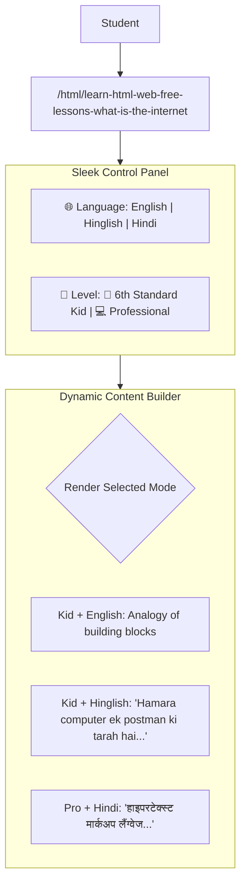

# 🚀 NextSem Academy HTML Course Teaching Plan

Welcome to the ultimate teaching blueprint for **Phase 1: HTML5**. This course teaching plan outlines the integration of our new `/html` entry points and the interactive `/learn` interface. 

Following your requirements, **every lesson** will support:
1. **Three Languages (Tabbed Selector)**:
   * 🇬🇧 **English**: Concise, professional terms.
   * 🇮🇳 **Hinglish**: Fun, conversational blending of English vocabulary with Hindi grammar (Latin script).
   * 🕉️ **Hindi**: Standard, clear explanations in Devanagari script.
2. **Two Learning Levels (Tabbed Selector)**:
   * 🧒 **Kid Level (6th Standard)**: Highly visual, story-based analogies, basic terms, and friendly developer emojis.
   * 💻 **Professional Level**: Technical specifications, DOM mechanics, syntax guidelines, and advanced coding tips.
3. **Rich Visual Layouts**: Dynamic graphics, custom icons, and visual diagrams inspired by *Duckett HTML & CSS* and *The Definitive Guide to HTML5*.
4. **Exercises**: Every single lesson includes an interactive check or exercise.
5. **SEO Slugs**: Every lesson runs on a dedicated route with an optimized URL slug to rank first for searches like *html web free lessons* and maximize ad views.

---

## 🗂️ Curriculum Mapping (Reference PDFs)
This plan synthesizes materials from:
1. 📕 **Duckett HTML & CSS.pdf**: Known for beautiful layout typography, structural flow, and visual diagrams.
2. 📘 **The Definitive Guide to HTML5 by Adam Freeman.pdf**: Focused on deep standard mechanics, attributes, DOM behaviors, and browser parsing.

---

## 📋 Complete List of 100 HTML Lessons, SEO Slugs & Exercises

### 🌐 Unit 1: Web Fundamentals & Client-Server Architecture (Lessons 1-10)
* **Book References**: Duckett Chapter 1, Freeman Chapters 1-3.

1. **Lesson 1: What is the Internet?**  
   * *SEO URL*: `/html/learn-html-web-free-lessons-what-is-the-internet`
   * *Concept*: The physical network of cables, routers, and data centers.
   * *Exercise*: Draw/trace the path of a packet from your device to a remote server.
2. **Lesson 2: Client vs. Server Model**  
   * *SEO URL*: `/html/free-web-development-lessons-client-server-model`
   * *Concept*: Clients (browsers) request data; servers (libraries) store and serve it.
   * *Exercise*: Match standard devices (phone, server rack, PC) to their roles.
3. **Lesson 3: Understanding DNS Lookup**  
   * *SEO URL*: `/html/how-dns-lookup-works-step-by-step`
   * *Concept*: Domain Name Systems translate `nextsem.online` to IP addresses.
   * *Exercise*: Look up the IP address of a popular domain in the terminal.
4. **Lesson 4: IP Addresses Explained**  
   * *SEO URL*: `/html/ipv4-vs-ipv6-address-types-tutorial`
   * *Concept*: IPv4 (e.g. `192.168.1.1`) vs IPv6 address schemas.
   * *Exercise*: Identify if a given string is a valid IPv4 address.
5. **Lesson 5: TCP/IP 3-Way Handshake**  
   * *SEO URL*: `/html/tcp-ip-3-way-handshake-process`
   * *Concept*: Establish connection via `SYN`, `SYN-ACK`, and `ACK` signals.
   * *Exercise*: Order the handshake steps in a drag-and-drop widget.
6. **Lesson 6: Anatomy of an HTTP Request**  
   * *SEO URL*: `/html/anatomy-of-http-request-headers-verbs`
   * *Concept*: Headers, verbs (`GET`, `POST`), and host parameters.
   * *Exercise*: Identify the host header in a raw HTTP packet text.
7. **Lesson 7: Anatomy of an HTTP Response**  
   * *SEO URL*: `/html/http-response-status-codes-explained`
   * *Concept*: Status codes (e.g., 200, 301, 404) and content types.
   * *Exercise*: Match status code values to their meaning (Success, Not Found, Server Error).
8. **Lesson 8: Anatomy of a URL**  
   * *SEO URL*: `/html/how-to-read-url-query-parameters-path`
   * *Concept*: Protocol (`https`), subdomain (`www`), domain, port, and query params.
   * *Exercise*: Extract the query parameters from a long URL string.
9. **Lesson 9: How Browsers Render HTML (DOM intro)**  
   * *SEO URL*: `/html/how-browser-renders-html-dom-tree`
   * *Concept*: Parsing text tags into a tree node structure (Document Object Model).
   * *Exercise*: Arrange nested nodes into a simple hierarchy tree.
10. **Lesson 10: Introduction to Browser DevTools**  
    * *SEO URL*: `/html/how-to-use-chrome-developer-tools-elements`
    * *Concept*: Opening the Elements panel to inspect live HTML tags.
    * *Exercise*: Open DevTools and locate the main wrapper ID of the sitemap.

---

### 🧱 Unit 2: The Document Structure & Metadata (Lessons 11-20)
* **Book References**: Duckett Chapter 1 & 8, Freeman Chapter 6 & 7.

11. **Lesson 11: The `<!DOCTYPE html>` Declaration**  
    * *SEO URL*: `/html/doctype-html5-declaration-syntax`
    * *Concept*: Tells browsers to parse the page using the HTML5 specification.
    * *Exercise*: Place the doctype declaration on the correct line in a skeleton test.
12. **Lesson 12: The `<html>` Root Element**  
    * *SEO URL*: `/html/html-root-element-lang-attribute`
    * *Concept*: Container for all code, configuring page language with `lang="en"`.
    * *Exercise*: Write the opening root tag with a language attribute set to Hindi (`hi`).
13. **Lesson 13: The `<head>` Container**  
    * *SEO URL*: `/html/html-head-container-metadata`
    * *Concept*: Invisible settings, configuration data, and scripts.
    * *Exercise*: Separate tags that belong in the head vs. the body.
14. **Lesson 14: The `<title>` Element**  
    * *SEO URL*: `/html/html-title-element-seo-importance`
    * *Concept*: Tab text configuration and SEO significance.
    * *Exercise*: Write a head block containing a descriptive page title.
15. **Lesson 15: Character Encoding with `<meta charset="UTF-8">`**  
    * *SEO URL*: `/html/html-meta-charset-utf8-encoding`
    * *Concept*: Tells browsers to decode symbols, emojis, and characters correctly.
    * *Exercise*: Write the meta tag that sets UTF-8 encoding.
16. **Lesson 16: Responsive Viewport Configuration**  
    * *SEO URL*: `/html/responsive-viewport-meta-tag-mobile`
    * *Concept*: `<meta name="viewport" content="width=device-width, initial-scale=1.0">`.
    * *Exercise*: Fill in the blanks for the scale settings of the viewport meta tag.
17. **Lesson 17: Adding Favicons**  
    * *SEO URL*: `/html/adding-favicons-link-rel-icon`
    * *Concept*: Linking shortcut icons in the tab bar using `<link rel="icon">`.
    * *Exercise*: Link a custom favicon path `favicon.ico` in the skeleton.
18. **Lesson 18: Linking CSS Stylesheets**  
    * *Concept*: Attaching styles via `<link rel="stylesheet" href="styles.css">`.
    * *SEO URL*: `/html/linking-external-css-stylesheets-link`
    * *Exercise*: Connect `theme.css` to the head of the document.
19. **Lesson 19: Internal CSS with the `<style>` Tag**  
    * *SEO URL*: `/html/internal-css-styles-style-tag`
    * *Concept*: Adding styles directly inside the HTML head.
    * *Exercise*: Write a style block to set body background to black.
20. **Lesson 20: Script Insertion with `<script>`**  
    * *SEO URL*: `/html/script-tag-insert-javascript-code`
    * *Concept*: Attaching JavaScript files or writing inline code.
    * *Exercise*: Write a script block that triggers an alert box.

---

### 🖋️ Unit 3: Structural Text & Layout Elements (Lessons 21-30)
* **Book References**: Duckett Chapter 2, Freeman Chapter 8.

21. **Lesson 21: The `<body>` Container**  
    * *SEO URL*: `/html/html-body-tag-visible-content`
    * *Concept*: Encloses everything visible to the end user.
    * *Exercise*: Place elements into the body segment.
22. **Lesson 22: Heading Elements (`<h1>` to `<h6>`)**  
    * *SEO URL*: `/html/html-heading-tags-h1-to-h6`
    * *Concept*: Structuring sections. The SEO rule: only one `<h1>` per page.
    * *Exercise*: Rearrange nested subheadings into hierarchical order.
23. **Lesson 23: The Paragraph Element (`<p>`)**  
    * *SEO URL*: `/html/html-paragraph-tag-p-margins`
    * *Concept*: Standard block of text with default margins.
    * *Exercise*: Separate a continuous block of text into three distinct paragraphs.
24. **Lesson 24: Line Breaks (`<br />`)**  
    * *SEO URL*: `/html/line-break-br-tag-text-split`
    * *Concept*: Forcing line splits without paragraph spacing.
    * *Exercise*: Insert a line break inside a mailing address text block.
25. **Lesson 25: Horizontal Rules (`<hr />`)**  
    * *SEO URL*: `/html/horizontal-rule-hr-tag-separator`
    * *Concept*: Creating a thematic break line between topics.
    * *Exercise*: Insert a thematic rule to split two recipes.
26. **Lesson 26: Div Containers (`<div>`)**  
    * *SEO URL*: `/html/div-tag-generic-block-level-container`
    * *Concept*: Generic block-level container for grouping and styling.
    * *Exercise*: Wrap a heading and paragraph inside a div container.
27. **Lesson 27: Span Containers (`<span>`)**  
    * *SEO URL*: `/html/span-tag-generic-inline-container`
    * *Concept*: Generic inline-level container for highlighting words.
    * *Exercise*: Wrap a single word in a span container.
28. **Lesson 28: Blockquotes (`<blockquote>`)**  
    * *SEO URL*: `/html/blockquote-tag-long-quotations-cite`
    * *Concept*: Block-level quotations carrying the `cite` attribute.
    * *Exercise*: Write a blockquote citing the source URL.
29. **Lesson 29: Inline Quotes (`<q>`)**  
    * *SEO URL*: `/html/inline-quote-q-tag-quotation-marks`
    * *Concept*: Short inline quotations automatically wrapped in quotes.
    * *Exercise*: Write a sentence containing an inline quote.
30. **Lesson 30: Address Details (`<address>`)**  
    * *SEO URL*: `/html/address-tag-author-contact-information`
    * *Concept*: Contains contact information for the author.
    * *Exercise*: Create a valid address block containing an email link.

---

### 💬 Unit 4: Semantic Content & Text Modifications (Lessons 31-40)
* **Book References**: Duckett Chapter 2, Freeman Chapter 8.

31. **Lesson 31: Presentational Bold (`<b>`) vs. Semantic Strong (`<strong>`)**  
    * *SEO URL*: `/html/bold-b-vs-semantic-strong-tag`
    * *Concept*: Bold visual styling vs. system importance.
    * *Exercise*: Mark a warning message with strong semantic importance.
32. **Lesson 32: Presentational Italic (`<i>`) vs. Semantic Emphasis (`<em>`)**  
    * *SEO URL*: `/html/italic-i-vs-semantic-emphasis-em-tag`
    * *Concept*: Slanted typography vs. emphasized meaning.
    * *Exercise*: Apply emphasis to the key word in a sentence.
33. **Lesson 33: Highlighted Text (`<mark>`)**  
    * *SEO URL*: `/html/highlight-text-mark-tag-search-results`
    * *Concept*: Wrapping text in a yellow highlight indicator.
    * *Exercise*: Mark the keyword match inside a search result paragraph.
34. **Lesson 34: Code Snippets (`<code>`)**  
    * *SEO URL*: `/html/monospace-code-snippet-code-tag`
    * *Concept*: Monospace rendering for variables and inline instructions.
    * *Exercise*: Wrap the variable name `userEmail` in a code block.
35. **Lesson 35: Preformatted Text (`<pre>`)**  
    * *SEO URL*: `/html/preformatted-text-pre-tag-spaces-tabs`
    * *Concept*: Retaining tabs, newlines, and spaces exactly as typed.
    * *Exercise*: Place an ASCII art diagram inside a pre block.
36. **Lesson 36: Insertions (`<ins>`) & Deletions (`<del>`)**  
    * *SEO URL*: `/html/insert-ins-and-delete-del-tags`
    * *Concept*: Editing edits on screen (underlines and strikethroughs).
    * *Exercise*: Write a price revision showing the old price deleted and new inserted.
37. **Lesson 37: Strikethrough (`<s>`)**  
    * *SEO URL*: `/html/strikethrough-s-tag-outdated-content`
    * *Concept*: Marking items that are no longer accurate.
    * *Exercise*: Mark a sold-out item in a catalog list.
38. **Lesson 38: Abbreviations (`<abbr>`)**  
    * *SEO URL*: `/html/abbreviation-abbr-tag-title-tooltip`
    * *Concept*: Declaring terms with mouse tooltips (`title` attribute).
    * *Exercise*: Create an abbreviation tag for W3C.
39. **Lesson 39: Defining Terms (`<dfn>`)**  
    * *SEO URL*: `/html/defining-term-dfn-tag-first-instance`
    * *Concept*: Marking the defining instance of a new term.
    * *Exercise*: Write a sentence defining "API" using the dfn tag.
40. **Lesson 40: Superscript (`<sup>`) & Subscript (`<sub>`)**  
    * *SEO URL*: `/html/superscript-sup-and-subscript-sub-tags`
    * *Concept*: Exponents and chemical notations.
    * *Exercise*: Write the chemical formula for carbon dioxide ($CO_2$) and a math equation ($X^2$).

---

### 🧭 Unit 5: Navigation & Hyperlinks (Lessons 41-50)
* **Book References**: Duckett Chapter 4, Freeman Chapter 13.

41. **Lesson 41: Anchor Elements (`<a>`) & the `href` Attribute**  
    * *SEO URL*: `/html/anchor-a-tag-href-hyperlinks`
    * *Concept*: The backbone of hyperlinks linking webpages.
    * *Exercise*: Link the text "Visit NextSem" to `https://nextsem.online`.
42. **Lesson 42: Absolute vs. Relative Paths**  
    * *SEO URL*: `/html/absolute-vs-relative-link-paths`
    * *Concept*: Fully qualified domain paths vs. local relative file offsets.
    * *Exercise*: Categorize links as absolute or relative.
43. **Lesson 43: Parent Directory Hopping (`../`)**  
    * *SEO URL*: `/html/parent-directory-hopping-relative-paths`
    * *Concept*: Navigating upward to parent directory trees.
    * *Exercise*: Write a link path to step up one directory and open `index.html`.
44. **Lesson 44: Grandparent Directory Hopping (`../../`)**  
    * *SEO URL*: `/html/grandparent-directory-hopping-double-slash`
    * *Concept*: Stepping up two levels in directory paths.
    * *Exercise*: Write a path that hops up two directories.
45. **Lesson 45: Linking to Email Addresses (`mailto:`)**  
    * *SEO URL*: `/html/email-mailto-links-anchor-tag`
    * *Concept*: Opening default mail applications with preset addresses.
    * *Exercise*: Create a link to email `support@nextsem.online`.
46. **Lesson 46: Telephone Dialing Links (`tel:`)**  
    * *SEO URL*: `/html/telephone-dialing-tel-links-mobile`
    * *Concept*: Direct dial prompts on mobile devices.
    * *Exercise*: Create a click-to-call link for emergency support numbers.
47. **Lesson 47: Target Targets (`target="_blank"`)**  
    * *SEO URL*: `/html/open-link-new-tab-target-blank`
    * *Concept*: Launching links in completely new browser tabs.
    * *Exercise*: Write an external link configured to open in a new window.
48. **Lesson 48: Link Security (`rel="noopener noreferrer"`)**  
    * *SEO URL*: `/html/link-security-rel-noopener-noreferrer`
    * *Concept*: Blocking tab-hijacking and retaining referral privacy.
    * *Exercise*: Add security parameters to an anchor tag targeting an external link.
49. **Lesson 49: Document Hash Links (`href="#id"`)**  
    * *SEO URL*: `/html/hash-links-jump-to-page-sections`
    * *Concept*: Anchoring/scrolling to specific sections on the same page.
    * *Exercise*: Write a link that jumps to a heading with ID `contact-form`.
50. **Lesson 50: The `<base>` Element**  
    * *SEO URL*: `/html/base-url-tag-document-head`
    * *Concept*: Setting a default URL prefix for all relative assets on the page.
    * *Exercise*: Configure a base URL for a page containing relative image resources.

---

### 🖼️ Unit 6: Multimedia & Responsive Art Direction (Lessons 51-60)
* **Book References**: Duckett Chapter 5, Freeman Chapter 15.

51. **Lesson 51: The Image Element (``)**  
    * *SEO URL*: `/html/image-img-tag-src-images`
    * *Concept*: Self-closing tag that embeds images onto the layout.
    * *Exercise*: Write the image tag with a source pointing to `banner.jpg`.
52. **Lesson 52: Alternative Text (`alt` attribute)**  
    * *SEO URL*: `/html/image-alt-attribute-accessibility-seo`
    * *Concept*: Image descriptions for accessibility (screen readers) and SEO index crawlers.
    * *Exercise*: Write a descriptive alt value for a chart graphic.
53. **Lesson 53: Image Dimensions (`width`/`height`)**  
    * *SEO URL*: `/html/image-width-height-prevent-layout-shift`
    * *Concept*: Reserving layout bounding boxes to prevent Cumulative Layout Shifts.
    * *Exercise*: Constrain an image dimension to 400px wide and 300px high.
54. **Lesson 54: The `<picture>` and `<source>` Elements for Responsive Art Direction**  
    * *SEO URL*: `/html/picture-and-source-responsive-images-art-direction`
    * *Concept*: Dynamically loading different image files based on browser screen width.
    * *Exercise*: Configure a picture tag serving mobile-optimized vs. desktop-wide images.
55. **Lesson 55: SVGs: Introduction to Vector Graphics**  
    * *SEO URL*: `/html/scalable-vector-graphics-svg-introduction`
    * *Concept*: Scalable vector shapes that do not blur on zoom.
    * *Exercise*: Write the base `<svg>` container tag.
56. **Lesson 56: SVG Shapes: Circles & Rectangles**  
    * *SEO URL*: `/html/draw-svg-circle-rect-vector-shapes`
    * *Concept*: `<circle>` and `<rect>` elements inside SVGs.
    * *Exercise*: Draw a red circle of radius 10 inside a 24x24 SVG viewport.
57. **Lesson 57: SVG Paths (`<path>`)**  
    * *SEO URL*: `/html/draw-svg-paths-vector-shapes`
    * *Concept*: Building vector shapes using paths (`d` commands).
    * *Exercise*: Map out a simple triangle path in SVG.
58. **Lesson 58: Figures (`<figure>`)**  
    * *SEO URL*: `/html/figure-tag-semantic-media-group`
    * *Concept*: Semantic container grouping diagrams, charts, and illustrations.
    * *Exercise*: Wrap an image element inside a figure element.
59. **Lesson 59: Figcaptions (`<figcaption>`)**  
    * *SEO URL*: `/html/figcaption-tag-media-captions`
    * *Concept*: Specifying the caption for a figure container.
    * *Exercise*: Add a caption describing the contents of the figure.
60. **Lesson 60: The `<time>` and `<data>` Elements for Semantic Value Binding**  
    * *SEO URL*: `/html/time-and-data-tags-semantic-value-binding`
    * *Concept*: Machine-readable dates (`datetime`) and numeric values (`value`).
    * *Exercise*: Create a calendar entry using `<time datetime="2026-07-17">`.

---

### 🎥 Unit 7: Native Audio, Video & Embeds (Lessons 61-70)
* **Book References**: Duckett Chapter 9, Freeman Chapter 16.

61. **Lesson 61: The Audio Element (`<audio>`)**  
    * *SEO URL*: `/html/audio-tag-play-sound-files-natively`
    * *Concept*: Native sound player requiring `src` and controls indicators.
    * *Exercise*: Write a player that plays `song.mp3`.
62. **Lesson 62: Audio Fallback Formats**  
    * *SEO URL*: `/html/audio-multiple-fallback-source-formats`
    * *Concept*: Bundling `<source>` files (MP3, OGG, WAV) inside the audio tag.
    * *Exercise*: Write a media tag with fallback sources.
63. **Lesson 63: The Video Element (`<video>`)**  
    * *SEO URL*: `/html/video-tag-native-playback-controls`
    * *Concept*: Native video player box with dimension controls.
    * *Exercise*: Embed `clip.mp4` with a width of 640px.
64. **Lesson 64: Video Poster Image (`poster` attribute)**  
    * *SEO URL*: `/html/video-poster-thumbnail-image-preload`
    * *Concept*: Renders a thumbnail image while the video buffer loads.
    * *Exercise*: Add a poster thumbnail to a video element.
65. **Lesson 65: Autoplay & Muted Controls**  
    * *SEO URL*: `/html/video-autoplay-muted-loop-background`
    * *Concept*: Automating video starts. Browsers block autoplay unless `muted` is set.
    * *Exercise*: Configure a background loop video using autoplay and muted flags.
66. **Lesson 66: Preload Settings**  
    * *SEO URL*: `/html/video-preload-attributes-none-metadata`
    * *Concept*: `preload="none"`, `metadata`, or `auto` parameters.
    * *Exercise*: Disable video preloading to save user bandwidth.
67. **Lesson 67: Video Tracks & Captions (`<track>`)**  
    * *SEO URL*: `/html/video-track-subtitles-caption-vtt`
    * *Concept*: Synchronizing text subtitles (`.vtt` files) with video playback.
    * *Exercise*: Add a captions track element inside a video player.
68. **Lesson 68: WebM vs. MP4 formats**  
    * *SEO URL*: `/html/video-webm-vs-mp4-compression-codecs`
    * *Concept*: Compression ratios and browser decoding support.
    * *Exercise*: Compare file sizes and format options.
69. **Lesson 69: Embedded Frames (`<iframe>`)**  
    * *SEO URL*: `/html/iframe-embed-external-webpages`
    * *Concept*: Embedding external pages (YouTube, maps) inside your layout.
    * *Exercise*: Embed an iframe pointing to `https://nextsem.online/playground`.
70. **Lesson 70: Iframe Security (`sandbox` attribute)**  
    * *SEO URL*: `/html/iframe-sandbox-security-rules`
    * *Concept*: Restricting external iframe scripts, forms, and redirection behaviors.
    * *Exercise*: Add a sandbox attribute allowing scripts but blocking popups.

---

### 📊 Unit 8: Lists, Tables & Layout Grids (Lessons 71-80)
* **Book References**: Duckett Chapter 3 & 6, Freeman Chapter 9 & 14.

71. **Lesson 71: Unordered Lists (`<ul>` and `<li>`)**  
    * *SEO URL*: `/html/unordered-lists-ul-li-bullet-points`
    * *Concept*: Creating lists with bullet markers.
    * *Exercise*: Create a list of three programming languages.
72. **Lesson 72: Ordered Lists (`<ol>` and `<li>`)**  
    * *SEO URL*: `/html/ordered-lists-ol-li-numbered-steps`
    * *Concept*: Numbered steps in sequential lists.
    * *Exercise*: List the steps to commit code in Git.
73. **Lesson 73: Ordered Lists Start & Reversed Attributes**  
    * *SEO URL*: `/html/ordered-list-start-reversed-indexing`
    * *Concept*: Adjusting numerical indices (start index, counting down).
    * *Exercise*: Start a list at count index 5 and reverse counting order.
74. **Lesson 74: Description Lists (`<dl>`, `<dt>`, `<dd>`)**  
    * *SEO URL*: `/html/description-lists-dl-dt-dd-glossary`
    * *Concept*: Glossary-style lists mapping terms to descriptions.
    * *Exercise*: Write a list explaining "HTML", "CSS", and "JS".
75. **Lesson 75: Table Container (`<table>`)**  
    * *SEO URL*: `/html/table-container-grid-rows-columns`
    * *Concept*: Arranging data columns and rows on the grid.
    * *Exercise*: Write the base table structure tags.
76. **Lesson 76: Rows (`<tr>`) and Cell Data (`<td>`)**  
    * *SEO URL*: `/html/table-rows-tr-cells-td`
    * *Concept*: Row units and cell containers.
    * *Exercise*: Build a table with 2 rows and 2 columns.
77. **Lesson 77: Table Header Labels (`<th>`)**  
    * *SEO URL*: `/html/table-headers-th-label-bold`
    * *Concept*: Row labels displaying bold, centered text by default.
    * *Exercise*: Add header labels "Subject" and "Code" to a table.
78. **Lesson 78: Merging Columns (`colspan`)**  
    * *SEO URL*: `/html/table-colspan-merge-columns`
    * *Concept*: Stretching cells horizontally across multiple columns.
    * *Exercise*: Stretch a cell to cover 2 columns.
79. **Lesson 79: Merging Rows (`rowspan`)**  
    * *SEO URL*: `/html/table-rowspan-merge-rows`
    * *Concept*: Stretching cells vertically across multiple rows.
    * *Exercise*: Stretch a side cell vertically to cover 2 rows.
80. **Lesson 80: Table Segments (`<thead>`, `<tbody>`, `<tfoot>`)**  
    * *SEO URL*: `/html/table-thead-tbody-tfoot-semantics`
    * *Concept*: Sectioning tables for styling and print pagination.
    * *Exercise*: Wrap rows in their corresponding semantic container.

---

### 📥 Unit 9: Interactive Forms & Inputs (Lessons 81-90)
* **Book References**: Duckett Chapter 7, Freeman Chapter 11 & 12.

81. **Lesson 81: The Form Container (`<form>`)**  
    * *SEO URL*: `/html/form-tag-submit-data-handling`
    * *Concept*: Form borders, actions, and encoding types.
    * *Exercise*: Create a form targeting `https://nextsem.online/submit-form`.
82. **Lesson 82: Form Methods (GET vs. POST)**  
    * *SEO URL*: `/html/form-methods-get-vs-post-security`
    * *Concept*: Appending queries to URLs (GET) vs. Request payloads (POST).
    * *Exercise*: Select the correct method for a search form vs. a registration page.
83. **Lesson 83: Text & Password Inputs (`type="text"`, `"password"`)**  
    * *SEO URL*: `/html/input-types-text-and-password-masking`
    * *Concept*: Standard text fields and hidden character masking.
    * *Exercise*: Create password and username input fields.
84. **Lesson 84: Radio Buttons (`type="radio"`)**  
    * *SEO URL*: `/html/input-radio-button-single-selection`
    * *Concept*: Mutual exclusion selections using matching `name` tags.
    * *Exercise*: Create a yes/no question using radio buttons.
85. **Lesson 85: Checkboxes (`type="checkbox"`)**  
    * *SEO URL*: `/html/input-checkbox-multi-selection`
    * *Concept*: Multi-selection toggles for list choices.
    * *Exercise*: Create checkbox inputs for three language selections.
86. **Lesson 86: Dropdown Select Lists (`<select>` and `<option>`)**  
    * *SEO URL*: `/html/select-dropdown-options-menu`
    * *Concept*: List selectors that conserve page space.
    * *Exercise*: Create a select dropdown to choose a revision semester.
87. **Lesson 87: Multi-line Input (`<textarea>`)**  
    * *SEO URL*: `/html/textarea-multi-line-scrolling-field`
    * *Concept*: Scrollable textboxes for feedback and bios.
    * *Exercise*: Create a textarea that allows typing up to 200 characters.
88. **Lesson 88: Buttons (`type="submit"`, `"button"`, `"reset"`)**  
    * *SEO URL*: `/html/button-types-submit-button-reset`
    * *Concept*: Action controllers in forms.
    * *Exercise*: Create submit and reset buttons in a form.
89. **Lesson 89: Binding Input Labels (`<label>`)**  
    * *SEO URL*: `/html/label-tag-for-input-binding`
    * *Concept*: Linking labels via `for` and `id` to improve usability.
    * *Exercise*: Bind a label to a terms-of-service checkbox.
90. **Lesson 90: Form Groups (`<fieldset>` and `<legend>`)**  
    * *SEO URL*: `/html/fieldset-and-legend-form-groups`
    * *Concept*: Visual borders and captions to organize form sections.
    * *Exercise*: Group "Personal Info" fields together.

---

### 🚀 Unit 10: Advanced Semantics, Validation & APIs (Lessons 91-100)
* **Book References**: Freeman Chapters 12, 16, & 25.

91. **Lesson 91: Form Field Required Validation**  
    * *SEO URL*: `/html/form-required-validation-attribute`
    * *Concept*: Preventing submissions when fields are left blank.
    * *Exercise*: Add a required attribute to an email input field.
92. **Lesson 92: Regex Pattern Matching (`pattern` attribute)**  
    * *SEO URL*: `/html/form-pattern-validation-regex`
    * *Concept*: Validating inputs against custom regular expressions.
    * *Exercise*: Add a pattern to check for a 5-digit zip code.
93. **Lesson 93: HTML5 Numeric Ranges (`type="range"`, `type="number"`)**  
    * *SEO URL*: `/html/input-types-range-slider-number-spinner`
    * *Concept*: Graphic sliders and spinners for numerical selections.
    * *Exercise*: Create a slider for volumes with min/max values.
94. **Lesson 94: Progress Indicators (`<progress>`) & Meter Gauges (`<meter>`)**  
    * *SEO URL*: `/html/progress-bar-and-meter-gauge-html5`
    * *Concept*: Task completion trackers and value boundaries indicators.
    * *Exercise*: Create a progress bar indicating 75% completeness.
95. **Lesson 95: Autocomplete Data Lists (`<datalist>`)**  
    * *SEO URL*: `/html/datalist-tag-autocomplete-suggestions`
    * *Concept*: Dropdown suggestion lists that filter as users type.
    * *Exercise*: Add a datalist with three browser options to an input.
96. **Lesson 96: Collapsible Accordions (`<details>` and `<summary>`)**  
    * *SEO URL*: `/html/details-and-summary-collapsible-accordion`
    * *Concept*: Creating native, script-free dropdown accordion widgets.
    * *Exercise*: Build a collapsible FAQ entry using details and summary tags.
97. **Lesson 97: Native Modals & Popups (`<dialog>`)**  
    * *SEO URL*: `/html/dialog-tag-native-popup-modal`
    * *Concept*: Native, overlay popup screens controlled with simple HTML attributes.
    * *Exercise*: Create a dialog modal container displaying terms of service.
98. **Lesson 98: Web Components Templates (`<template>` and `<slot>`)**  
    * *SEO URL*: `/html/template-and-slot-web-components`
    * *Concept*: Declaring reusable markup segments that remain dormant until cloned by script.
    * *Exercise*: Define a template holding a profile card interface.
99. **Lesson 99: Canvas Graphics (`<canvas>`)**  
    * *SEO URL*: `/html/canvas-tag-drawing-2d-graphics`
    * *Concept*: Drawing canvas areas controlled via JavaScript.
    * *Exercise*: Declare a canvas element of dimensions 400x300px.
100. **Lesson 100: Capstone Project: Portfolio Layout**  
     * *SEO URL*: `/html/html5-portfolio-capstone-project-validation`
     * *Concept*: Combining headings, semantic structure, links, images, tables, and contact forms.
     * *Exercise*: Build and validate a complete webpage structure using semantic HTML5 tags.

---

## 🎨 Interactive Interface Mockup (`/learn`)

The `/learn` workspace will feature a clean tabbed panel control. Here is a conceptual visualization of the layout:



---

## 🛠️ Step-by-Step Implementation Roadmap

To deliver this premium feature seamlessly, we will complete the development in 3 progressive steps:

### Step 1: Define multi-language data schemas
We will extend `/src/data/searchIndex.json` (or write a dedicated content mapper `/src/data/htmlLessonsData.ts`) to store:
* Hindi, Hinglish, and English strings.
* Kid mode vs. Pro mode text.
* SVG illustrations/icons paths.

### Step 2: Build the tabbed `/html` client layouts
We will create `src/app/html/page.tsx` and `src/app/html/[slug]/page.tsx` using a stateful component:
```typescript
const [selectedLang, setSelectedLang] = useState<'en' | 'hinglish' | 'hi'>('en');
const [selectedLevel, setSelectedLevel] = useState<'kid' | 'pro'>('kid');
```
We will build beautiful tab toggle controls (glowing pill buttons) styled with glassmorphism to let users switch content modes on the fly.

### Step 3: Implement client redirects
Modify `src/app/book/[chapter]/page.tsx` to automatically intercept routes:
* Check `if (chapter.startsWith('p1-'))`
* Replace state with `/html` or `/html/[slug]`.
* Complete testing by running `npm run lint` and verifying the dynamic redirects in the browser.
