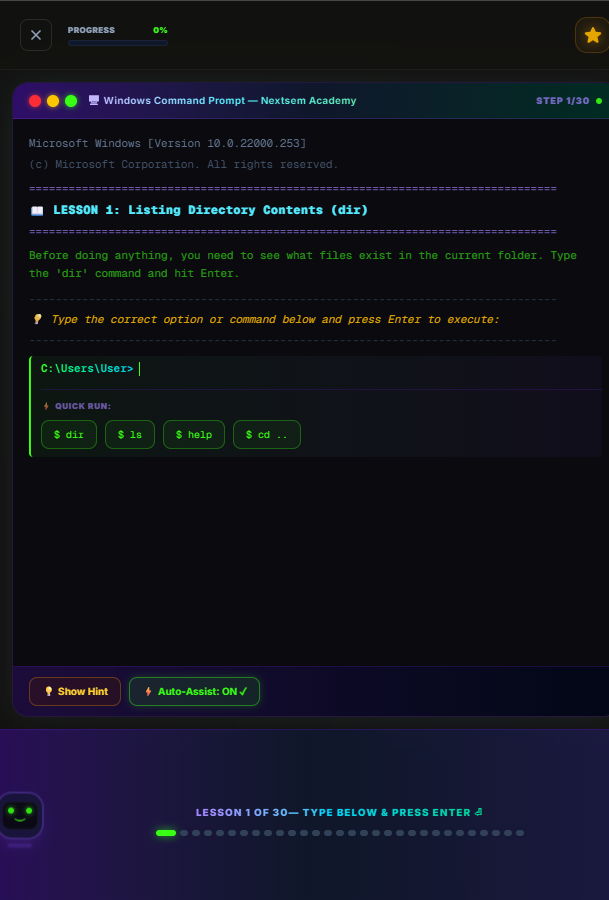

#my ideas as on 8 july 2026
how much credit is left
instead of letting users type in command promt provide some type of prewritten buttons to click on to  execute commands.
also highlight the the command promt input when it ready for user to type in and dim it when its not ready.
also highlight or give some type of visual que to the user that the system is working on the command that was given.
as the user correctly answers the question give them points. for wrong answers deduct points.
if users are to play the game offline then the game should not use any type of online database to store the users progress. the game should store the users progress in the local storage of the browser.
if users want to play the game online then the game should use a firebase database to store the users progress.
this will allow users to play the game offline and online.
highlight the code in screen task so that iti is easy to read and understand.
suggest more command prompts for each task.
also add more details to the questions and answers to make them more understandable.
also the preview of the command prompt should be shown only when the user is typing the command.    
add some 
very nice how much credit is left i have to put in left bottom section our mascot semmy with an animation each for hint correct wrong next level etc..
go to https://nextsem-staging.web.app/book/p0-2-terminal and to similiar pages and recreate this page much like  by breaking the whole page into multiple lessons but it must be similiar to our brilliant terminal page and te first task of the lesson is given in the screenshot. present the screenshot of the full screen task for eg. as a hint when user asks for a hint button click and there should be options given to the user to select from the given screenshot to progress. there should be a path shown to the user of the task. screenshot is present if folder placed at C:\jbrs-landing-page\design_6_reference\Brilliant app ideas also stop keyboard pop up automatically or better put everthing in form of button just below and let user select it 
remove bottom navigation from brilliant pages and make it similiar on all pages which are built on brilliant app ideas
i think 3D Game-Style Student Developer is better 
when chapter is completed automatically take to next chapter and always put a cross button which takes user to course selection screen.
/learn pause git start only at 10PM daily for 2 mins
remove this mascot and free this bottom space and allocate it to terminal section as in the screenshot saved at C:\jbrs-landing-page\design_6_reference\Brilliant app ideas\remove mascot.png
i want to integrate flutter in our project help me
sitemap make a site map and always check weather sitemap is available or not also provide a way for next.js to generate sitemap dynamically and update it in firebase 
/learn also always check on nextsem.online domain what problems are there related to content navigation etc.. since my adsense account is not verified i have applied on 2nd july and today is 10 july 
i want to restart from crash but only on staging site with main focus on both web and mobile layout and i want you to suggest me complete step by step by guidance to make a fully workinhg app and website for a person who have never used computer or mobile to a full stack web developer also i want it to be gamified. i want to gamify the experience of learning. provide me with a plan to gamify the experience of learning but it should look professinal i am confused weather it is better to make it gamified also with my task is to get 850$ ad revenue per month from both web and mobile app i will be using adsens and admobs take your time and creat a step by step plan and show it to me with predefined tasks for me to execute. use gemini to create a step by step plan and show it to me with predefined tasks for me to execute. also i have saved some screenshots for reference in C:\jbrs-landing-page\design_6_reference\Brilliant app ideas i have taken screenshot of brillint  android app arrange the images in ascernding order of screenshtos using time stamps. make the full screen of the brilliant app ideas on mobile view
try to make it better by adding more features and ideas if you can or come up with some new better ideas and show them to me with predefined tasks for me to execute 