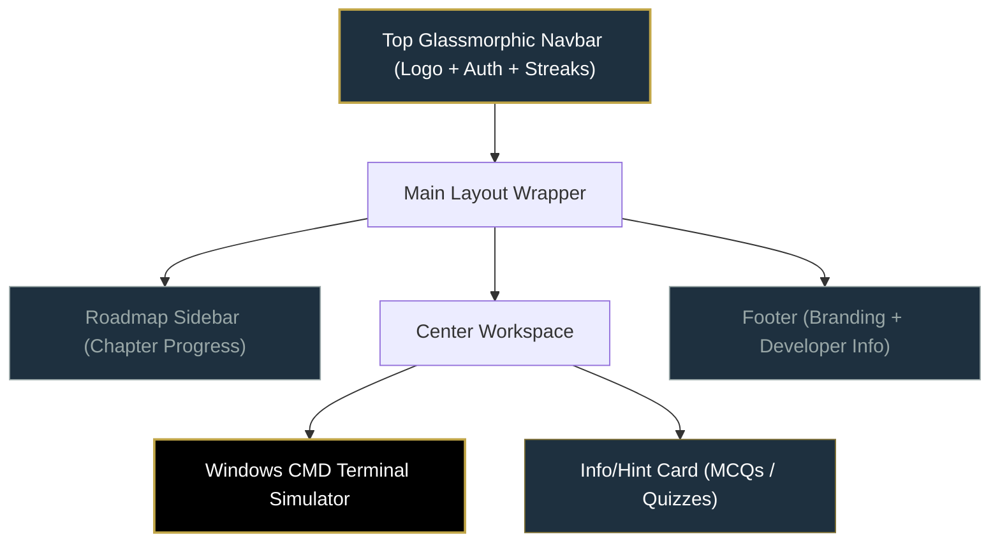

# NextSem Academy - Golden Theme Design System 🌟

This design system uses the color palette extracted from `docs/NA upscaled.jpg` to create a premium, state-of-the-art developer learning environment. The palette combines deep naval tech tones with a bright, prestigious sunlight gold accent.

---

## 🎨 Color Palette Reference

| Color Name | Hex Code | Rgb Value | Role / Usage |
| :--- | :--- | :--- | :--- |
| **Deep Navy Slate** | `#1e303f` | `30, 48, 63` | Terminal base, background wrapper, dark containers, active sidebar |
| **Sunlight Gold** | `#c1a648` | `193, 166, 72` | Primary branding, buttons, active states, certification glows, prompts |
| **Slate Silver** | `#99a7a7` | `153, 167, 167` | Secondary text, inactive links, subtle borders, utility icons |
| **Bronze Gold** | `#7f7034` | `127, 112, 52` | Hover overlays, active borders, depth gradients, success shadows |
| **Frost White** | `#fbfbfb` | `251, 251, 251` | Primary text, titles, high contrast code lines |

---

## 🔧 Tailwind CSS Configuration (v4 / v3 style)

To make these colors easily reusable in our React components, integrate this config:

```javascript
// tailwind.config.js
module.exports = {
  theme: {
    extend: {
      colors: {
        nextsem: {
          navy: '#1e303f',       // Deep Base
          gold: '#c1a648',       // Accent Primary
          bronze: '#7f7034',     // Accent Dark
          silver: '#99a7a7',     // Neutral Muted
          frost: '#fbfbfb',      // Neutral Light
        }
      },
      boxShadow: {
        'gold-glow': '0 0 15px rgba(193, 166, 72, 0.25)',
        'gold-glow-lg': '0 0 25px rgba(193, 166, 72, 0.4)',
      }
    }
  }
}
```

---

## 🖥️ Layout & Component Mockups (Tailwind CSS)

### 1. Logo Design

A premium vector-based or text-based logo design.

```html
<div class="flex items-center space-x-3 select-none">
  <!-- Glowing Hexagon Logo Icon -->
  <div class="relative flex items-center justify-center w-10 h-10 bg-nextsem-navy border-2 border-nextsem-gold rounded-xl shadow-gold-glow">
    <span class="text-nextsem-gold font-bold text-xl tracking-tighter">N</span>
    <!-- Inner pulse decoration -->
    <span class="absolute w-2 h-2 rounded-full bg-nextsem-frost animate-ping opacity-75"></span>
  </div>
  
  <!-- Text Branding -->
  <div class="flex flex-col">
    <span class="text-nextsem-frost font-black text-lg tracking-wider leading-none">
      NEXT<span class="text-nextsem-gold">SEM</span>
    </span>
    <span class="text-[10px] text-nextsem-silver tracking-[0.25em] font-semibold uppercase leading-none mt-1">
      Academy
    </span>
  </div>
</div>
```

---

### 2. Top Navigation Menubar (Glassmorphism)

This menu floats at the top with a subtle blur, letting underlying scroll details bleed through elegantly.

```html
<header class="sticky top-0 z-50 w-full border-b border-nextsem-gold/20 bg-nextsem-navy/80 backdrop-blur-md px-6 py-4 flex items-center justify-between">
  <!-- Logo Section -->
  <div class="flex items-center">
    <!-- NextSem Logo Component Here -->
  </div>

  <!-- Central Navigation Links -->
  <nav class="hidden md:flex items-center space-x-8">
    <a href="#" class="text-nextsem-frost font-medium hover:text-nextsem-gold transition-colors duration-200">Terminal</a>
    <a href="#" class="text-nextsem-silver font-medium hover:text-nextsem-frost transition-colors duration-200">Textbook</a>
    <a href="#" class="text-nextsem-silver font-medium hover:text-nextsem-frost transition-colors duration-200">Certificates</a>
    <a href="#" class="text-nextsem-silver font-medium hover:text-nextsem-frost transition-colors duration-200">Community</a>
  </nav>

  <!-- Right Actions (Authentication / Streak) -->
  <div class="flex items-center space-x-4">
    <!-- Streak Counter -->
    <div class="flex items-center bg-nextsem-bronze/20 border border-nextsem-gold/30 px-3 py-1.5 rounded-full space-x-2">
      <span class="text-nextsem-gold">🔥</span>
      <span class="text-nextsem-frost text-sm font-bold">5 Day Streak</span>
    </div>

    <!-- Profile Dropdown or Auth Button -->
    <button class="bg-nextsem-gold hover:bg-nextsem-bronze text-nextsem-navy font-bold px-4 py-2 rounded-lg transition-all duration-300 hover:shadow-gold-glow">
      Sign In
    </button>
  </div>
</header>
```

---

### 3. Sidebar (Roadmap & Lessons)

A structured navigation sidebar panel showing chapter progress.

```html
<aside class="w-80 h-screen bg-nextsem-navy/95 border-r border-nextsem-silver/10 flex flex-col justify-between">
  <!-- Sidebar Header -->
  <div class="p-6 border-b border-nextsem-silver/10">
    <h3 class="text-nextsem-frost font-bold text-base flex items-center gap-2">
      <span>📖</span> Curriculum Roadmap
    </h3>
    <p class="text-nextsem-silver text-xs mt-1">10-Day Windows CMD Command Mastery</p>
  </div>

  <!-- Lesson Navigation List -->
  <nav class="flex-1 overflow-y-auto p-4 space-y-2">
    <!-- Completed Lesson -->
    <a href="#" class="flex items-center justify-between p-3 rounded-lg bg-nextsem-silver/5 border border-nextsem-silver/10 text-nextsem-silver hover:text-nextsem-frost transition-all duration-200">
      <div class="flex items-center space-x-3">
        <span class="text-nextsem-gold">✓</span>
        <span class="text-sm font-medium">Day 1: Setup & Directories</span>
      </div>
      <span class="text-[10px] uppercase font-bold text-nextsem-gold">Done</span>
    </a>

    <!-- Active Lesson -->
    <a href="#" class="flex items-center justify-between p-3 rounded-lg bg-nextsem-gold/10 border border-nextsem-gold/30 text-nextsem-gold shadow-gold-glow/10">
      <div class="flex items-center space-x-3">
        <span class="animate-pulse">📂</span>
        <span class="text-sm font-bold">Day 2: File Manipulations</span>
      </div>
      <span class="text-[10px] uppercase font-bold bg-nextsem-gold text-nextsem-navy px-1.5 py-0.5 rounded">Active</span>
    </a>

    <!-- Locked Lesson -->
    <a href="#" class="flex items-center justify-between p-3 rounded-lg opacity-50 cursor-not-allowed">
      <div class="flex items-center space-x-3">
        <span>🔒</span>
        <span class="text-sm font-medium text-nextsem-silver">Day 3: Network Diagnostics</span>
      </div>
    </a>
  </nav>

  <!-- Sidebar Footer Progress -->
  <div class="p-6 border-t border-nextsem-silver/10 bg-nextsem-navy/50">
    <div class="flex items-center justify-between mb-2">
      <span class="text-xs text-nextsem-silver font-semibold">Course Progress</span>
      <span class="text-xs text-nextsem-gold font-bold">20%</span>
    </div>
    <!-- Progress Bar -->
    <div class="w-full bg-nextsem-silver/20 rounded-full h-1.5">
      <div class="bg-gradient-to-r from-nextsem-bronze to-nextsem-gold h-1.5 rounded-full" style="width: 20%"></div>
    </div>
  </div>
</aside>
```

---

### 4. Interactive 🪟 Windows CMD Terminal Simulator

This is the centerpiece of the landing page. It keeps within the device viewport size (`h-screen` context) to avoid vertical page overflow issues.

```html
<div class="flex-1 flex flex-col h-full bg-nextsem-navy/40 p-6">
  <!-- Windows Window Container -->
  <div class="flex-1 flex flex-col rounded-xl border border-nextsem-gold/20 shadow-gold-glow bg-black/85 overflow-hidden">
    
    <!-- Title Bar (Windows 11 Command Prompt mockup) -->
    <div class="h-10 bg-nextsem-navy px-4 flex items-center justify-between border-b border-nextsem-silver/10 select-none">
      <div class="flex items-center space-x-2">
        <span class="text-xs text-nextsem-gold">⊞</span>
        <span class="text-xs text-nextsem-frost font-mono">Command Prompt - nextsem_academy</span>
      </div>
      
      <!-- Windows Chrome Controls -->
      <div class="flex items-center space-x-3">
        <span class="w-3 h-3 rounded-full bg-nextsem-silver/30 hover:bg-nextsem-silver/60 transition-colors cursor-pointer"></span>
        <span class="w-3 h-3 rounded-full bg-nextsem-gold/50 hover:bg-nextsem-gold transition-colors cursor-pointer"></span>
        <span class="w-3 h-3 rounded-full bg-red-500/40 hover:bg-red-500 transition-colors cursor-pointer"></span>
      </div>
    </div>

    <!-- Terminal Content Area -->
    <div class="flex-1 p-6 font-mono text-sm overflow-y-auto space-y-4 text-nextsem-frost">
      
      <!-- Welcome Headers -->
      <div class="text-nextsem-silver">
        <p>Microsoft Windows [Version 10.0.22631]</p>
        <p>(c) Microsoft Corporation. All rights reserved.</p>
        <p class="mt-2 text-nextsem-gold font-bold">--- NEXTSEM ACADEMY CMD SIMULATOR ---</p>
      </div>

      <!-- Historical command line -->
      <div class="space-y-1">
        <p class="text-nextsem-silver">C:\Users\Student> <span class="text-nextsem-frost">mkdir my_first_app</span></p>
        <p class="text-nextsem-gold">Directory 'my_first_app' created successfully.</p>
      </div>

      <!-- Current command input line -->
      <div class="flex items-center space-x-2 text-nextsem-silver">
        <span>C:\Users\Student></span>
        <span class="text-nextsem-gold animate-pulse">cd my_first_app</span>
        <span class="w-2 h-4 bg-nextsem-gold animate-blink"></span>
      </div>

    </div>

    <!-- Instructions / Guide Footer (Dynamic Panel) -->
    <div class="bg-nextsem-navy border-t border-nextsem-gold/20 p-4 flex items-center justify-between">
      <div class="flex items-center space-x-3">
        <span class="text-nextsem-gold text-lg">💡</span>
        <p class="text-xs text-nextsem-silver">
          <strong class="text-nextsem-frost">Task:</strong> Type <code class="text-nextsem-gold bg-nextsem-navy/50 px-1 py-0.5 rounded border border-nextsem-gold/20 font-mono">cd my_first_app</code> and press enter to navigate into the new folder.
        </p>
      </div>
      <button class="bg-nextsem-gold/10 hover:bg-nextsem-gold/20 text-nextsem-gold border border-nextsem-gold/40 text-xs px-3 py-1.5 rounded transition-all duration-200">
        Skip Task
      </button>
    </div>

  </div>
</div>
```

---

### 5. App Footer

A simple, low-key footer that anchors the workspace.

```html
<footer class="w-full bg-nextsem-navy border-t border-nextsem-silver/10 px-8 py-6 flex flex-col md:flex-row items-center justify-between">
  <!-- Copyright & Credits -->
  <div class="text-xs text-nextsem-silver">
    <p>&copy; 2026 NextSem Academy. All rights reserved.</p>
    <p class="mt-1">Designed with premium Sunlight Gold ⊞ styling.</p>
  </div>

  <!-- Social / Terms Links -->
  <div class="flex items-center space-x-6 mt-4 md:mt-0">
    <a href="#" class="text-xs text-nextsem-silver hover:text-nextsem-gold transition-colors">Privacy Policy</a>
    <a href="#" class="text-xs text-nextsem-silver hover:text-nextsem-gold transition-colors">Terms of Service</a>
    <a href="#" class="text-xs text-nextsem-gold hover:underline">Get Certified</a>
  </div>
</footer>
```

---

## 🏗️ Comprehensive Full-Page Layout Grid

Below is a diagram of how these elements connect to form the application page layout:



This layout perfectly fits a standard desktop screen viewport height, allowing students to learn command-prompt mechanics in a clean and highly engaging environment.
