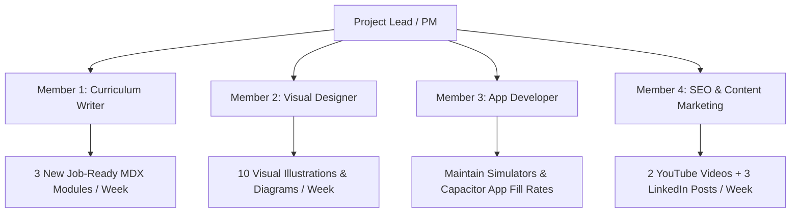

# 🚀 Nextsem Academy: Master Execution Roadmap & Site Architecture

> **Target Goal:** Scale Nextsem Academy to **₹65,000 / Month** through Google AdMob (Mobile) & Google AdSense (Web).  
> **Current Platform Status:** `Phase 2: Day 9 Active` ⚡ | **Overall Progress:** `82% Completed`  
> **Live Site:** [`https://nextsem.online`](https://nextsem.online)

---

## 📊 Executive Overview & Revenue Target

| Metric | Target / Budget | Notes & Strategy |
| :--- | :--- | :--- |
| 💰 **Monthly Revenue Target** | **₹65,000 / month** (~$780 USD) | Solely via Google AdSense (Web) & Google AdMob (Mobile) |
| 👥 **Team Expense Budget** | **₹40,000 / month** | 4 Team Members @ ₹10,000/month each |
| 👑 **Project Lead Net Share** | **₹25,000 / month** | Net profit share after team operational costs |
| 📈 **Target Traffic Metrics** | **500+ Daily Active Users (DAU)** | Target $6.00+ RPM via Tier-1 / Global traffic mix |

---

## 🎯 Current Next Task

> [!IMPORTANT]
> **NEXT IMMEDIATE FOCUS: DAY 9 DEVELOPMENT**
> - **Task:** Implement **AI Compiler Sage CLI hint generator** (`SageAiHintModal.tsx`).
> - **Goal:** Provide intelligent visual terminal hints when learners make syntax errors in Windows CMD CLI exercises.
> - **Command to check live status:** `npm run status` or `npm run task`

---

## 📌 1. AdSense & AdMob Approval Roadmap (Monetization Engine)

### 🟢 Completed Setup Tasks (100% Configured)

- `[x]` **Single Primary Publisher Account:** Migrated all monetization to `manojkmr2403@gmail.com` (`pub-5947565211927754`). ✅
- `[x]` **Team Access Configured:** Added `nextsem.academy@gmail.com` as active Manager/Admin on AdMob & AdSense. ✅
- `[x]` **Closed Duplicate Account:** Closed standalone AdSense under `nextsem.academy@gmail.com` to prevent duplicate policy errors. ✅
- `[x]` **Play Console Contact Info:** Verified Developer Website URL is `https://nextsem.online`. ✅
- `[x]` **Live `app-ads.txt` File:** Published `google.com, pub-5947565211927754, DIRECT, f08c47fec0942fa0` at [`app-ads.txt`](file:///c:/Users/manoj2403/Documents/nextsem.online/public/app-ads.txt) • [Web Link](https://nextsem.online/app-ads.txt). ✅
- `[x]` **Live `ads.txt` File:** Published `google.com, pub-5947565211927754, DIRECT, f08c47fec0942fa0` at [`ads.txt`](file:///c:/Users/manoj2403/Documents/nextsem.online/public/ads.txt) • [Web Link](https://nextsem.online/ads.txt). ✅
- `[x]` **Root Layout Script & Meta Tag:** Injected AdSense publisher ID `ca-pub-5947565211927754` in [`src/app/layout.tsx`](file:///c:/Users/manoj2403/Documents/nextsem.online/src/app/layout.tsx). ✅
- `[x]` **AdSense Site Ownership Verification:** Verified site ownership via `ads.txt` snippet (Status: *Your site is verified*). ✅
- `[x]` **Review Requested:** Submitted `nextsem.online` for site approval on 17 Aug 2026. ✅
- `[x]` **Production AdMob Units:** ✅
  * **App ID:** `ca-app-pub-5947565211927754~5718902515` (Injected in [`AndroidManifest.xml`](file:///c:/Users/manoj2403/Documents/nextsem.online/android/app/src/main/AndroidManifest.xml))
  * **Banner ID:** `ca-app-pub-5947565211927754/4565552616` (Bottom anchored banner)
  * **Interstitial ID:** `ca-app-pub-5947565211927754/5893147977` (Triggered on every 2nd link navigation & lesson completion)
  * **Rewarded ID:** `ca-app-pub-5947565211927754/6967837750` (Replenishes 5 gamification hearts & lesson PDF downloads)
  * **App Open ID:** `ca-app-pub-5947565211927754/4753305205` (App launch screen)

### ⏳ Automated Background Review Steps (In Progress)

- `[ ]` **Step 1.1 (1 to 24 Hours):** Google crawler scans `app-ads.txt` $\rightarrow$ Status changes to **Ready (Green Checkmark)**.
- `[ ]` **Step 1.2:** "Test Ad" labels automatically turn into real live production ads.
- `[ ]` **Step 1.3 (1 to 7 Days):** AdSense site review completes for `nextsem.online` web ads.

---

## 🎮 2. 10-Day Gamified Platform Development Roadmap

| Day | Module / Feature Objective | Codebase & Live Links | Status |
| :---: | :--- | :--- | :---: |
| **Day 1** | Define `desktopSimulatorSteps.ts` metadata & keyboard/mouse objectives | 📄 [`desktopSimulatorSteps.ts`](file:///c:/Users/manoj2403/Documents/nextsem.online/src/data/desktopSimulatorSteps.ts) • 🔗 [CLI Intro Lesson](https://nextsem.online/cli/introduction-to-command-line-interface-cli-basics) | ✅ |
| **Day 2** | Build `DesktopSimulator.tsx` (draggable files, folder double-clicks, recycle bin) | 📄 [`DesktopSimulator.tsx`](file:///c:/Users/manoj2403/Documents/nextsem.online/src/components/DesktopSimulator.tsx) • 🔗 [CMD Basics Lesson](https://nextsem.online/cli/learn-windows-command-prompt-cmd-basics) | ✅ |
| **Day 3** | Setup conditional staging redirection to desktop simulator on first launch | 📄 [`HomeClient.tsx`](file:///c:/Users/manoj2403/Documents/nextsem.online/src/app/HomeClient.tsx) • 🔗 [Landing Page Terminal](https://nextsem.online/) | ✅ |
| **Day 4** | Refactor `/book/[chapter]` into bite-sized card sliders | 📄 [`src/app/curriculum/page.tsx`](file:///c:/Users/manoj2403/Documents/nextsem.online/src/app/curriculum/page.tsx) • 🔗 [/curriculum](https://nextsem.online/curriculum) | ✅ |
| **Day 5** | Integrate MCQs, matching, and drag-and-drop quiz card blocks | 📄 [`UniversalLessonTemplate.tsx`](file:///c:/Users/manoj2403/Documents/nextsem.online/src/components/UniversalLessonTemplate.tsx) • 🔗 [/html/quiz](https://nextsem.online/html/quiz) | ✅ |
| **Day 6** | Create `GamificationContext` (Hearts/Lives, Streaks, Points) | 📄 [`GamificationContext.tsx`](file:///c:/Users/manoj2403/Documents/nextsem.online/src/context/GamificationContext.tsx) • 🔗 [HTML Hub](https://nextsem.online/html) | ✅ |
| **Day 7** | Connect AdMob Rewarded Video ads to replenish hearts | 📄 [`RewardedHeartButton.tsx`](file:///c:/Users/manoj2403/Documents/nextsem.online/src/components/RewardedHeartButton.tsx) • 🔗 [Live App](https://nextsem.online) | ✅ |
| **Day 8** | Configure 2nd-Link Navigation Interstitial Ads & 10 Practical Mini-Projects | 📄 [`htmlMiniProjects.ts`](file:///c:/Users/manoj2403/Documents/nextsem.online/src/data/htmlMiniProjects.ts) • 🔗 [/html](https://nextsem.online/html) | ✅ |
| **Day 9** | **Implement AI Compiler Sage CLI hint generator** | 📄 [`SageAiHintModal.tsx`](file:///c:/Users/manoj2403/Documents/nextsem.online/src/components/SageAiHintModal.tsx) | ⚡ **NEXT TASK** |
| **Day 10** | Build sandbox static portfolio subdomain publishing backend | 📄 `src/app/api/portfolio/route.ts` | ⏳ Upcoming |

---

## 🎨 3. Interactive Project & Animation Labs Standard (Candle Pattern Standard)

Every lab project page is engineered according to the **Candle Flame Project Standard**:
1. **Interactive Demo Stage**: Live interactive visual preview canvas with real-time controls.
2. **VS Code Multi-Tab Code Workspace**: Tabs for `index.html`, `style.css`, `script.js` with head-folding and live syntax highlighting.
3. **What You Need To Learn To Build This Project**: 4 prerequisite lesson cards linking to core HTML, CSS, JavaScript/Physics, and Windows CMD CLI topics.

### 🕯️ 1. Realistic CSS Candle Flame Animation
- 🔗 **Live Lab URL:** [`https://nextsem.online/candle-flame-animation`](https://nextsem.online/candle-flame-animation)
- 📄 **Source Component:** [`CandleFlameAnimation.tsx`](file:///c:/Users/manoj2403/Documents/nextsem.online/src/components/CandleFlameAnimation.tsx)
- 🎨 **Stage Features:** Multi-step piece-by-piece assembly (Wax Pillar, Cotton Wick, Flame Curve, Concentric Color Layers, Live Editable Workspace), ignition/extinguish click toggle, ambient room glow.
- 💻 **Code Tabs:** `index.html` • `style.css` • `script.js`
- 🎓 **Prerequisites & Course Links:**
  - 1. [HTML5 Structural Elements](https://nextsem.online/html/learn-html-web-free-lessons-what-is-the-internet) (`
` nesting & DOM hierarchy)
  - 2. [CSS Gradients & Curves](https://nextsem.online/html/html-headings-paragraphs-and-text-formatting) (`linear-gradient` & 8-point `border-radius`)
  - 3. [Keyframe Animation Physics](https://nextsem.online/html/quiz) (`@keyframes flicker`, skew transform & `box-shadow` glow)
  - 4. [🪟 Windows CMD Terminal](https://nextsem.online/cli/learn-windows-command-prompt-cmd-basics) (Testing local dev servers on Windows PC)

---

### 🌧️ 2. Realistic HTML5 Canvas Rain Drop Effect
- 🔗 **Live Lab URL:** [`https://nextsem.online/rain-effect-animation`](https://nextsem.online/rain-effect-animation)
- 📄 **Source Component:** [`RainEffectAnimation.tsx`](file:///c:/Users/manoj2403/Documents/nextsem.online/src/components/RainEffectAnimation.tsx)
- 🎨 **Stage Features:** HTML5 Canvas particle physics, rain drop speed toggles (`Light`, `Heavy`, `Storm`), real-time particle array loop.
- 💻 **Code Tabs:** `index.html` • `style.css` • `script.js`
- 🎓 **Prerequisites & Course Links:**
  - 1. [HTML5 Canvas Stage](https://nextsem.online/html/learn-html-web-free-lessons-what-is-the-internet) (`<canvas id="rainCanvas">` setup)
  - 2. [CSS Canvas Styling](https://nextsem.online/html/html-headings-paragraphs-and-text-formatting) (Dark viewport background & flex alignment)
  - 3. [JavaScript Particle Physics](https://nextsem.online/html/quiz) (`requestAnimationFrame`, particle velocity & opacity decay)
  - 4. [🪟 Windows CMD Terminal](https://nextsem.online/cli/learn-windows-command-prompt-cmd-basics) (Running local Node/Next.js dev server)

---

### 🟩 3. Matrix Code Rain Animation
- 🔗 **Live Lab URL:** [`https://nextsem.online/matrix-code-animation`](https://nextsem.online/matrix-code-animation)
- 📄 **Source Component:** [`MatrixCodeAnimation.tsx`](file:///c:/Users/manoj2403/Documents/nextsem.online/src/components/MatrixCodeAnimation.tsx)
- 🎨 **Stage Features:** Cyberpunk green katakana character rain stream, variable column speed, dynamic canvas fade overlay.
- 💻 **Code Tabs:** `index.html` • `style.css` • `script.js`
- 🎓 **Prerequisites & Course Links:**
  - 1. [HTML5 Canvas Container](https://nextsem.online/html/learn-html-web-free-lessons-what-is-the-internet) (`<canvas>` initialization)
  - 2. [CSS Dark Cyberpunk Theme](https://nextsem.online/html/html-headings-paragraphs-and-text-formatting) (Full-screen canvas layout)
  - 3. [2D Context Character Stream](https://nextsem.online/html/quiz) (`ctx.fillText`, font sizing & Y-position reset logic)
  - 4. [🪟 Windows CMD Terminal](https://nextsem.online/cli/learn-windows-command-prompt-cmd-basics) (Launching local server via `cmd.exe`)

---

### 🎲 4. 3D Interactive Rotating Cube
- 🔗 **Live Lab URL:** [`https://nextsem.online/3d-cube-animation`](https://nextsem.online/3d-cube-animation)
- 📄 **Source Component:** [`ThreeCubeAnimation.tsx`](file:///c:/Users/manoj2403/Documents/nextsem.online/src/components/ThreeCubeAnimation.tsx)
- 🎨 **Stage Features:** CSS 3D `transform-style: preserve-3d` cube, 6 textured faces, interactive mouse/touch rotation drag.
- 💻 **Code Tabs:** `index.html` • `style.css` • `script.js`
- 🎓 **Prerequisites & Course Links:**
  - 1. [HTML Cube Face Structure](https://nextsem.online/html/learn-html-web-free-lessons-what-is-the-internet) (Nesting 6 face `
` elements)
  - 2. [CSS 3D Perspective](https://nextsem.online/html/html-headings-paragraphs-and-text-formatting) (`perspective`, `rotateX`, `rotateY`, `translateZ`)
  - 3. [JavaScript Mouse Event Drag](https://nextsem.online/html/quiz) (`pointermove`, delta X/Y calculation)
  - 4. [🪟 Windows CMD Terminal](https://nextsem.online/cli/learn-windows-command-prompt-cmd-basics) (Local project execution)

---

### 🎵 5. Audio Spectrum Visualizer
- 🔗 **Live Lab URL:** [`https://nextsem.online/audio-spectrum-animation`](https://nextsem.online/audio-spectrum-animation)
- 📄 **Source Component:** [`AudioSpectrumAnimation.tsx`](file:///c:/Users/manoj2403/Documents/nextsem.online/src/components/AudioSpectrumAnimation.tsx)
- 🎨 **Stage Features:** Frequency equalizer visualizer bars, dynamic height scaling, color gradient transitions.
- 💻 **Code Tabs:** `index.html` • `style.css` • `script.js`
- 🎓 **Prerequisites & Course Links:**
  - 1. [HTML Audio Element & Layout](https://nextsem.online/html/learn-html-web-free-lessons-what-is-the-internet) (Bar flex container)
  - 2. [CSS Bar Gradients](https://nextsem.online/html/html-headings-paragraphs-and-text-formatting) (Vibrant accent styling)
  - 3. [Web Audio API & Frequency Array](https://nextsem.online/html/quiz) (`AudioContext`, `AnalyserNode`, `getByteFrequencyData`)
  - 4. [🪟 Windows CMD Terminal](https://nextsem.online/cli/learn-windows-command-prompt-cmd-basics) (Dev server startup)

---

### 🌌 6. Solar System Orbit Simulation
- 🔗 **Live Lab URL:** [`https://nextsem.online/solar-system-animation`](https://nextsem.online/solar-system-animation)
- 📄 **Source Component:** [`SolarSystemAnimation.tsx`](file:///c:/Users/manoj2403/Documents/nextsem.online/src/components/SolarSystemAnimation.tsx)
- 🎨 **Stage Features:** Sun core with radial glow, 8 orbiting planets with relative speed and distance scales.
- 💻 **Code Tabs:** `index.html` • `style.css` • `script.js`
- 🎓 **Prerequisites & Course Links:**
  - 1. [HTML Planetary Nesting](https://nextsem.online/html/learn-html-web-free-lessons-what-is-the-internet) (Sun & orbit ring elements)
  - 2. [CSS Orbital Animation](https://nextsem.online/html/html-headings-paragraphs-and-text-formatting) (`@keyframes spin`, `border-radius: 50%`)
  - 3. [JavaScript Speed Controls](https://nextsem.online/html/quiz) (Pause/resume & speed multiplier)
  - 4. [🪟 Windows CMD Terminal](https://nextsem.online/cli/learn-windows-command-prompt-cmd-basics) (Local previewing)

---

### ⚡ 7. Neon Glow Interactive Button
- 🔗 **Live Lab URL:** [`https://nextsem.online/neon-button-animation`](https://nextsem.online/neon-button-animation)
- 📄 **Source Component:** [`NeonButtonAnimation.tsx`](file:///c:/Users/manoj2403/Documents/nextsem.online/src/components/NeonButtonAnimation.tsx)
- 🎨 **Stage Features:** Cyberpunk neon border glow, hover expansion, ripple click physics.
- 💻 **Code Tabs:** `index.html` • `style.css` • `script.js`
- 🎓 **Prerequisites & Course Links:**
  - 1. [HTML Button Markup](https://nextsem.online/html/learn-html-web-free-lessons-what-is-the-internet) (`<button>` tag & ARIA labels)
  - 2. [CSS Box Shadow & Text Shadow](https://nextsem.online/html/html-headings-paragraphs-and-text-formatting) (Multi-layered neon glow)
  - 3. [JavaScript Click Ripple Effect](https://nextsem.online/html/quiz) (Dynamic span insertion on click coordinates)
  - 4. [🪟 Windows CMD Terminal](https://nextsem.online/cli/learn-windows-command-prompt-cmd-basics) (Terminal commands)

---

### 💎 8. Glassmorphism Card Hover Effect
- 🔗 **Live Lab URL:** [`https://nextsem.online/glassmorphism-card-animation`](https://nextsem.online/glassmorphism-card-animation)
- 📄 **Source Component:** [`GlassmorphismCardAnimation.tsx`](file:///c:/Users/manoj2403/Documents/nextsem.online/src/components/GlassmorphismCardAnimation.tsx)
- 🎨 **Stage Features:** Frosted glass card UI, `backdrop-filter: blur()`, glowing border gradients, tilt physics.
- 💻 **Code Tabs:** `index.html` • `style.css` • `script.js`
- 🎓 **Prerequisites & Course Links:**
  - 1. [HTML Card Structure](https://nextsem.online/html/learn-html-web-free-lessons-what-is-the-internet) (Card header, body, footer)
  - 2. [CSS Backdrop Blur](https://nextsem.online/html/html-headings-paragraphs-and-text-formatting) (`backdrop-filter`, semi-transparent RGBA borders)
  - 3. [JavaScript 3D Tilt Physics](https://nextsem.online/html/quiz) (`mousemove` tilt calculations)
  - 4. [🪟 Windows CMD Terminal](https://nextsem.online/cli/learn-windows-command-prompt-cmd-basics) (Local server setup)

---

### 🌊 9. Animated Fluid Waves Effect
- 🔗 **Live Lab URL:** [`https://nextsem.online/animated-waves-animation`](https://nextsem.online/animated-waves-animation)
- 📄 **Source Component:** [`AnimatedWavesAnimation.tsx`](file:///c:/Users/manoj2403/Documents/nextsem.online/src/components/AnimatedWavesAnimation.tsx)
- 🎨 **Stage Features:** Multi-layered SVG wave paths, smooth sine-wave translation animations.
- 💻 **Code Tabs:** `index.html` • `style.css` • `script.js`
- 🎓 **Prerequisites & Course Links:**
  - 1. [HTML5 SVG `<path>` Element](https://nextsem.online/html/learn-html-web-free-lessons-what-is-the-internet) (SVG vector curves)
  - 2. [CSS Wave Keyframe Translation](https://nextsem.online/html/html-headings-paragraphs-and-text-formatting) (`@keyframes moveWave`, opacity layering)
  - 3. [JavaScript Dynamic Wave Speed](https://nextsem.online/html/quiz) (Interactive frequency adjustment)
  - 4. [🪟 Windows CMD Terminal](https://nextsem.online/cli/learn-windows-command-prompt-cmd-basics) (Terminal testing)

---

### 🚀 10. Warp Speed Starfield Acceleration
- 🔗 **Live Lab URL:** [`https://nextsem.online/warp-speed-animation`](https://nextsem.online/warp-speed-animation)
- 📄 **Source Component:** [`WarpSpeedAnimation.tsx`](file:///c:/Users/manoj2403/Documents/nextsem.online/src/components/WarpSpeedAnimation.tsx)
- 🎨 **Stage Features:** 3D perspective starfield canvas, star streak acceleration on mouse hold.
- 💻 **Code Tabs:** `index.html` • `style.css` • `script.js`
- 🎓 **Prerequisites & Course Links:**
  - 1. [HTML5 Fullscreen Canvas](https://nextsem.online/html/learn-html-web-free-lessons-what-is-the-internet) (`<canvas>` initialization)
  - 2. [CSS Viewport Layout](https://nextsem.online/html/html-headings-paragraphs-and-text-formatting) (Dark space background)
  - 3. [3D Projection Math](https://nextsem.online/html/quiz) (Z-axis movement & perspective divide)
  - 4. [🪟 Windows CMD Terminal](https://nextsem.online/cli/learn-windows-command-prompt-cmd-basics) (Local execution)

---

### ✨ 11. Nextsem Animated Logo Glow
- 🔗 **Live Lab URL:** [`https://nextsem.online/logo-animation`](https://nextsem.online/logo-animation)
- 📄 **Source Component:** [`NextsemLogoAnimation.tsx`](file:///c:/Users/manoj2403/Documents/nextsem.online/src/components/NextsemLogoAnimation.tsx)
- 🎨 **Stage Features:** High-contrast NS brand emblem, emerald green pulse glow, stroke drawing animation.
- 💻 **Code Tabs:** `index.html` • `style.css` • `script.js`
- 🎓 **Prerequisites & Course Links:**
  - 1. [HTML Brand Logo Structure](https://nextsem.online/html/learn-html-web-free-lessons-what-is-the-internet) (Logo wrapper & SVG paths)
  - 2. [CSS Stroke Dasharray Animation](https://nextsem.online/html/html-headings-paragraphs-and-text-formatting) (`stroke-dashoffset` path drawing)
  - 3. [JavaScript Brand Interaction](https://nextsem.online/html/quiz) (Hover feedback physics)
  - 4. [🪟 Windows CMD Terminal](https://nextsem.online/cli/learn-windows-command-prompt-cmd-basics) (Testing local dev builds)

---

## 📚 4. Live Completed Lessons Directory

Direct live web links to completed interactive course modules:

### 🪟 Windows CMD CLI Course (Completed Lessons)
- 🔗 **Lesson 1:** [How to Open Windows 11 Command Prompt (`cmd.exe`)](https://nextsem.online/cli/introduction-to-command-line-interface-cli-basics) • [`cliLessonsData.ts`](file:///c:/Users/manoj2403/Documents/nextsem.online/src/data/cliLessonsData.ts#L31)
- 🔗 **Lesson 2:** [Essential Windows CMD Commands (`ver`, `cls`, `help`, `title`)](https://nextsem.online/cli/learn-windows-command-prompt-cmd-basics) • [`cliLessonsData.ts`](file:///c:/Users/manoj2403/Documents/nextsem.online/src/data/cliLessonsData.ts#L90)
- 🔗 **Lesson 3:** [Essential File & Navigation Commands (`dir`, `cd`, `mkdir`, `rmdir`)](https://nextsem.online/cli/essential-cmd-commands)
- 🔗 **Lesson 4:** [Most Useful CMD Commands in Windows 11](https://nextsem.online/cli/most-useful-cmd-commands-in-windows)
- 🔗 **Interactive Checkpoint:** [Windows CMD Quiz & Simulator](https://nextsem.online/cli/quiz)

### 🌐 HTML5 & Web Fundamentals Course (Completed Lessons)
- 🔗 **Lesson 1:** [What is the Internet?](https://nextsem.online/html/learn-html-web-free-lessons-what-is-the-internet) • [`htmlLessonsData.ts`](file:///c:/Users/manoj2403/Documents/nextsem.online/src/data/htmlLessonsData.ts#L41)
- 🔗 **Lesson 2:** [Web Architecture: Client-Server, DNS, IP Addresses](https://nextsem.online/html/free-web-development-lessons-client-server-model)
- 🔗 **Lesson 3:** [Anatomy of an HTTP Request](https://nextsem.online/html/anatomy-of-http-request-headers-verbs)
- 🔗 **Lesson 4:** [Anatomy of an HTTP Response & Status Codes](https://nextsem.online/html/http-response-status-codes-explained)
- 🔗 **Lesson 5:** [How Browsers Render HTML (DOM Tree)](https://nextsem.online/html/how-browser-renders-html-dom-tree)
- 🔗 **Interactive Checkpoint:** [HTML5 Knowledge Quiz](https://nextsem.online/html/quiz)

---

## 📐 5. Complete Site Architecture & Layout Blueprint

```mermaid
graph TD
    RootLayout["🌐 RootLayout (src/app/layout.tsx)"]
    RootLayout --> Providers["🎨 Global Theme & State Providers"]
    RootLayout --> Overhead["🔔 Overhead UI Widgets & Controls"]
    RootLayout --> AdEngine["💰 Ad Engine (AdSense Web + AdMob Native)"]
    RootLayout --> PageRoutes["📱 Dynamic Page Routes (src/app/*)"]

    Providers --> ThemeProvider["Dark Theme (#17181c)"]
    Providers --> ProgressProvider["Progress Sync & Gamification"]

    Overhead --> SplashScreen["SplashScreen & OfflineGuard"]
    Overhead --> UpdateBanner["UpdateBanner & Start Alert"]
    Overhead --> SearchWidget["SearchWidget (Global Search Ctrl+K)"]
    Overhead --> TranslateWidget["TranslateWidget (Hindi / Hinglish / English)"]
    Overhead --> GlobalNav["GlobalNavigationWidget & BottomNavigation"]

    AdEngine --> AdSenseScript["AdSense ca-pub-5947565211927754"]
    AdEngine --> AdMobCapacitor["AdMob Capacitor (Banner / Interstitial / Rewarded)"]

    PageRoutes --> Home["/ (Landing Terminal Simulator)"]
    PageRoutes --> Courses["/html, /cli, /cpp, /git, /curriculum"]
    PageRoutes --> Tools["/playground, /pdf-to-markdown, /jobs"]
    PageRoutes --> UserProfile["/profile, /admin"]
    PageRoutes --> Utility["/about, /contact, /privacy, /terms, /sitemap"]
```

---

## 👥 6. Team Execution & Weekly Content Operations

| Member / Role | Focus Area | Weekly Target Output | Key Links |
| :--- | :--- | :--- | :--- |
| **Member 1**   *(Curriculum Writer)* | Job-ready MDX course modules (React, Next.js, Git, Tailwind) | 📄 **3 New Modules** / week | 🔗 [Curriculum Hub](https://nextsem.online/curriculum) |
| **Member 2**   *(Visual Designer)* | Custom illustrations to replace long text blocks in lessons | 🎨 **10 Visual Assets** / week | 📄 [`public/images`](file:///c:/Users/manoj2403/Documents/nextsem.online/public/images) |
| **Member 3**   *(App Developer)* | Terminal simulators, Capacitor mobile builds, ad slot monitoring | 🛠️ **Build & Platform Maintenance** | 📄 [`android`](file:///c:/Users/manoj2403/Documents/nextsem.online/android) |
| **Member 4**   *(SEO & Marketing)* | YouTube Shorts, LinkedIn "Build in Public", GitHub repos | 🎥 **2 Videos + 3 Posts** / week | 🔗 [Nextsem App](https://nextsem.online) |

---

## 💻 7. Developer CLI Command Reference

| Command | Action / Purpose |
| :--- | :--- |
| `npm run status` | View live interactive project & task dashboard |
| `npm run task` | Show current active daily task details |
| `npm run save-chat` | Archive conversation transcript into `chat-logs/` |
| `npm run build` | Validate & compile Next.js production build |
| `npm run deploy:staging` | Deploy current build to Firebase Staging environment |
| `npm run deploy:prod` | Deploy current build to Live Production (`https://nextsem.online`) |
