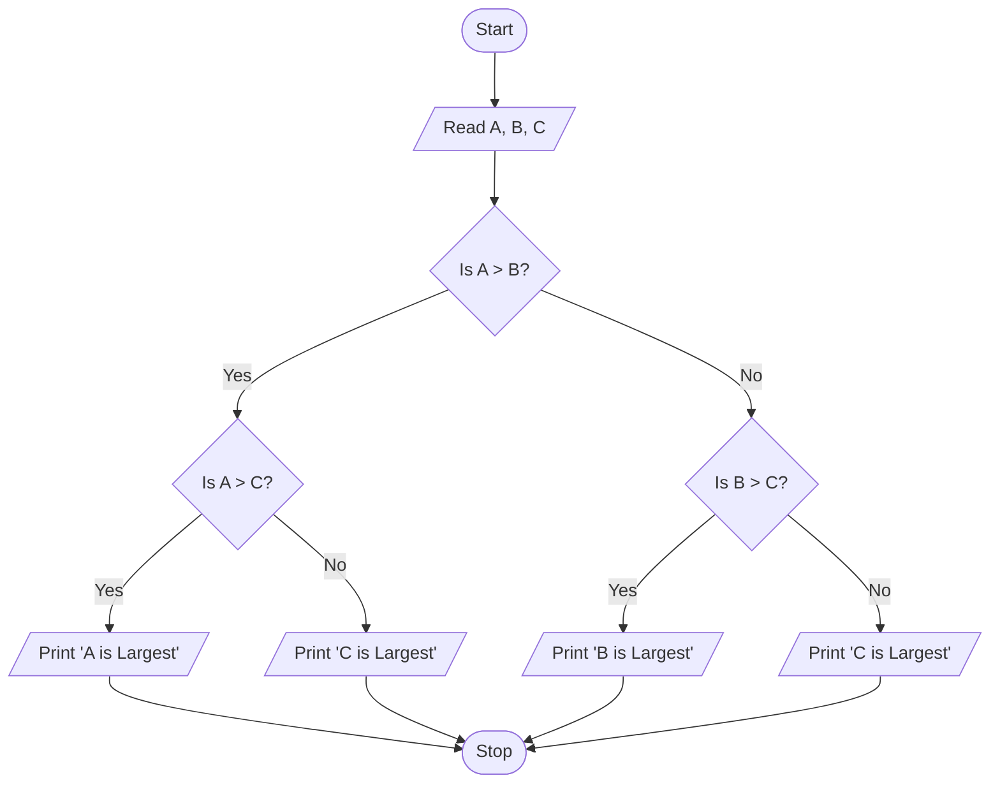
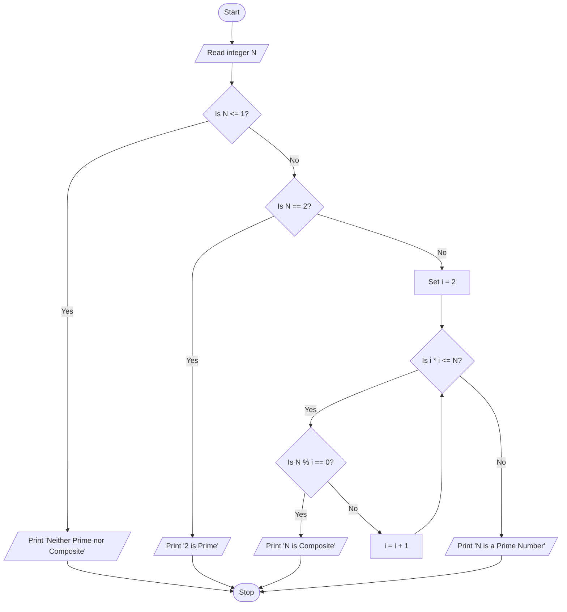
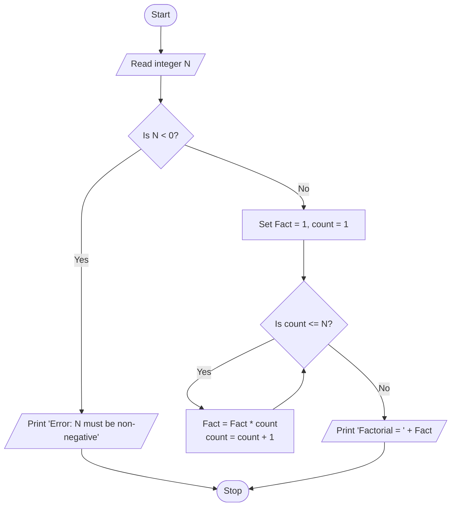
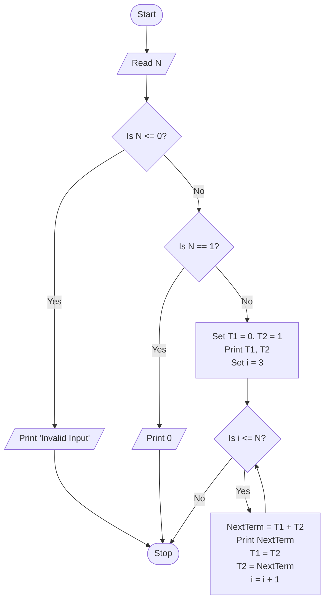
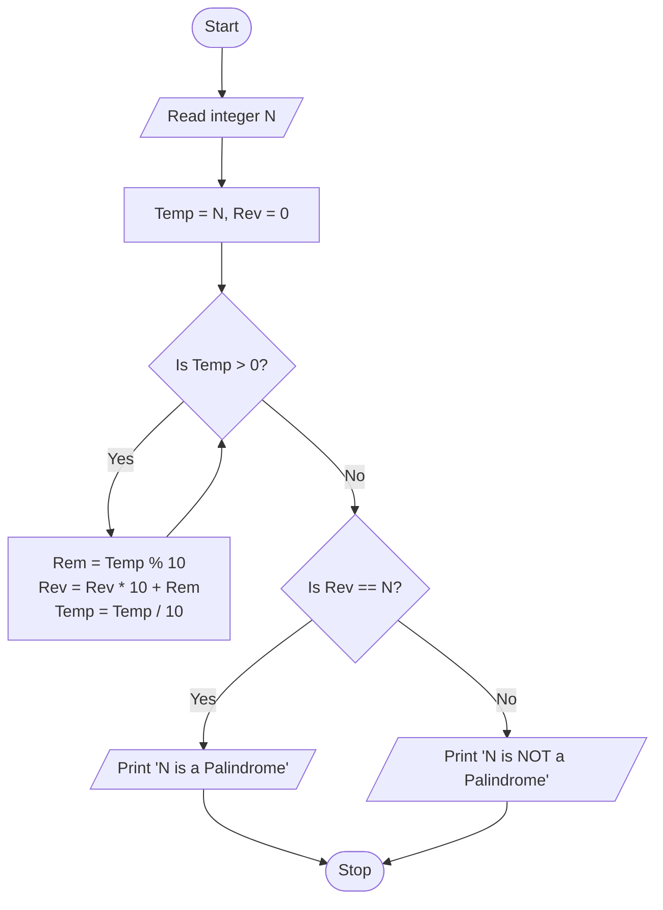
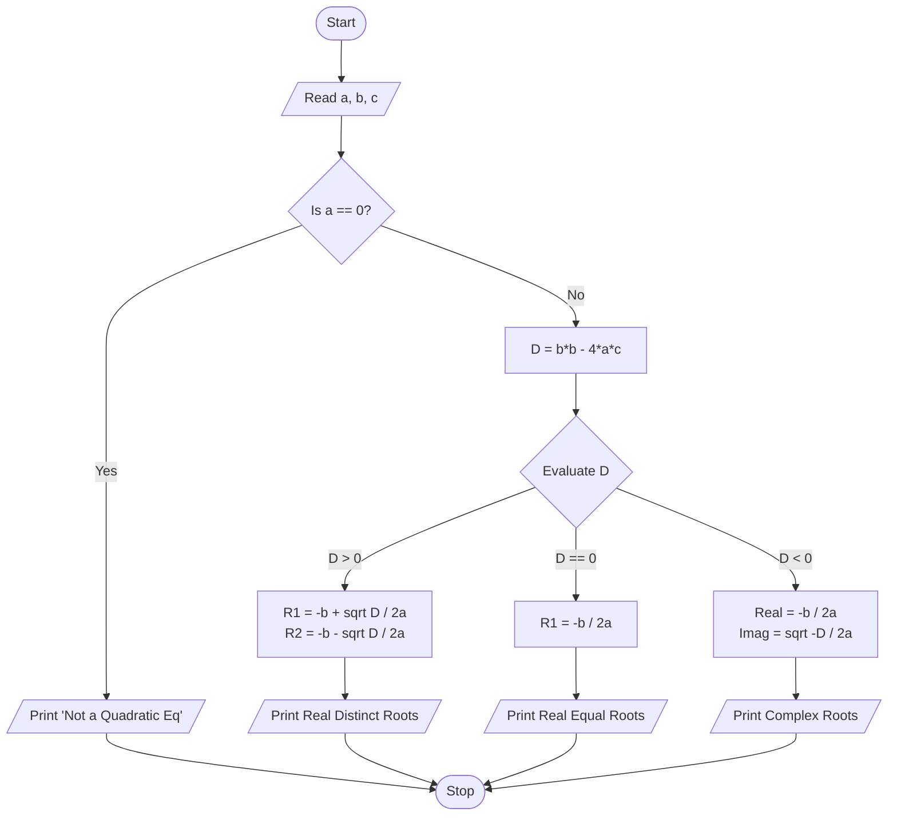
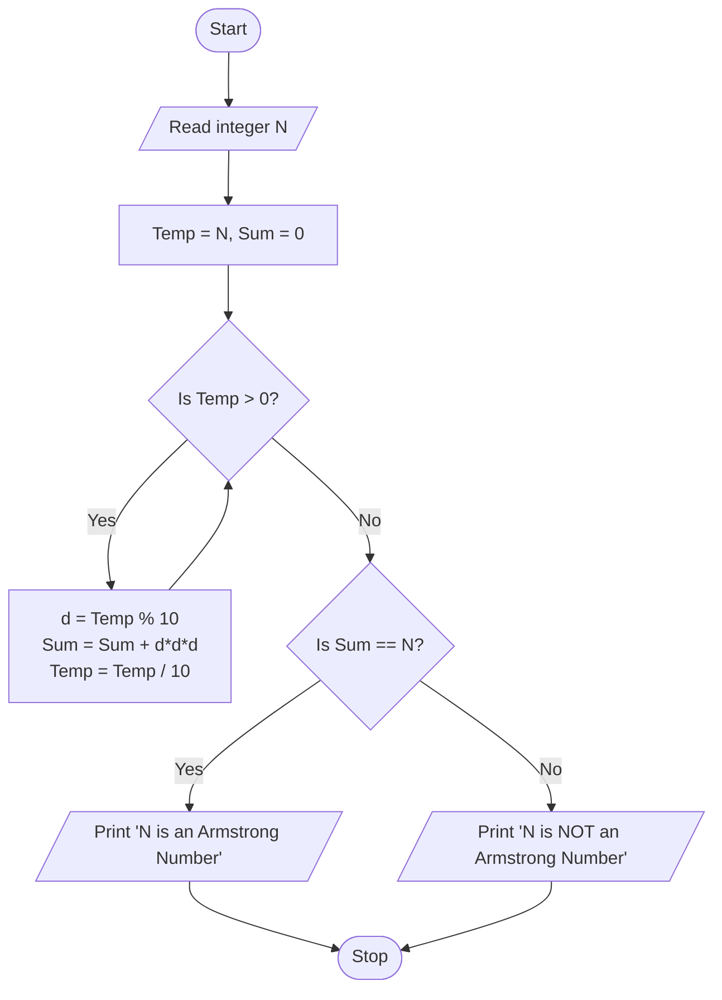
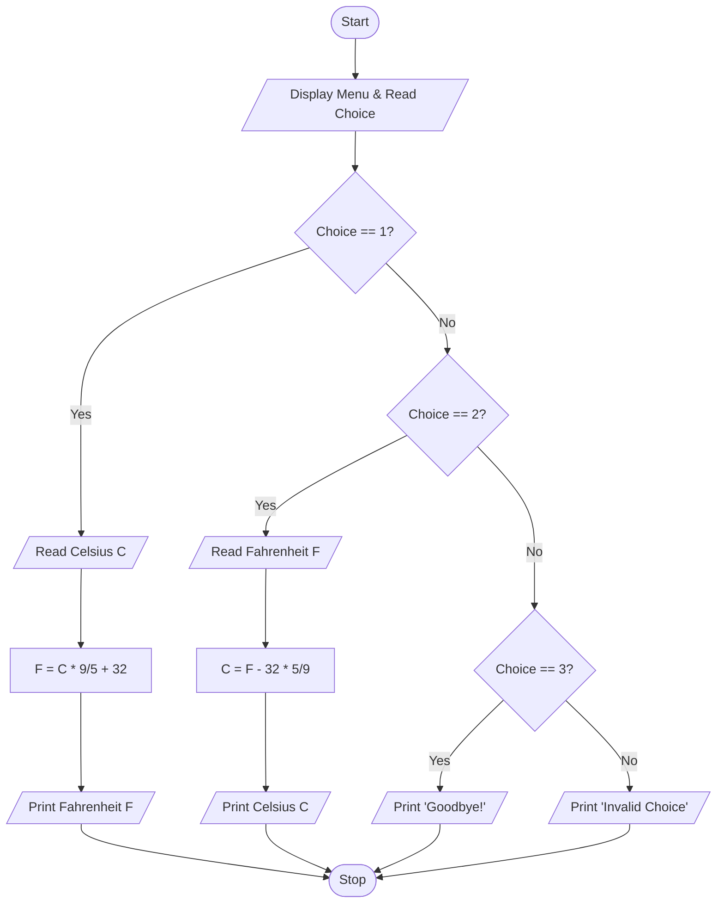

# 🧠 10 Master Problems: Algorithm Formulation & Flowchart Design
**Author:** Er. Manoj Kumar | **Platform:** NextSem Academy (CS-Guide) • IGNOU BCA / Computer Science Fundamentals
**Syllabus Relevance:** BCS-011 (Computer Basics & PC Software), Programming Problem Solving & Algorithm Design

---

## 🎯 Pedagogical Objectives & Standard Flowchart Conventions
In computer science, an **Algorithm** is a finite, unambiguous, step-by-step sequence of computational instructions to solve a given problem. A **Flowchart** is the standardized graphical representation of an algorithm using internationally accepted ANSI/ISO geometric symbols.

| Geometric Symbol | Symbol Name | Function in Flowchart |
| :--- | :--- | :--- |
| **Oval / Stadium** `([Start / Stop])` | Terminal | Marks the entry (Start) and exit (Stop / End) of the program logic. |
| **Parallelogram** `[/Input or Output/]` | Data I/O | Represents reading input from user or displaying output results. |
| **Rectangle** `[Process]` | Process / Action | Represents arithmetic operations, variable assignments, and data manipulation. |
| **Diamond / Rhombus** `{"Condition"}` | Decision | Evaluates a boolean condition (True/False or Yes/No) and branches control. |
| **Circle** `((Connector))` | On-Page Connector | Connects intersecting or distant flow lines on the same page. |
| **Flowlines / Arrows** `-->` | Flow Direction | Shows the exact sequence of execution. |

---

## 📋 Table of Contents: 10 Fundamental Problems
1. [Problem 1: Find the Largest (Maximum) of Three Numbers](#problem-1-find-the-largest-of-three-numbers)
2. [Problem 2: Check Whether a Given Integer is Prime or Composite](#problem-2-check-whether-a-given-integer-is-prime-or-composite)
3. [Problem 3: Calculate the Factorial of a Non-Negative Integer (N!)](#problem-3-calculate-the-factorial-of-a-non-negative-integer-n)
4. [Problem 4: Generate the First N Terms of the Fibonacci Series](#problem-4-generate-the-first-n-terms-of-the-fibonacci-series)
5. [Problem 5: Reverse an Integer and Check if It is a Palindrome](#problem-5-reverse-an-integer-and-check-if-it-is-a-palindrome)
6. [Problem 6: Calculate Simple & Compound Interest with Tiered Bonus Rate](#problem-6-calculate-simple--compound-interest-with-tiered-bonus-rate)
7. [Problem 7: Find All Real and Complex Roots of a Quadratic Equation](#problem-7-find-all-real-and-complex-roots-of-a-quadratic-equation)
8. [Problem 8: Linear Search in an Array of N Elements with Early Exit](#problem-8-linear-search-in-an-array-of-n-elements-with-early-exit)
9. [Problem 9: Sum of Digits & Armstrong (Narcissistic) Number Check](#problem-9-sum-of-digits--armstrong-narcissistic-number-check)
10. [Problem 10: Menu-Driven Temperature Conversion (Celsius ⇋ Fahrenheit)](#problem-10-menu-driven-temperature-conversion-celsius--fahrenheit)

---

## Problem 1: Find the Largest of Three Numbers

### 1. Problem Statement
Given three distinct numbers `A`, `B`, and `C`, formulate a step-by-step algorithm and draw a flowchart to determine and print the largest number among them.

### 2. Variable Table
| Variable | Data Type | Purpose |
| :--- | :--- | :--- |
| `A` | Numeric (Float/Int) | First input number |
| `B` | Numeric (Float/Int) | Second input number |
| `C` | Numeric (Float/Int) | Third input number |

### 3. Step-by-Step Algorithm
- **Step 1:** Start.
- **Step 2:** Read the values of `A`, `B`, and `C`.
- **Step 3:** Compare `A` and `B`:
  - If `A > B`:
    - Check if `A > C`:
      - If True, Print **"A is the largest"**.
      - Else, Print **"C is the largest"**.
  - Else (i.e., `B >= A`):
    - Check if `B > C`:
      - If True, Print **"B is the largest"**.
      - Else, Print **"C is the largest"**.
- **Step 4:** Stop.

### 4. Flowchart (Mermaid Syntax)


### 5. Flowchart (Visual ASCII Diagram)
```text
       +------------------+
       |     [ START ]    |
       +------------------+
                 |
                 v
       +------------------+
       |  Read A, B, C    |
       +------------------+
                 |
                 v
              /      \
            /  A > B?  \
           /            \
        YES               NO
        /                   \
       v                     v
    /      \              /      \
  /  A > C?  \          /  B > C?  \
 /            \        /            \
YES          NO       YES          NO
 |            |        |            |
 v            v        v            v
[Print A]  [Print C] [Print B]  [Print C]
 \            |        |            /
  \-----------+--------+-----------/
                 |
                 v
       +------------------+
       |     [ STOP ]     |
       +------------------+
```

### 6. Dry Run Trace Table
| Step | A | B | C | Condition: A > B | Condition: A > C / B > C | Output |
| :---: | :---: | :---: | :---: | :---: | :---: | :--- |
| Run 1 | 45 | 12 | 89 | 45 > 12 (True) | 45 > 89 (False) | Print "C is Largest" (89) |
| Run 2 | 10 | 95 | 32 | 10 > 95 (False) | 95 > 32 (True) | Print "B is Largest" (95) |

> 💡 **Developer Key Takeaway:** Always use nested decision trees rather than multiple independent if-statements to minimize redundant comparisons from 3 comparisons to at most 2 comparisons.

---

## Problem 2: Check Whether a Given Integer is Prime or Composite

### 1. Problem Statement
Given a positive integer `N`, design an algorithm and flowchart to determine whether `N` is a Prime number (divisible only by 1 and itself) or a Composite number.

### 2. Variable Table
| Variable | Data Type | Purpose |
| :--- | :--- | :--- |
| `N` | Integer | The input number to test |
| `i` | Integer | Loop divisor counter starting from 2 up to `N/2` |
| `isPrime` | Boolean/Flag | 1 if prime, 0 if composite |

### 3. Step-by-Step Algorithm
- **Step 1:** Start.
- **Step 2:** Read positive integer `N`.
- **Step 3:** If `N <= 1`, Print **"Neither Prime nor Composite"** and go to Step 8.
- **Step 4:** If `N == 2`, Print **"2 is a Prime Number"** and go to Step 8.
- **Step 5:** Initialize loop counter `i = 2`.
- **Step 6:** Check loop condition: If `i * i <= N` (or `i <= N / 2`):
  - Check if `N % i == 0`:
    - If True, Print **"N is Composite"** and go to Step 8.
    - If False, Increment `i = i + 1` and repeat Step 6.
- **Step 7:** If the loop terminates without finding any divisor, Print **"N is a Prime Number"**.
- **Step 8:** Stop.

### 4. Flowchart (Mermaid Syntax)


### 5. Dry Run Trace Table (Sample N = 29)
| Step | N | i | i * i <= N | N % i == 0 | Action |
| :---: | :---: | :---: | :---: | :---: | :--- |
| 1 | 29 | 2 | 4 <= 29 (T) | 29 % 2 = 1 (F) | i = 3 |
| 2 | 29 | 3 | 9 <= 29 (T) | 29 % 3 = 2 (F) | i = 4 |
| 3 | 29 | 4 | 16 <= 29 (T) | 29 % 4 = 1 (F) | i = 5 |
| 4 | 29 | 5 | 25 <= 29 (T) | 29 % 5 = 4 (F) | i = 6 |
| 5 | 29 | 6 | 36 <= 29 (F) | Loop Exits | Print **"29 is a Prime Number"** |

> 💡 **Developer Key Takeaway:** Checking divisors only up to `sqrt(N)` reduces execution complexity from O(N) to O(sqrt(N)), which is crucial for modern cryptographic algorithms (e.g. RSA key generation).

---

## Problem 3: Calculate the Factorial of a Non-Negative Integer (N!)

### 1. Problem Statement
Given an integer `N`, calculate `N! = 1 * 2 * 3 * ... * N`. By mathematical definition, `0! = 1`. Negative inputs are invalid.

### 2. Variable Table
| Variable | Data Type | Purpose |
| :--- | :--- | :--- |
| `N` | Integer | Input integer |
| `Fact` | BigInt/Float | Accumulator initialized to 1 |
| `count` | Integer | Iteration index from 1 to `N` |

### 3. Step-by-Step Algorithm
- **Step 1:** Start.
- **Step 2:** Read non-negative integer `N`.
- **Step 3:** If `N < 0`, Print **"Error: Factorial not defined for negative numbers"** and go to Step 7.
- **Step 4:** Initialize `Fact = 1` and `count = 1`.
- **Step 5:** Check if `count <= N`:
  - If True:
    - Compute `Fact = Fact * count`.
    - Increment `count = count + 1`.
    - Repeat Step 5.
  - If False:
    - Proceed to Step 6.
- **Step 6:** Print **"Factorial of N is Fact"**.
- **Step 7:** Stop.

### 4. Flowchart (Mermaid Syntax)


### 5. Dry Run Trace Table (Sample N = 4)
| Iteration | count | count <= 4 | Fact (Before) | Fact = Fact * count | count = count + 1 |
| :---: | :---: | :---: | :---: | :---: | :---: |
| 1 | 1 | True | 1 | 1 * 1 = 1 | 2 |
| 2 | 2 | True | 1 | 1 * 2 = 2 | 3 |
| 3 | 3 | True | 2 | 2 * 3 = 6 | 4 |
| 4 | 4 | True | 6 | 6 * 4 = 24 | 5 |
| 5 | 5 | False | 24 | Loop Terminates | **Result: 24** |

---

## Problem 4: Generate the First N Terms of the Fibonacci Series

### 1. Problem Statement
Develop an algorithm and flowchart to generate and print the first `N` terms of the Fibonacci sequence:
`0, 1, 1, 2, 3, 5, 8, 13, 21, 34, ...` where each term is the sum of the preceding two terms.

### 2. Variable Table
| Variable | Data Type | Purpose |
| :--- | :--- | :--- |
| `N` | Integer | Total number of terms required |
| `T1` | Integer | First preceding term (initialized to 0) |
| `T2` | Integer | Second preceding term (initialized to 1) |
| `NextTerm` | Integer | Sum of `T1 + T2` |
| `i` | Integer | Loop counter for terms printed |

### 3. Step-by-Step Algorithm
- **Step 1:** Start.
- **Step 2:** Read total number of terms `N`.
- **Step 3:** If `N <= 0`, Print **"Please enter a positive integer"** and go to Step 8.
- **Step 4:** If `N == 1`, Print **"0"** and go to Step 8.
- **Step 5:** Initialize `T1 = 0`, `T2 = 1`, and print `T1` and `T2`.
- **Step 6:** Initialize counter `i = 3` (since two terms are already printed).
- **Step 7:** While `i <= N`:
  - Calculate `NextTerm = T1 + T2`.
  - Print `NextTerm`.
  - Shift terms: Set `T1 = T2`, then Set `T2 = NextTerm`.
  - Increment `i = i + 1`.
- **Step 8:** Stop.

### 4. Flowchart (Mermaid Syntax)


---

## Problem 5: Reverse an Integer and Check if It is a Palindrome

### 1. Problem Statement
Given an integer number `N`, extract its digits, construct its mathematical reverse `Rev`, and determine whether the number is a **Palindrome** (e.g. 121, 1331, 4554).

### 2. Variable Table
| Variable | Data Type | Purpose |
| :--- | :--- | :--- |
| `N` | Integer | Original user input number |
| `Temp` | Integer | Working copy of number being dissected |
| `Rem` | Integer | Remainder (extracted last digit via modulo 10) |
| `Rev` | Integer | Accumulated reversed number (initialized to 0) |

### 3. Step-by-Step Algorithm
- **Step 1:** Start.
- **Step 2:** Read integer `N`.
- **Step 3:** Store copy of `N`: Set `Temp = N` and initialize `Rev = 0`.
- **Step 4:** While `Temp > 0`:
  - Extract last digit: `Rem = Temp % 10`.
  - Shift reversed digits and append: `Rev = (Rev * 10) + Rem`.
  - Truncate last digit: `Temp = floor(Temp / 10)`.
- **Step 5:** Compare reversed value with original:
  - If `Rev == N`:
    - Print **"N is a Palindrome"**.
  - Else:
    - Print **"N is NOT a Palindrome"**.
- **Step 6:** Stop.

### 4. Flowchart (Mermaid Syntax)


---

## Problem 6: Calculate Simple & Compound Interest with Tiered Bonus Rate

### 1. Problem Statement
A banking software calculates Simple Interest (SI) and Compound Interest (CI) given Principal (`P`), Base Annual Interest Rate (`R`), and Time in years (`T`). If the principal amount is `P >= 100,000`, a premium customer bonus rate of `+0.5%` is added to `R`.

### 2. Formulas
```text
Effective Rate (R_eff) = R + 0.5 (if P >= 100,000), else R
Simple Interest (SI) = (P * R_eff * T) / 100
Compound Interest (CI) = P * (1 + R_eff / 100)^T - P
Total Amount = P + CI
```

### 3. Step-by-Step Algorithm
- **Step 1:** Start.
- **Step 2:** Read `P` (Principal), `R` (Rate), and `T` (Time).
- **Step 3:** Verify validity: If `P <= 0` or `R <= 0` or `T <= 0`, Print **"Invalid inputs"** and go to Step 8.
- **Step 4:** Check premium tier:
  - If `P >= 100000`, Set `R_eff = R + 0.5`.
  - Else, Set `R_eff = R`.
- **Step 5:** Calculate Simple Interest: `SI = (P * R_eff * T) / 100`.
- **Step 6:** Calculate Compound Interest: `CI = P * ( (1 + R_eff / 100)^T ) - P`.
- **Step 7:** Print `R_eff`, `SI`, and `CI`.
- **Step 8:** Stop.

### 4. Flowchart (Mermaid Syntax)
```mermaid
flowchart TD
    Start([Start]) --> Input[/Read P, R, T/]
    Input --> Valid{Is P > 0 & R > 0 & T > 0?}
    Valid -- No --> Err[/Print 'Invalid Inputs'/] --> Stop([Stop])
    Valid -- Yes --> CheckTier{Is P >= 100,000?}
    CheckTier -- Yes --> Bonus[R_eff = R + 0.5]
    CheckTier -- No --> Standard[R_eff = R]
    Bonus --> Calc[SI = P * R_eff * T / 100<br/>CI = P * (1 + R_eff/100)^T - P]
    Standard --> Calc
    Calc --> Out[/Print R_eff, SI, CI/] --> Stop
```

---

## Problem 7: Find All Real and Complex Roots of a Quadratic Equation

### 1. Problem Statement
Given the coefficients `a, b, c` of a quadratic equation ax² + bx + c = 0 with a ≠ 0, compute the discriminant D = b² - 4ac and determine whether the roots are:
1. Real and Distinct (D > 0)
2. Real and Equal (D = 0)
3. Complex Conjugate Roots (D < 0)

### 2. Step-by-Step Algorithm
- **Step 1:** Start.
- **Step 2:** Read coefficients `a, b, c`.
- **Step 3:** Check if `a == 0`:
  - If True, Print **"Not a quadratic equation (Linear Equation)"** and go to Step 6.
- **Step 4:** Compute discriminant: `D = (b * b) - (4 * a * c)`.
- **Step 5:** Branch based on discriminant value:
  - **Case 1: D > 0**
    - Compute `R1 = (-b + sqrt(D)) / (2 * a)`.
    - Compute `R2 = (-b - sqrt(D)) / (2 * a)`.
    - Print **"Real and Distinct Roots: R1, R2"**.
  - **Case 2: D == 0**
    - Compute `R1 = -b / (2 * a)`.
    - Print **"Real and Equal Roots: R1 = R2 = R1"**.
  - **Case 3: D < 0**
    - Compute `RealPart = -b / (2 * a)`.
    - Compute `ImagPart = sqrt(-D) / (2 * a)`.
    - Print **"Complex Roots: RealPart ± ImagPart * i"**.
- **Step 6:** Stop.

### 4. Flowchart (Mermaid Syntax)


---

## Problem 8: Linear Search in an Array of N Elements with Early Exit

### 1. Problem Statement
Given an array `A[0 ... N-1]` of `N` elements and a target search key `K`, scan the array sequentially to locate `K`. If found, print the array index and immediately exit the loop (early exit optimization); otherwise, print **"Element Not Found"**.

### 2. Variable Table
| Variable | Data Type | Purpose |
| :--- | :--- | :--- |
| `A[]` | Array of Int/Float | Input list of items |
| `N` | Integer | Total count of elements in array |
| `K` | Int/Float | Search key |
| `i` | Integer | Loop index pointer (0 to N-1) |
| `found` | Boolean | 0 = false, 1 = true |

### 3. Step-by-Step Algorithm
- **Step 1:** Start.
- **Step 2:** Read array size `N`.
- **Step 3:** Read `N` elements into array `A[0 ... N-1]`.
- **Step 4:** Read search key `K`.
- **Step 5:** Initialize index `i = 0` and flag `found = 0`.
- **Step 6:** While `i < N`:
  - If `A[i] == K`:
    - Print **"Element found at index: " + i**.
    - Set `found = 1`.
    - Break loop and go to Step 8 (Early Exit).
  - Else:
    - Increment `i = i + 1`.
- **Step 7:** If `found == 0`, Print **"Element K not found in array"**.
- **Step 8:** Stop.

### 4. Flowchart (Mermaid Syntax)
```mermaid
flowchart TD
    Start([Start]) --> Input[/Read array A of size N, and Key K/]
    Input --> Init[Set i = 0, found = 0]
    Init --> LoopCheck{Is i < N?}
    LoopCheck -- Yes --> MatchCheck{Is A[i] == K?}
    MatchCheck -- Yes --> Found[/Print 'Found at index ' + i/]--> SetFound[found = 1] --> Stop([Stop])
    MatchCheck -- No --> Inc[i = i + 1] --> LoopCheck
    LoopCheck -- No --> NotFoundCheck{Is found == 0?}
    NotFoundCheck -- Yes --> OutNotFound[/Print 'Key Not Found'/] --> Stop
    NotFoundCheck -- No --> Stop
```

---

## Problem 9: Sum of Digits & Armstrong (Narcissistic) Number Check

### 1. Problem Statement
An Armstrong number (e.g. 153, 370, 371) is an integer where the sum of the cubes of its individual digits equals the number itself:
153 = 1³ + 5³ + 3³ = 1 + 125 + 27 = 153. Formulate an algorithm and flowchart to verify if a 3-digit number is an Armstrong number.

### 2. Step-by-Step Algorithm
- **Step 1:** Start.
- **Step 2:** Read positive integer `N`.
- **Step 3:** Initialize `Sum = 0` and `Temp = N`.
- **Step 4:** While `Temp > 0`:
  - Extract digit: `d = Temp % 10`.
  - Add cube to sum: `Sum = Sum + (d * d * d)`.
  - Truncate digit: `Temp = floor(Temp / 10)`.
- **Step 5:** Check condition:
  - If `Sum == N`:
    - Print **"N is an Armstrong Number"**.
  - Else:
    - Print **"N is NOT an Armstrong Number"**.
- **Step 6:** Stop.

### 4. Flowchart (Mermaid Syntax)


---

## Problem 10: Menu-Driven Temperature Conversion (Celsius ⇋ Fahrenheit)

### 1. Problem Statement
Design an interactive, menu-driven algorithm and flowchart where the user chooses between:
- **Choice 1:** Convert Celsius to Fahrenheit (F = (C * 9/5) + 32)
- **Choice 2:** Convert Fahrenheit to Celsius (C = (F - 32) * 5/9)
- **Choice 3:** Exit

### 2. Step-by-Step Algorithm
- **Step 1:** Start.
- **Step 2:** Display Menu options:
  - `1. Celsius to Fahrenheit`
  - `2. Fahrenheit to Celsius`
  - `3. Exit`
- **Step 3:** Read user selection `choice`.
- **Step 4:** Branch based on `choice`:
  - If `choice == 1`:
    - Read temperature in Celsius `C`.
    - Compute `F = (C * 9 / 5) + 32`.
    - Print **"Temperature in Fahrenheit = F"**.
  - Else If `choice == 2`:
    - Read temperature in Fahrenheit `F`.
    - Compute `C = (F - 32) * 5 / 9`.
    - Print **"Temperature in Celsius = C"**.
  - Else If `choice == 3`:
    - Print **"Exiting program. Goodbye!"** and go to Step 6.
  - Else:
    - Print **"Invalid Menu Choice. Please enter 1, 2, or 3"**.
- **Step 5:** Return to Step 2 or proceed to Step 6.
- **Step 6:** Stop.

### 4. Flowchart (Mermaid Syntax)


---

## 🏆 Comprehensive Summary Matrix of All 10 Problems

| Problem # | Algorithmic Paradigm | Primary Decision Constructs | Key Edge Cases |
| :---: | :--- | :--- | :--- |
| **1** | Multi-way Comparison | Nested `if-else` tree | Duplicate numbers (A = B = C) |
| **2** | Prime Number Verification | Divisibility loop with `sqrt(N)` boundary | N <= 1 and N = 2 (only even prime) |
| **3** | Accumulation Product | Count-controlled iteration | 0! = 1 and negative inputs |
| **4** | State Shifting Sequence | Multiple variable pointer swapping | N = 1 and N = 2 |
| **5** | Number Digits Extraction | Modulo arithmetic (% 10, / 10) | Single-digit numbers and numbers ending in 0 |
| **6** | Financial Calculation | Tiered threshold conditional | Zero or negative rate / principal |
| **7** | Algebraic Root Branching | Multi-branch discriminant categorization | a = 0 (degenerates to linear equation) |
| **8** | Linear Array Searching | Sequential search with early exit break | Key not present / empty array |
| **9** | Digits Cube Summation | While loop accumulator with digit extraction | 3-digit boundary and non-Armstrong values |
| **10** | Menu-Driven Interactive | Switch/Case selection dispatching | Invalid choice integers and absolute zero limits |

---
*Created for CS-Guide & NextSem Academy • Author: Er. Manoj Kumar*
