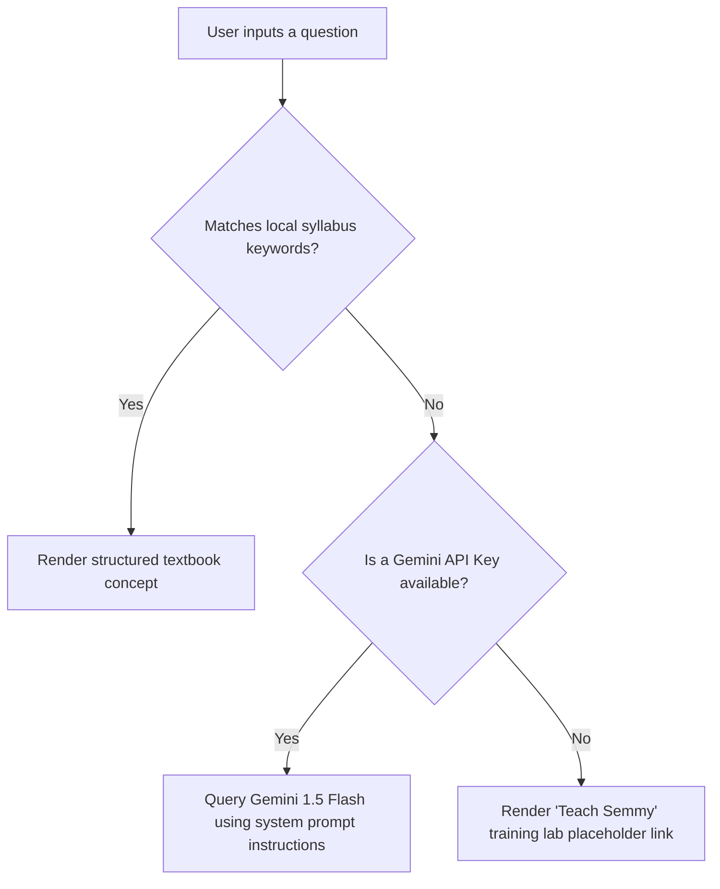

# 🧠 Nextsem Academy: Gemini AI Integration Guide

Semmy AI is designed with a hybrid response engine. It first searches its local curriculum knowledge base for exact matches, and falls back to **Gemini 1.5 Flash** for dynamic, general questions.

To activate the Gemini AI capabilities, follow this step-by-step guide to configure the API key.

---

## Step 1: Obtain a Gemini API Key
1. Go to the [Google AI Studio Console](https://aistudio.google.com/).
2. Log in with your Google account.
3. Click **Create API Key** in the top left sidebar.
4. Copy the generated `AIzaSy...` key to your clipboard.

---

## Step 2: Choose Configuration Method

You can configure the key globally for all users (Method A), or locally in your browser for testing (Method B).

### Method A: Global Setup (Recommended for Developers)
To configure the key globally so that every student has access to the AI fallback without entering their own keys:
1. Open the [`.env.local`](file:///c:/jbrs-landing-page/.env.local) file in your codebase.
2. Locate the variable on line 12:
   ```env
   NEXT_PUBLIC_GEMINI_API_KEY=
   ```
3. Paste your API key directly:
   ```env
   NEXT_PUBLIC_GEMINI_API_KEY=AIzaSyYourKeyHere
   ```
4. Save the file and restart your local dev server:
   ```bash
   npm run dev
   ```

### Method B: Browser Testing Setup (User-specific)
To configure the key in a specific browser session without touching the code:
1. Open the website: `http://localhost:3000/`.
2. Click the floating **Semmy AI Mascot** bubble at the bottom right.
3. In the chat window header, click the 🔑 (Key) settings icon.
4. Paste your API key into the input field.
5. The key is securely saved in your browser's `localStorage` and will be used instantly.

---

## How Semmy's Hybrid Engine Works

The query execution flow follows this hierarchy:



The system instruction is pre-configured in [`src/lib/gemini.ts`](file:///c:/jbrs-landing-page/src/lib/gemini.ts#L15) to force Gemini to stay in character as Semmy, providing concise, encouraging tutoring outputs formatted with markdown headers and bullet points.
