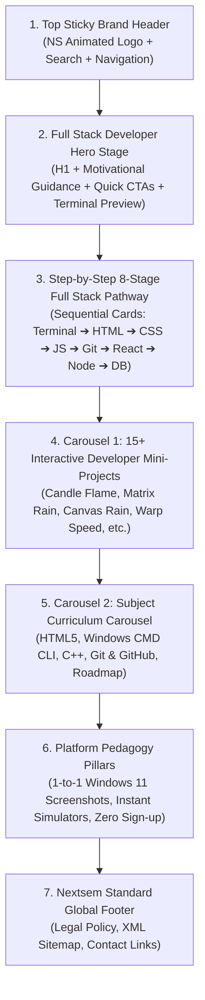
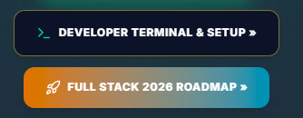
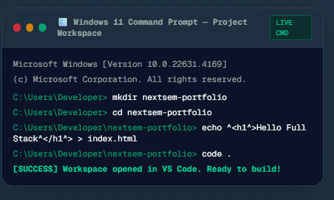
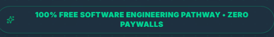
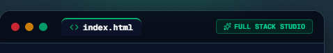
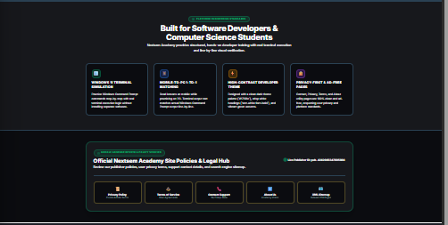
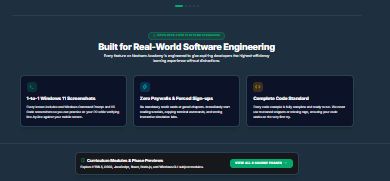
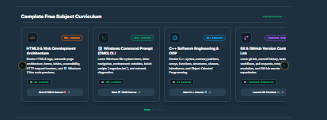
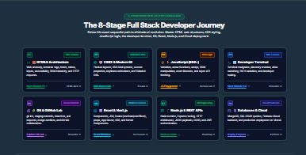
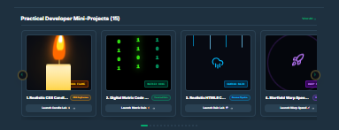

# 🚀 Nextsem.online — Full Stack Web Developer Landing Page Master Document (`frontpage.md`)

> **Primary Mission:** Guide every new student step-by-step from zero coding knowledge to a **Job-Ready Full Stack Web Developer** in clear, structured, motivating English with zero paywalls, zero bloat, and zero confusion.

---

## 💬 User Original Inputs & Notes (Verbatim)

> we will work in very small small steps so that we dont get bored.
> i want front page design unique and based onour aim of learning and becoming full stack web developer.
>
> is file m nextsem.online ka front page ko most beautiful way me design karo jisme aim full stack web developer banane ka ho aur google pe jitne bhi ese platform hai unse ideas collect karo aur mujhe batao fir hum usse banayenge
>
> logo jo humne green black aur white colour m design kiya hai wo use karo
>
> acha thoda thoda update karo aur mujhe batate raho bilkul chote chote steps k sath taki m bore na hou
>
> ek problem hai logo m -> Logo ka image asset galat hai (/logo-transparent.png ya /logo.png use karna hai)
>
> tum batao ab kya krna chahiye front page k liye aur abhi tak jo humne front page pe update kiya hai sab lkuch front_page.md m sahi se update kardo taki m future m easilt smjh saku
>
> ha agar kisi ko pehle se thoda knowledge hai to uska test karne k liye koi test type actual simulations based type professional exam babo jaise cicso ka CCIE ka exam hota hai aur use start lesson k upar ek link k form m add kardo
>
> remove v29 pill badge it does not look professional.
> logo is broken correct it.
> remove back to home front page
> logo animation at the start of website keep that as final and use logo similiar to that.
> why this progress if user is not logged in locally nor with google
> put a accept agreement at the bottom so that cookies and users data are saved locally
> balki front page ko fresh redesign krte hai kyunki hamara main task is waqt full stack web developer hai m confuse hu kese start karein jo bhi user front page pe pohche use englih langugae me guide krte hue full stack web developer sikhana hai baki jo bhi is waqt unnecessary ho use archive kardo aur sirf search engine ko show ho users ko link na show ho par delete nhi karna kuch bhi
> frontpage.md naam se ek file bna do jisem hum sirf front page ka content desing sab hoga docs wale folder m bna do
> saari files folders k andar ho docs wale folder k andar
> nextsem.online ka favicon logo for nextsem/nextsem-favicon.svg ye arkho
> makfrontpage adsense bot frecldy reove bottom navigatoin ansd show them ony on lesno pages strictly
> keep al phaes hidden toreduce front page space and size andon frnt page add privacy contact us etc [ages
> beautify front page professional platform pillars no fake testimonials
> redesign course curriculum page as per our theme
> remove ads from contact and utility pages
> we are wrkg for both moble and desktop versoisn so do whatever is better
> 100% complete work for adsense geting verified
> do not deloy just build
> front page ko jaise pehle 2 carasoual the project aur courses k jaise wese wapis kardo
> ye files q hai inhe merge karke ek file hi rakho

---

## 🎯 Primary Goal & Design Philosophy

**Goal**: Make `https://nextsem.online` the #1 unique, visually stunning, free learning platform for self-taught software engineers, college students, and computer science aspirants worldwide to become **Full Stack Web Developers**.

**Development Workflow Constraint**:

- ⚡ **Very Small Steps Policy**: All updates are broken down into bite-sized, single-focused incremental micro-steps so learning & building remains engaging, visual, and fun without boredom!

**Theme Palette**:

- **Background**: High-contrast dark mode `#17181c`
- **Surface Cards**: Sleek dark surface `#0c1328`
- **Primary Accent**: Emerald Green `#04AA6D` (Glow: `drop-shadow-[0_0_10px_rgba(4,170,109,0.3)]`)
- **Text Standard**: Crisp pure white `#ffffff` headings & high-contrast body text
- **Links Standard**: Vibrant emerald green `text-[#04AA6D] hover:text-[#039861] underline decoration-[#04AA6D]`
- **Branding Logo Asset**: `logo for nextsem/nextsem-favicon.svg` & `NextsemLogoAnimation.tsx` (Emerald N + White S vector emblem)

---

## 🧭 1. Page Wireframe & Structural Layout Flow



---

## 🎯 2. Section-by-Section Content & Copywriting (100% Developer English)

### 📌 Section 1: Sticky Brand Header (`Header.tsx` & `NextsemLogoAnimation.tsx`)

- **Logo Emblem & Tagline:** Interactive vector `NextsemLogoAnimation` (N-E-X-T-S-E-M trace $\rightarrow$ locks into permanent emerald `NS` badge + **"FULL STACK WEB DEVELOPER"** theme-styled emerald subtitle).
- **Official SVG Assets in `docs/logo for nextsem/`:**
  - [`docs/logo for nextsem/nextsem-logo-fullstack.svg`](file:///c:/Users/manoj2403/Documents/nextsem.online/docs/logo%20for%20nextsem/nextsem-logo-fullstack.svg) (Horizontal Navbar SVG)
  - [`docs/logo for nextsem/nextsem-logo-fullstack-stacked.svg`](file:///c:/Users/manoj2403/Documents/nextsem.online/docs/logo%20for%20nextsem/nextsem-logo-fullstack-stacked.svg) (Stacked Icon & Badge SVG)
  - [`public/logo.svg`](file:///c:/Users/manoj2403/Documents/nextsem.online/public/logo.svg) (Public Web Asset)
- **Navigation Links:**
  - `Home` (`/`)
  - `Full Stack Roadmap` (`/full-stack-web-development-roadmap`)
  - `HTML & CSS` (`/html`)
  - `Windows CLI` (`/cli`)
  - `Projects Lab` (`/course/projects`)
  - `Curriculum` (`/curriculum`)
- **Search Widget:** Interactive dropdown with instant full-text tutorial search + Google Search fallback.

---

### 📌 Section 2: Hero Stage — "Become a Job-Ready Full Stack Developer"

#### Copywriting

- **Pill Badge:** `⚡ 100% FREE SOFTWARE ENGINEERING PATHWAY • ZERO PAYWALLS`
- **Main Heading (H1):** `Become a Job-Ready Full Stack Web Developer`
- **Subtitle:**  
  *"Master full-stack web development step-by-step on your Windows PC. Start by setting up Visual Studio Code & HTML structure, progress through modern CSS layouts and JavaScript logic, build full-stack React and Node.js applications, manage databases, and deploy real-world projects to the cloud."*
- **Action Button:**
  1. `[Primary Emerald Button]` **Start Learning »** $\rightarrow$ Links directly to [`/html/learn-html-web-free-lessons-what-is-the-internet`](https://nextsem.online/html/learn-html-web-free-lessons-what-is-the-internet)

#### Live Full Stack VS Code & Web Developer Studio Card

```html
<!-- 1. Frontend Web Architecture (HTML5 + CSS + JavaScript) -->
<!DOCTYPE html>
<html lang="en">
<head>
  <title>Job-Ready Full Stack Developer</title>
  <link rel="stylesheet" href="styles.css">
</head>
<body>
  <h1 class="text-emerald-400">Hello World! Building Full Stack Web Apps 🚀</h1>
  <script src="app.js"></script>
</body>
</html>
```

---

### 📌 Section 3: The 8-Stage Sequential Full Stack Learning Pathway (`#pathway`)

Every beginner follows this exact chronological, visual-first roadmap to eliminate all confusion:

| Step | Stage Name | Target Skills & Modules | Live Lessons & Link |
| :---: | :--- | :--- | :--- |
| **01** | **🧱 HTML5 Web Architecture** | Web fundamentals, semantic tags, forms, tables, inputs, accessibility, DOM hierarchy, and HTTP client-server requests. | 📚 **98+ Lessons**<br>🔗 [`/html`](https://nextsem.online/html) |
| **02** | **🎨 CSS3 Responsive UI & Layouts** | Flexbox containers, CSS Grid systems, custom properties (variables), media queries, keyframe animations, and modern Tailwind CSS. | 📚 **Interactive Labs**<br>🔗 [`/candle-flame-animation`](https://nextsem.online/candle-flame-animation) |
| **03** | **⚡ JavaScript (ES6+) Core Logic** | Variables (`let`/`const`), arrow functions, arrays, objects, event listeners, DOM manipulation, promises, and `async/await` API fetching. | 📚 **Hands-on Labs**<br>🔗 [`/playground`](https://nextsem.online/playground) |
| **04** | **🪟 Developer Terminal & CLI Setup** | Terminal navigation, directory creation (`mkdir`), drive switching, PATH variables, VS Code workspace launch (`code .`), and local tooling. | 📚 **100+ Lessons**<br>🔗 [`/cli`](https://nextsem.online/cli) |
| **05** | **🌿 Git & GitHub Version Control** | `git init`, commit staging, branch management, pull requests, merge conflict resolution, and GitHub remote repositories. | 📚 **Terminal Simulator**<br>🔗 [`/git`](https://nextsem.online/git) |
| **06** | **⚛️ React.js & Next.js Framework** | Component architecture, JSX, `useState`/`useEffect` hooks, props passing, Next.js App Router, SSR, and Server Components. | 📚 **Full Stack Pathway**<br>🔗 [`/curriculum`](https://nextsem.online/curriculum) |
| **07** | **🔌 Backend REST APIs with Node.js** | Node.js runtime, Express server routing, HTTP middleware, JSON payloads, CORS, and JWT authentication tokens. | 📚 **API Backend Lab**<br>🔗 [`/curriculum`](https://nextsem.online/curriculum) |
| **08** | **🗄️ Databases & Cloud Deployment** | MongoDB / SQL CRUD queries, schema models, Firebase Cloud backend, CI/CD deployment pipelines on Vercel / Firebase Hosting. | 📚 **Cloud Production**<br>🔗 [`/full-stack-web-development-roadmap`](https://nextsem.online/full-stack-web-development-roadmap) |

---

### 📌 Section 4: Carousel 1 — 15+ Practical Developer Mini-Projects (`StudentProjectsSection.tsx`)

A dedicated horizontal swipe gallery showcasing live interactive animation and software labs built by students:

1. **Realistic CSS Candle Flame** (`/candle-flame-animation`) — Keyframe physics, concentric gradient colors, and wick glow.
2. **Digital Matrix Code Rain** (`/matrix-code-animation`) — Green streaming katakana character physics on 2D Canvas.
3. **HTML5 Canvas Rain Drop Effect** (`/rain-effect-animation`) — Real-time particle arrays and velocity gravity loops.
4. **Warp Speed Starfield Acceleration** (`/warp-speed-animation`) — 3D projection math and star streak acceleration.
5. **Cyberpulse Laser Neon Button** (`/neon-button-animation`) — Multi-layered neon border glow with ripple click physics.
6. **Holographic 3D Glass Card** (`/glassmorphism-card-animation`) — `backdrop-filter` frosted glass tilt physics.
7. **Audio Equalizer Beats Visualizer** (`/audio-spectrum-animation`) — Frequency array waveform dynamic height scaling.
8. **Solar System 3D Planet Orbit** (`/solar-system-animation`) — Rotational orbit scales with speed multiplier controls.
9. **3D Cube Rotation Engine** (`/3d-cube-animation`) — CSS 3D `preserve-3d` perspective rotation on mouse drag.
10. **Animated Ocean Fluid Waves** (`/animated-waves-animation`) — Multi-layered SVG vector wave translations.
11. **Cyberpunk Glitch Text Effect** (`/glitch-text-animation`) — Polygon clip-path slicing and RGB split offset.
12. **3D Holographic Foil Card Tilt** (`/holographic-card-animation`) — Metallic gold foil reflection shader.
13. **3D Rotating DNA Double Helix** (`/dna-helix-animation`) — Harmonic sinusoidal particle wave pairing.
14. **Liquid Glass Battery Level** (`/liquid-wave-animation`) — Rotational fluid displacement container.
15. **Black Hole Gravitational Lensing** (`/black-hole-animation`) — Conic light bending around an event horizon.

---

### 📌 Section 5: Carousel 2 — Subject Curriculum Carousel (`CourseCarouselSection.tsx`)

Direct interactive access to all structured subjects with lesson badges and counts:

- 🧱 **HTML5 & Web Fundamentals** (98+ Lessons) $\rightarrow$ `/html`
- 🪟 **Windows 11 Command Prompt (CMD)** (100+ Lessons) $\rightarrow$ `/cli`
- 💻 **C++ Software Engineering & OOP** (21+ Lessons) $\rightarrow$ `/cpp`
- 🌿 **Git & GitHub Version Control Lab** (Terminal Simulator) $\rightarrow$ `/git`
- 🗺️ **Full Stack 2026 Career Roadmap** (Complete 8-Stage Pathway) $\rightarrow$ `/full-stack-web-development-roadmap`

---

### 📌 Section 6: Platform Pedagogy Pillars (Why Nextsem is Unique)

1. 💻 **1-to-1 Windows 11 PC Screenshots:**  
   Every lesson includes real Windows 11 Command Prompt and VS Code screenshots so students practicing on their PC can verify output line-by-line against their mobile phone.
2. ⚡ **Zero Paywalls & Zero Forced Sign-ups:**  
   Students can immediately start reading, copying code, and running interactive terminal commands without payment gates or mandatory sign-up walls.
3. 🎯 **Job-Ready Code Snippets:**  
   Complete, fully functional code blocks (no truncated placeholders) adhering to industry best practices.

---

### 📌 Section 7: Nextsem Standard Global Footer (`Footer.tsx`)

Permanent brand footer containing all legal and sitemap compliance links:

- `Nextsem Academy • Complete Free Dev Curriculum`
- `Privacy Policy` (`/privacy`)
- `Terms of Service` (`/terms`)
- `Contact Support` (`/contact`)
- `About Us` (`/about`)
- `XML Sitemap` (`/sitemap.xml`)

---

## 🔒 3. SEO Preservation & Zero-Deletion Guarantee

- **No Routes Deleted:** All 280+ static pages (C++ lessons, IGNOU BCA indexes, CLI modules, HTML guides) remain active and valid in the build.
- **Sitemap Integrity:** [`sitemap.ts`](file:///c:/Users/manoj2403/Documents/nextsem.online/src/app/sitemap.ts) automatically generates clean XML URLs for Google search bots and AdSense verification crawlers.

24 aug 2026

front page ko analyse karo aur batao kya changes jaroori hai
sabse pehle ye batao full stack web developer banne k liye kha se start kra chahiye fir usi ka according front page design
kya cmd sikhana jaroori hai ?
user ko windows pe sikhana hai ya to visual studio install krna hoga pehle to wha se strat karo aur start learning button bnankar start step 1 ko replace karo






ise actual vs code in windows 11 fromat m rakho


    
