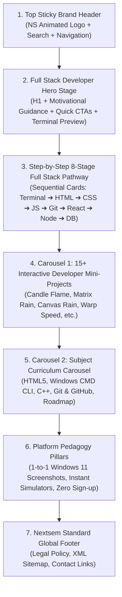

# 🌐 Nextsem Academy: Master Front Page Design & Content Blueprint (`frontpage.md`)

> **Primary Mission:** Guide every new student step-by-step from zero coding knowledge to a **Job-Ready Full Stack Web Developer** in clear, structured, motivating English with zero paywalls, zero bloat, and zero confusion.

---

## 🧭 1. Page Wireframe & Structural Layout Flow



---

## 🎯 2. Section-by-Section Content & Copywriting (100% Developer English)

### 📌 Section 1: Sticky Brand Header (`Header.tsx`)
- **Logo Emblem:** Interactive vector `NextsemLogoAnimation` (N-E-X-T-S-E-M trace $\rightarrow$ locks into permanent emerald `NS` badge).
- **Navigation Links:**
  - `Home` (`/`)
  - `Full Stack Roadmap` (`/full-stack-web-development-roadmap`)
  - `HTML & CSS` (`/html`)
  - `Windows CLI` (`/cli`)
  - `Projects Lab` (`/course/projects`)
  - `Curriculum` (`/curriculum`)
- **Search Widget:** Interactive dropdown with instant full-text tutorial search + Google Search fallback.
- **Brand Badge:** `v29` / `100% Free Dev Bootcamp`.

---

### 📌 Section 2: Hero Stage — "Become a Job-Ready Full Stack Developer"

#### Copywriting:
- **Pill Badge:** `⚡ 100% FREE SOFTWARE ENGINEERING PATHWAY • ZERO PAYWALLS`
- **Main Heading (H1):** `Become a Job-Ready Full Stack Web Developer`
- **Subtitle:**  
  *"Learn modern web development from the ground up. Start with your first Windows terminal command and HTML structure, progress through modern CSS layouts and JavaScript logic, build full-stack React and Node.js applications, manage databases, and deploy real-world projects to the cloud."*
- **Action Buttons:**
  1. `[Primary Emerald Button]` **Start Step 1: Terminal Setup »** $\rightarrow$ Links to [`/cli/introduction-to-command-line-interface-cli-basics`](https://nextsem.online/cli/introduction-to-command-line-interface-cli-basics)
  2. `[Secondary Indigo Button]` **Explore Full Pathway ➔** $\rightarrow$ Scrolls to Section 3 Pathway Deck.
  3. `[Gradient Accent Button]` **Full Stack 2026 Roadmap »** $\rightarrow$ Links to [`/full-stack-web-development-roadmap`](https://nextsem.online/full-stack-web-development-roadmap)

#### Live Terminal Code Preview Card:
```cmd
C:\Users\Developer> mkdir nextsem-portfolio
C:\Users\Developer> cd nextsem-portfolio
C:\Users\Developer\nextsem-portfolio> echo ^<h1^>Hello Full Stack^</h1^> > index.html
C:\Users\Developer\nextsem-portfolio> code .
[SUCCESS] Workspace launched in VS Code. Ready to build!
```

---

### 📌 Section 3: The 8-Stage Sequential Full Stack Learning Pathway

Every beginner follows this exact chronological step-by-step roadmap to eliminate all confusion:

| Step | Stage Name | Target Skills & Modules | Live Lessons & Link |
| :---: | :--- | :--- | :--- |
| **01** | **🪟 Windows CMD & Dev Environment** | Terminal navigation, directory creation, drive switching, environment variables, PATH configuration, and local server tooling. | 📚 **100+ Lessons**<br>🔗 [`/cli`](https://nextsem.online/cli) |
| **02** | **🧱 HTML5 Web Architecture** | Semantic tags, document outlines, forms, inputs, tables, accessibility, DOM tree hierarchy, and HTTP request headers. | 📚 **98+ Lessons**<br>🔗 [`/html`](https://nextsem.online/html) |
| **03** | **🎨 CSS3 Responsive UI & Layouts** | Flexbox containers, CSS Grid systems, custom properties (variables), media queries, keyframe animations, and modern Tailwind CSS utility styling. | 📚 **Interactive Labs**<br>🔗 [`/html`](https://nextsem.online/html) |
| **04** | **⚡ JavaScript (ES6+) Core Logic** | Variables (`let`/`const`), arrow functions, arrays, objects, event listeners, DOM manipulation, promises, and `async/await` API fetching. | 📚 **Hands-on Labs**<br>🔗 [`/playground`](https://nextsem.online/playground) |
| **05** | **🌿 Git & GitHub Version Control** | `git init`, commit staging, branch management, pull requests, merge conflict resolution, and GitHub remote repositories. | 📚 **Terminal Simulator**<br>🔗 [`/git`](https://nextsem.online/git) |
| **06** | **⚛️ React.js & Next.js Framework** | Component architecture, JSX, `useState`/`useEffect` hooks, props passing, Next.js App Router, SSR, and Server Components. | 📚 **Full Stack Pathway**<br>🔗 [`/curriculum`](https://nextsem.online/curriculum) |
| **07** | **🔌 Backend REST APIs with Node.js** | Node.js runtime, Express server routing, HTTP middleware, JSON payloads, CORS, and JWT authentication tokens. | 📚 **API Backend Lab**<br>🔗 [`/curriculum`](https://nextsem.online/curriculum) |
| **08** | **🗄️ Databases & Cloud Deployment** | MongoDB / SQL CRUD queries, schema models, Firebase Cloud backend, CI/CD deployment pipelines on Vercel / Firebase Hosting. | 📚 **Cloud Production**<br>🔗 [`/full-stack-web-development-roadmap`](https://nextsem.online/full-stack-web-development-roadmap) |

---

### 📌 Section 4: Carousel 1 — 15+ Practical Developer Mini-Projects (`StudentProjectsSection.tsx`)

A dedicated horizontal swipe gallery showcasing live interactive animation and software labs built by students:

1. **Realistic CSS Candle Flame** (`/candle-flame-animation`) — Keyframe physics, concentric gradient colors, and wick glow.
2. **Digital Matrix Code Rain** (`/matrix-code-animation`) — Green streaming katakana character physics on 2D Canvas.
3. **HTML5 Canvas Rain Drop Effect** (`/rain-effect-animation`) — Real-time particle arrays and velocity gravity loops.
4. **Warp Speed Starfield Acceleration** (`/warp-speed-animation`) — 3D projection math and star streak acceleration.
5. **Cyberpulse Laser Neon Button** (`/neon-button-animation`) — Multi-layered neon border glow with ripple click physics.
6. **Holographic 3D Glass Card** (`/glassmorphism-card-animation`) — `backdrop-filter` frosted glass tilt physics.
7. **Audio Equalizer Beats Visualizer** (`/audio-spectrum-animation`) — Frequency array waveform dynamic height scaling.
8. **Solar System 3D Planet Orbit** (`/solar-system-animation`) — Rotational orbit scales with speed multiplier controls.
9. **3D Cube Rotation Engine** (`/3d-cube-animation`) — CSS 3D `preserve-3d` perspective rotation on mouse drag.
10. **Animated Ocean Fluid Waves** (`/animated-waves-animation`) — Multi-layered SVG vector wave translations.
11. **Cyberpunk Glitch Text Effect** (`/glitch-text-animation`) — Polygon clip-path slicing and RGB split offset.
12. **3D Holographic Foil Card Tilt** (`/holographic-card-animation`) — Metallic gold foil reflection shader.
13. **3D Rotating DNA Double Helix** (`/dna-helix-animation`) — Harmonic sinusoidal particle wave pairing.
14. **Liquid Glass Battery Level** (`/liquid-wave-animation`) — Rotational fluid displacement container.
15. **Black Hole Gravitational Lensing** (`/black-hole-animation`) — Conic light bending around an event horizon.

---

### 📌 Section 5: Carousel 2 — Subject Curriculum Carousel (`CourseCarouselSection.tsx`)

Direct interactive access to all structured subjects with lesson badges and counts:
- 🧱 **HTML5 & Web Fundamentals** (98+ Lessons) $\rightarrow$ `/html`
- 🪟 **Windows 11 Command Prompt (CMD)** (100+ Lessons) $\rightarrow$ `/cli`
- 💻 **C++ Software Engineering & OOP** (21+ Lessons) $\rightarrow$ `/cpp`
- 🌿 **Git & GitHub Version Control Lab** (Terminal Simulator) $\rightarrow$ `/git`
- 🗺️ **Full Stack 2026 Career Roadmap** (Complete 8-Stage Pathway) $\rightarrow$ `/full-stack-web-development-roadmap`

---

### 📌 Section 6: Platform Pedagogy Pillars (Why Nextsem is Unique)

1. 💻 **1-to-1 Windows 11 PC Screenshots:**  
   Every lesson includes real Windows 11 Command Prompt and VS Code screenshots so students practicing on their PC can verify output line-by-line against their mobile phone.
2. ⚡ **Zero Paywalls & Zero Forced Sign-ups:**  
   Students can immediately start reading, copying code, and running interactive terminal commands without payment gates or mandatory sign-up walls.
3. 🎯 **Job-Ready Code Snippets:**  
   Complete, fully functional code blocks (no truncated placeholders) adhering to industry best practices.

---

### 📌 Section 7: Nextsem Standard Global Footer (`Footer.tsx`)

Permanent brand footer containing all legal and sitemap compliance links:
- `Nextsem Academy • Complete Free Dev Curriculum`
- `Privacy Policy` (`/privacy`)
- `Terms of Service` (`/terms`)
- `Contact Support` (`/contact`)
- `About Us` (`/about`)
- `XML Sitemap` (`/sitemap.xml`)

---

## 🔒 3. SEO Preservation & Zero-Deletion Guarantee

- **No Routes Deleted:** All 280+ static pages (C++ lessons, IGNOU BCA indexes, CLI modules, HTML guides) remain active and valid in the build.
- **Sitemap Integrity:** [`sitemap.ts`](file:///c:/Users/manoj2403/Documents/nextsem.online/src/app/sitemap.ts) automatically generates clean XML URLs for Google search bots and AdSense verification crawlers.
