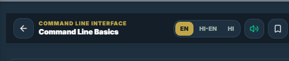
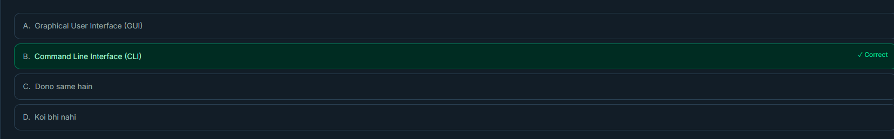

i dont want bottom navigation bar visible during lesson navigation but visible when user reaches last of lesson make sure bottom navigation is working

hide bottom navigation when reading a lesson and make it visible only at the last of lesson or when user reaches at the last of lesson.
also hide floating prev and next buttons that do not look professional

ok in the mean time i take a rest you yourself test first lesson under cli amd find errors as i find there is lots of content make it eay to read on mobile and every instruction must follow a screnshot uploaded by me so that it is easy fir users.

do not deploy unless i give a signal but building locally 

https://nextsem-staging.web.app/cli/ i find content a little bit not satisfying also i dont like  placed randomly like this. this is not looking good make the content beautiful and eye-catching .
why these txt have green colour link like if does not have link. and why is there this much gap between sections?? 

on this page put all 1000 lessons major lesson links active only for those which are completed and locked others .

also remove ** or any identifier which user or google can find as ai content. i want my website to be unique.

keep text colour only green and only link colour as green. remove background like this
 
 on cli lesson pages explain a command then in new line write the command and its output screenshot in new line or in next section with a proper heading.

do not change the content of the lesson just reformat it. and remove  and this like "[alt text](image-4.png)" random commands writing it is not looking professional.

i dont like  commands written like this remove copy icon and write commands as it is when teaching about its usage.
remoev green colour of this text 

auto run and insert output below each command make screenshots using gemini but it must bebased on windows 11 and it must look real screenshot not ai made also remove this upload requests 

remove  icon from whole project 
again it is not looking professional just write commands as it is in normal white colour just make it bold and underlined 
 why this if not needed just remove it. 

 use actual windows minimize maximize and cloe icon not this 
 here either remove winodws logo or use actual winodws logo like 

 remove this from whole project.

 rewrite this and like this on lessons with little more space and well looking i dont know how to explain. but make it look better.

 update this from Er.manoj Kumar to Nextsem with logo and add curriculum link page 

remove this 

let us make lesson 2 similiar to lesson 1 

on Interactive Lesson Check let users select the answer instead of auto correct answer and also randomise the answr.

let us make lesson 3 similiar to lesson 1 and 2.

clicking on account on bottom navigation should take user to profile page and do not show all lessons etc.  also inside profile page show users current progress in each unit and overall progress. and also show logout button. aldo i want to show profile as on overlay not the direct page as it will ditract user from completing lesons. use the style of lesson 1 of unit 1 of cli as reference

let us make lesson 4 similiar to lesson 1 and 2 and 3.

 update overall learning progress too as it showing 0/170 also add a link to profile page if user wants to see comlpete progress. but keep the back to leson also active 

here  near header on each lesson page in a square box write current lesson number /1000 to make more clarity a green tick if completed that lesson also put it at the end of lesson too.

answering the interactive lesson check mcq must makr lesson completed weather it is correct or wrong.

let us make lesson 5 similiar to lesson 1 2 3 4.
let us make lesson 6 similiar to lesson 1 2 3 4.
let us make lesson 7 similiar to lesson 1 2 3 4.
let us make lesson 8 similiar to lesson 1 2 3 4.
let us make lesson 9 similiar to lesson 1 2 3 4.
let us make lesson 10 similiar to lesson 1 2 3 4.

i fond no screenshots added by you from lessons no 4 onwards 

screenshots generated on lesson 4 onwards do not look professional as they loked in lesson 1 2 and 3. do correct it.

no no i dont like these screenshots i want you to genrate screenshots using gemini only and similiar to lesson 1 2 and 3.

ok let us follow same patterna dn create next 20 lessons similiar to abov e 10 lessons with same screenshots  and content style also deploy them to prod that is nextsem.online.

i find that logging with same email on another device does not remember users progress it will be disastrous please correc it do not deploy for now.
ok let us follow same patterna dn create next 70 lessons similiar to above 30 lessons with same screenshots  and content style also deploy them to prod that is nextsem.online.

also on profile page on the top of the page  also update in curriculum page too and keep the overal progress same as in the profile page follow lesson creation path such that every thing about command prompt is completed and speed should be average to teach all lessons  remember we have to create 1000 lessons for cmd 

when a returning user logs in or open the app he should be landed at the lesson he left last with a motivation to continue studying . if user completed 100 lessons show him a motivational message with 100 completed badge and offer to start next course python course etc. also add navigation to previous and next course.
also add share button to share course in social media.
send emails to continue lessons if users have logged in and left studies or not logged in for more than 3 days. in a week send 2 emails.

one more thing let us keep a trget of 100 lessons in each subject and follow the same pattern as cmd to create lessons, create batch file for running and testing and creating screenshots and creating all 100 lessons for all subjects and after it is completed i will apply for adsense and admobs to get 100% verified.
