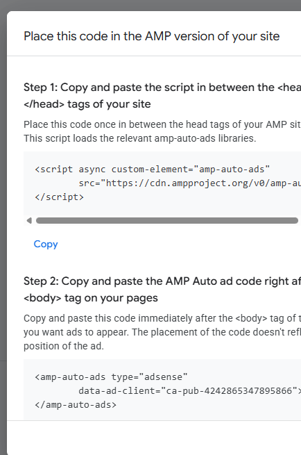
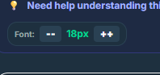
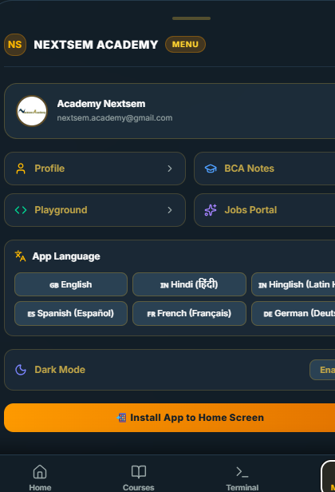
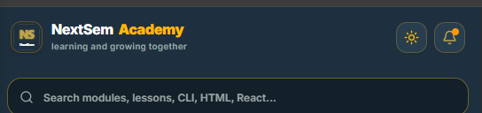
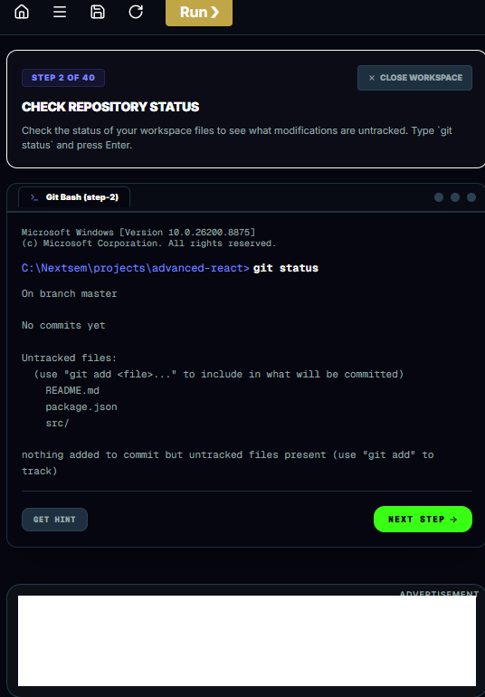
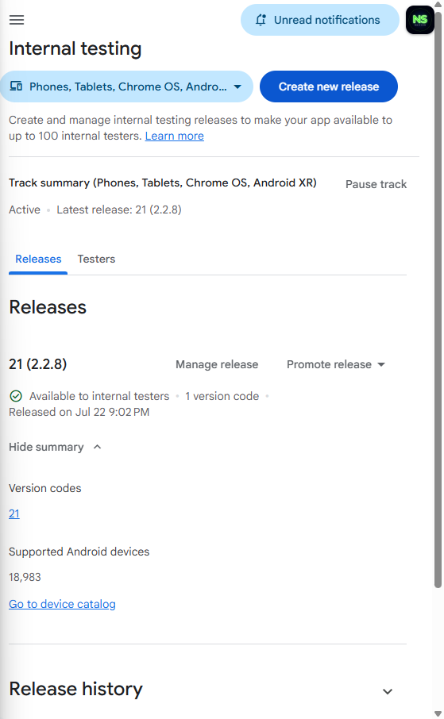
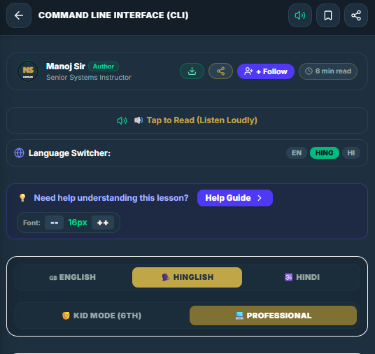
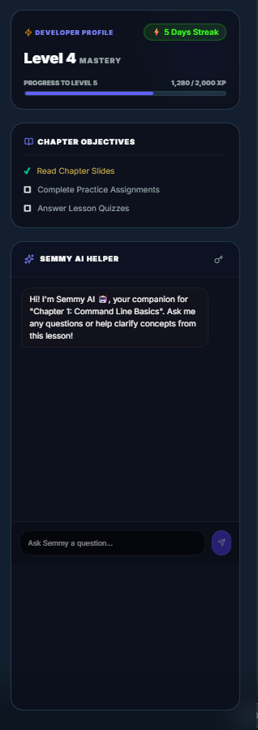
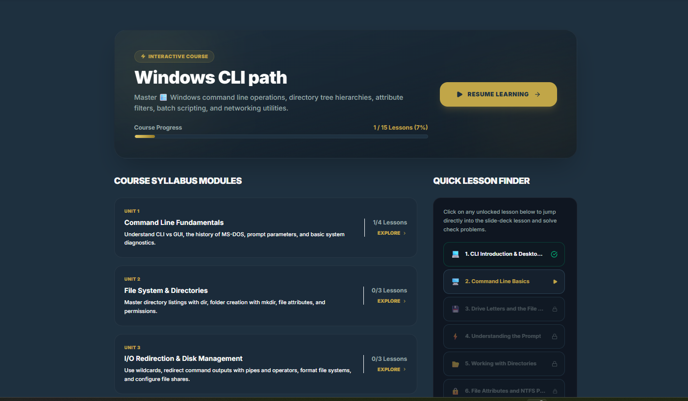
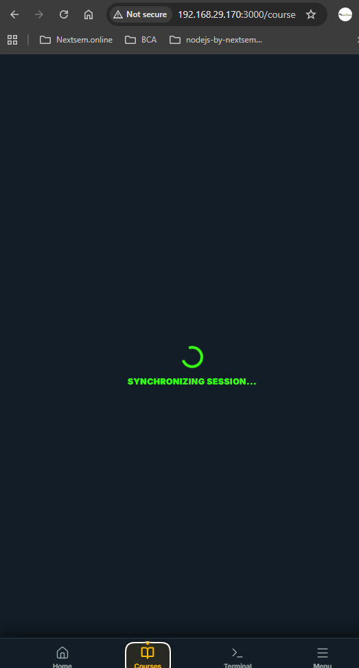

We are currently working on Version Code 23 (Version Name 2.3.1).

📜 Recent Version History Summary:
Version Code	Version Name	Details / Status
19	2.2.6	Old live release on Play Store
20 & 21	2.3.0	Draft/test version codes used in Play Console
22	2.3.0	Currently waiting in Play Console ("Quick checks")
23	2.3.1	⚡ Current Active Version — Contains all mobile layout fixes & AdMob updates (the test APK on your phone right now!)

fix this   and  on android app.
also add all features which are currently implemented on nextsem.online

in the mean time change logo colour of app as is favicon of nextsem.online. also  content is not visible clearly correct it make it like   and like this   and lesson as  but on app it should become full screen if on a lesson page. also remove this  also  make logo colour as per our theme also  i find next and prev buttons on lesson pages just remove them and keep next and prev only on bottom navigation buttons only. also it should work on mobile browser too in full screen mode with mobile theme not on desktop theme.

suggest more features for android app and make changes as per user demand on live site.but it should not create problem in layout as i have applied for admobs review.
i find a white bar on the top of app i think it is for admob ads but it should not be visible in full screen mode when lesson is open. also while watching ads it should not be visible and even on lesson pages it should not be visible. also do not show it on front page it should only be visible on lesson pages. and one more thing when i try to use it on mobile browser it should work on mobile theme not on desktop theme. but on desktop it should work on desktop theme. use responsive desing for mobile browser and desktop browser. do check if pdf reward is working perfectlky or not.

ok develop apk and deploy nextsem.online too.

 remove white spaces at the top of app and bottom in the android app it does not look professional and remake apk and also app freeezes in between do correct it do not make apk

when i click on a link or button on the app it take some time to open i get confused and reclick many time correct that and why does it happens.

also full screen on android app and mobile browser is not working perfectly by full screen i mean dihe logo and upper navigation logo and bottom navigation and only show lesson content.

stop deploying too.

urgent i find some w3school similar content on mobile browser on the top right corner and in middle remove them.
and on android app i find the bottom bar i think it is for admob ads but it should not be visible in full screen mode when lesson is open. also while watching ads it should not be visible and even on lesson pages it should not be visible. also do not show it on front page it should only be visible on lesson pages. and one more thing when i try to use it on mobile browser it should work on mobile theme not on desktop theme. but on desktop it should work on desktop theme. use responsive desing for mobile browser and desktop browser. do check if pdf reward is working perfectlky or not. also do not use any css html java jsx tsx or any class id name as w3 instead use ns as prefexi it is urgent.

khud ek internal test karke dekho kya problem aa rahi hai abhi app m aur solutions batao.

agar saare test pass ho gye hai to .apk banao.

deploy bhi kardo.