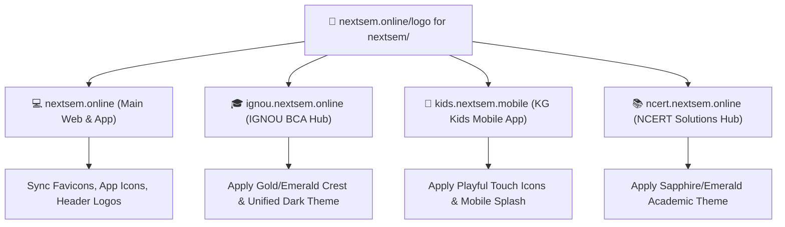

# 🎨 Nextsem Brand Design System & Master Logo Suite

> **Central Brand Repository:** All official logos, color themes, typography tokens, and platform styling are designed, tested, and maintained here before deploying to **Nextsem Online**, **IGNOU Nextsem**, **Kids Nextsem**, and **NCERT Nextsem**.

---

## 🌟 Brand Philosophy & Core Identity

Nextsem represents the **Next Semester of Software Engineering & Free Education**.  
The brand identity is built on three unbreakable pillars:

1. **⚡ Speed & Modernity:** Instant terminal simulators, interactive visual coding labs, zero paywalls, zero bloat.
2. **💎 Contrast & Readability:** High-contrast pure white typography (`#ffffff`), deep dark background (`#17181c` / `#060c18`), vibrant developer emerald green (`#04AA6D`) accents.
3. **🪟 Unified Experience:** 100% 1-to-1 matching across Windows 11 PC monitors and mobile Android WebViews.

---

## 🎨 Master Color Palette & Theme Tokens

### 1. Primary Platform Colors (Web & App)
| Role | Color Name | Hex Code | Usage |
| :--- | :--- | :--- | :--- |
| **Primary Accent** | Emerald Green | `#04AA6D` | Main brand color, active buttons, links, terminal prompts |
| **Emerald Hover** | Deep Emerald | `#039861` | Interactive button & link hover states |
| **Emerald Glow** | Electric Mint | `#10b981` | Neon glow shadows, success badges, live indicator dots |
| **Base Background** | Nextsem Charcoal | `#17181c` | Master page background across all desktop & mobile layouts |
| **Card Surface** | Deep Space Navy | `#0c1328` | Elevated cards, terminal containers, VS Code code boxes |
| **Card Surface Alt** | Slate Dark | `#1e293b` | Secondary cards, pill filters, modal overlays |
| **Text Primary** | Pure White | `#ffffff` | All headings (H1, H2, H3), titles, and high-contrast body text |
| **Text Secondary** | Muted Slate | `#94a3b8` | Subtitles, helper captions, timestamp labels |
| **Text Tertiary** | Dark Slate | `#64748b` | Inactive borders, breadcrumbs, placeholder text |

### 2. Multi-App Specialized Accents
| Sub-App | Accent Name | Hex Code | Target App |
| :--- | :--- | :--- | :--- |
| 💻 **Main Bootcamp** | Emerald Green | `#04AA6D` | [`nextsem.online`](https://nextsem.online) |
| 🎓 **IGNOU BCA** | Imperial Gold | `#c1a648` | [`ignou.nextsem.online`](https://ignou.nextsem.online) |
| 🧸 **Kids Learning** | Sunshine Amber & Mint | `#f59e0b` / `#10b981` | [`kids.nextsem.mobile`](https://kids.nextsem.mobile) |
| 📚 **NCERT Solutions** | Sapphire Azure | `#0284c7` | [`ncert.nextsem.online`](https://ncert.nextsem.online) |

---

## 📁 Logo Files & Asset Directory

All official vector assets in this folder:

| File Name | Format | Dimensions | Description |
| :--- | :---: | :---: | :--- |
| [`nextsem-logo-mark.svg`](./nextsem-logo-mark.svg) | SVG | 120x120 | Signature Emerald `N` + Pure White `S` Monogram Badge |
| [`nextsem-logo-full-horizontal.svg`](./nextsem-logo-full-horizontal.svg) | SVG | 600x120 | Full Brand Wordmark (`Nextsem`) with Monogram & Subtitle |
| [`nextsem-logo-app-icon-512.svg`](./nextsem-logo-app-icon-512.svg) | SVG | 512x512 | Master Google Play Store / Capacitor Android App Icon |
| [`nextsem-logo-monochrome-dark.svg`](./nextsem-logo-monochrome-dark.svg) | SVG | 120x120 | Black & White High-Contrast Logo for Dark Backgrounds |
| [`nextsem-logo-monochrome-light.svg`](./nextsem-logo-monochrome-light.svg) | SVG | 120x120 | Black & White Logo for Print / Light Backgrounds |
| [`nextsem-logo-gold-edition.svg`](./nextsem-logo-gold-edition.svg) | SVG | 120x120 | Gold & Emerald Crest for IGNOU BCA & Certificates |
| [`nextsem-logo-kids-edition.svg`](./nextsem-logo-kids-edition.svg) | SVG | 120x120 | Playful Rounded Mascot Badge for Kids Mobile App |
| [`nextsem-logo-ncert-edition.svg`](./nextsem-logo-ncert-edition.svg) | SVG | 120x120 | Sapphire Academic Emblem for NCERT Solutions Hub |
| [`nextsem-favicon.svg`](./nextsem-favicon.svg) | SVG | 32x32 | Crisp 32x32 Browser Tab Favicon |
| [`theme-tokens.json`](./theme-tokens.json) | JSON | - | JSON export of all colors, typography, borders, and shadows |
| [`theme-tokens.ts`](./theme-tokens.ts) | TS | - | Type-safe TypeScript theme tokens ready for React / Next.js |

---

## 🔄 Rollout Plan to Other Workspaces

Once approved and tested on [`nextsem.online`](file:///c:/Users/manoj2403/Documents/nextsem.online):

---

## 🧪 How to Preview & Test Live

You can test all logo variants and switch color themes live in the interactive **Nextsem Logo & Theme Studio**:
- 🔗 **Live Route:** `/logo-studio`
- 🖥️ **Interactive Controls:** Toggle Backgrounds (Nextsem Dark `#17181c`, Deep Space Navy `#0c1328`, Pure Dark `#000000`, IGNOU Gold Navy `#060c18`), test sizes, copy SVG code in 1 click, and preview mobile app icons.
