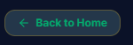
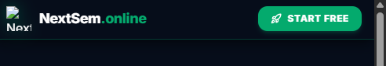
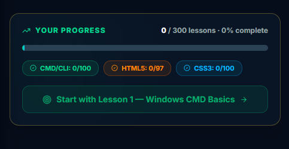
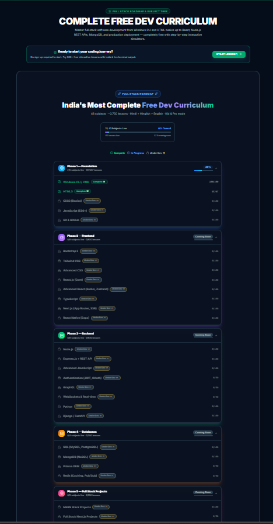
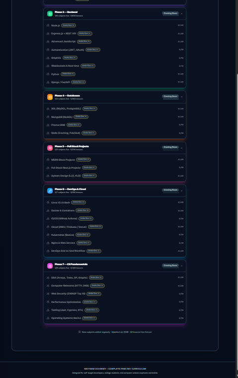
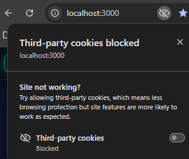

# 🚀 Nextsem.online — Full Stack Web Developer Landing Page Master Document

## 💬 User Original Inputs & Notes (Verbatim)
> we will work in very small small steps so that we dont get bored.
> i want front page design unique and based onour aim of learning and becoming full stack web developer. 
>
> is file m nextsem.online ka front page ko most beautiful way me design karo jisme aim full stack web developer banane ka ho aur google pe jitne bhi ese platform hai unse ideas collect karo aur mujhe batao fir hum usse banayenge
>
> logo jo humne green black aur white colour m design kiya hai wo use karo
>
> acha thoda thoda update karo aur mujhe batate raho bilkul chote chote steps k sath taki m bore na hou
>
> ek problem hai logo m -> Logo ka image asset galat hai (/logo-transparent.png ya /logo.png use karna hai)
>
> tum batao ab kya krna chahiye front page k liye aur abhi tak jo humne front page pe update kiya hai sab lkuch front_page.md m sahi se update kardo taki m future m easilt smjh saku
>
> ha agar kisi ko pehle se thoda knowledge hai to uska test karne k liye koi test type actual simulations based type professional exam babo jaise cicso ka CCIE ka exam hota hai aur use start lesson k upar ek link k form m add kardo

---

## 🎯 Primary Goal & Design Philosophy
**Goal**: Make `https://nextsem.online` the #1 unique, visually stunning, free learning platform for self-taught software engineers, college students, and computer science aspirants worldwide to become **Full Stack Web Developers**.

**Development Workflow Constraint**:
- ⚡ **Very Small Steps Policy**: All updates are broken down into bite-sized, single-focused incremental micro-steps so learning & building remains engaging, visual, and fun without boredom!

**Theme Palette**:
- **Background**: High-contrast dark mode `#060d1a` / `#17181c`
- **Primary Accent**: Emerald Green `#04AA6D` (Glow: `drop-shadow-[0_0_10px_rgba(4,170,109,0.3)]`)
- **Secondary Accents**: Cyan `#06b6d4`, Amber `#f59e0b`, Orange `#f97316`
- **Branding Logo Asset**: `public/logo-transparent.png` (Green, Black & White emblem with transparent background)

---

## 💡 Unique Front Page Features & Step-by-Step Roadmap

### Step 1: Unique Header & Navigation
- Official Green, Black & White transparent logo badge.
- Subject pills for `🪟 CMD CLI`, `🧱 HTML5`, `🎨 CSS3`, `⚡ JS ES6`, `⚛️ React`, `🟢 Node.js`.
- Glowing Emerald `[🚀 Start Free]` button.

### Step 2: Hero Section & CCIE Placement Simulation Banner
- "Become a Full Stack Web Developer" gradient title.
- CCIE-Style Practical Developer Placement Exam banner (`/cli/quiz`).
- Live Windows 11 Command Prompt interactive sandbox terminal box.

### Step 3: 7-Phase Full Stack Pathway Cards
- Visual roadmap grid covering CLI → HTML → CSS → JS → React → Node.js → Git & Cloud.

---

## 📁 Key File Map

| File Path | Description |
| :--- | :--- |
| `src/app/page.tsx` | Main root route entry point rendering `CurriculumClient`. |
| `src/app/curriculum/CurriculumClient.tsx` | Main landing page client component. |
| `docs/roadmap/Front_page.md` | Master documentation for landing page design & roadmap. |

remove v29 pill badge it does not look professional.
logo is broken correct it.

remove back to home front page 

ye hai 

logo animation at the start of website keep that as final and use logo similiar to that.

why this progress if user is not logged in locally nor with google 

put a accept agreement at the bottom so that cookies and users data are saved locally 

  make it professional

