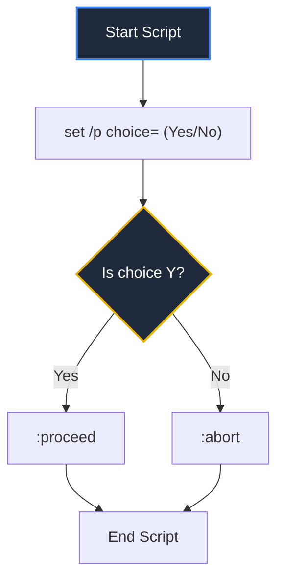

# Chapter 13: Batch Files

## 📄 Shell Scripting Automation

A **batch file** (saved with the **`.bat`** extension) is an executable script containing a list of Command Prompt instructions. When you execute a batch file, the command interpreter executes the lines sequentially.

---

## 🛠️ Core Scripting Instructions

To write clean, interactive automation scripts in 🪟 Windows 11, developers use these standard commands:

### 1. Echoing Control (`@echo off`)
By default, the terminal prints every command line in the batch script before running it.
* **`@echo off`**: Add this at the absolute top of your script to hide command prompts from showing, making the terminal output look extremely clean.
* **`echo Message`**: Prints a custom message line to the console screen.

### 2. Pausing Execution (`pause`)
Temporarily freezes script execution and displays the text: `Press any key to continue . . .`. It waits for the user to press a key before moving to the next line. (Crucial for preventing the terminal window from auto-closing before you can read the output!).

### 3. Remarks and Comments (`rem` or `::`)
Used to write notes for developers that the computer ignores when running:
```cmd
rem This is a standard remark comment
:: This is a shorthand modern comment
```

---

## 🔄 Branching, User Inputs, & Conditionals



### 1. User Prompts (`set /p`)
Prompts the user for a text string and saves it into a variable:
```cmd
set /p folderName=Enter new folder name: 
mkdir %folderName%
```
*(Notice we wrap the variable name in `%` signs to read its value).*

### 2. Interactive Selection (`choice`)
Restricts the user's input to specific keys, returning an error level indicator depending on what was selected:
```cmd
choice /c YN /m "Do you want to run the backup now?"
```
*Outputs: `Do you want to run the backup now? [Y,N]?`*

### 3. Conditional Checks (`if`)
Executes blocks based on filesystem states or string evaluations:
* **Check if file exists:**
  ```cmd
  if exist config.txt (
      echo Configuration loaded!
  ) else (
      echo Warning: Configuration missing!
  )
  ```
* **Variable comparison:**
  ```cmd
  if "%choice%"=="Y" goto proceed
  ```

### 4. Jump Labels (`goto`)
Directs script execution to jump to a specific label starting with a colon (`:`):
```cmd
@echo off
set /p ans=Build app? (Y/N): 
if "%ans%"=="Y" goto build
if "%ans%"=="N" goto end

:build
echo Building Web App...
npm run build
pause

:end
echo Exiting script...
```

> 🤫 **Developer Joke:** Why did the batch script refuse to wake up? Because `@echo off` was too quiet! 💤

---

## 💻 Practice Terminal Drill

Choose how you want to complete your practice drill:

### ⚡ Option A: Quick-Run Simulator (Recommended)
Click the pills below to execute the drill commands automatically:

<CommandLineRunner
  commands={[
    { input: "echo @echo off > run.bat", output: "", explanation: "Creates a batch file run.bat and writes '@echo off' to suppress execution prints." },
    { input: "echo echo Nextsem Academy! >> run.bat", output: "", explanation: "Appends an echo print statement to run.bat." },
    { input: "run.bat", output: "Nextsem Academy!", explanation: "Runs the batch script file from the Command Prompt." }
  ]}
/>

### 🛠️ Option B: Open-Ended Terminal Sandbox
If you want to manually type these commands yourself, launch the full system simulator below:

<TabbedOS />

---

## 🏆 Lesson Check
Check your batch automation knowledge below:

<DragDropQuestion
  questionId="cmd-batch-if"
  text="To check if a directory named 'backups' exists inside a batch script before creating it, execute __________."
  correctOption="if not exist backups mkdir backups"
  options="if not exist backups mkdir backups, if exist backups rmdir backups, verify backups exist, mkdir backups"
  explanation="if not exist [path] checks if a file or directory is missing before running the command."
/>
