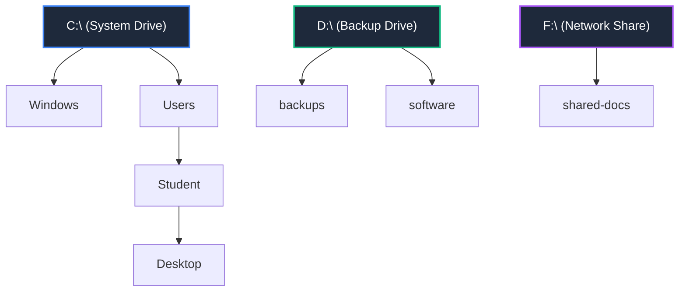

# Chapter 2: Drive Letters and the File System

## 💾 Storage Drives & Volume Layouts

Unlike Unix-based operating systems (like macOS or Linux) which merge all storage drives into a single root directory (`/`), 🪟 Windows organizes storage partitions using alphabetical letters followed by a colon:
* **`C:`**: The primary local drive (where the 🪟 Windows 11 system files and operating system are installed).
* **`D:`**: The secondary drive (often used for data backups, extra software, or USB storage).
* **`F:`**: Shared network drives or virtual mounted partitions.

Every drive has its own independent root directory represented by a backslash `\`. For example, `C:\` represents the root directory of the C drive.

> 📁 **Developer Joke:** Why did the folders break up? Because they couldn't agree on which partition they belonged to! 💔💾

---

## 🧭 Swapping Active Drives and Directory Trees

To view directories or move around, you must understand your active partition context. To switch drives, type the target drive letter followed by a colon (e.g. `D:`) and press `Enter`.

Explore the interactive drive-switching simulation below:

<FolderTreeVisualizer
  title="Drive Switching & Volume Explorer"
  initialTree={[
    { name: "C: (System Drive)", type: "folder", path: "C:" },
    { name: "Windows", type: "folder", path: "C:/Windows" },
    { name: "Users", type: "folder", path: "C:/Users" },
    { name: "Student", type: "folder", path: "C:/Users/Student" }
  ]}
  steps={[
    {
      command: "D:",
      output: "D:\\>",
      explanation: "Switches the command prompt context from the primary system drive (C:) to the secondary backup drive (D:).",
      highlightPath: "D:",
      treeState: [
        { name: "C: (System Drive)", type: "folder", path: "C:" },
        { name: "Windows", type: "folder", path: "C:/Windows" },
        { name: "Users", type: "folder", path: "C:/Users" },
        { name: "Student", type: "folder", path: "C:/Users/Student" },
        { name: "D: (Backup Drive)", type: "folder", path: "D:" },
        { name: "backups", type: "folder", path: "D:/backups" },
        { name: "software", type: "folder", path: "D:/software" }
      ]
    },
    {
      command: "tree",
      output: "Folder PATH list\nVolume serial number is 0042-4286\nD:.\n├───backups\n└───software",
      explanation: "Draws a visual path tree of directories on the active D: drive.",
      highlightPath: "D:/backups",
      treeState: [
        { name: "C: (System Drive)", type: "folder", path: "C:" },
        { name: "Windows", type: "folder", path: "C:/Windows" },
        { name: "Users", type: "folder", path: "C:/Users" },
        { name: "Student", type: "folder", path: "C:/Users/Student" },
        { name: "D: (Backup Drive)", type: "folder", path: "D:" },
        { name: "backups", type: "folder", path: "D:/backups" },
        { name: "software", type: "folder", path: "D:/software" }
      ]
    },
    {
      command: "C:",
      output: "C:\\Users\\Student>",
      explanation: "Switches the command interpreter back to your primary partition (C:) and returns you to your previous directory.",
      highlightPath: "C:",
      treeState: [
        { name: "C: (System Drive)", type: "folder", path: "C:" },
        { name: "Windows", type: "folder", path: "C:/Windows" },
        { name: "Users", type: "folder", path: "C:/Users" },
        { name: "Student", type: "folder", path: "C:/Users/Student" }
      ]
    }
  ]}
/>

> [!IMPORTANT]
> **Active Context:**
> Switching partitions changes your working drive, not your subfolder path. When you switch to `D:`, you are placed at the root of `D:\` or the last active directory on that partition.

---

## 💻 Practice Terminal Drill

Choose how you want to complete your practice drill:

### ⚡ Option A: Quick-Run Simulator (Recommended)
Click the pills below to execute the drill commands automatically:

<CommandLineRunner
  commands={[
    { input: "D:", output: "D:\\>", explanation: "Switches active partition to the secondary storage D drive." },
    { input: "dir", output: " Volume in drive D is BACKUPS\n Directory of D:\\\n\n07/07/2026  03:15 AM    <DIR>          backups\n07/07/2026  03:15 AM    <DIR>          software\n               0 File(s)              0 bytes", explanation: "Lists directory contents for partition D:\\." },
    { input: "tree", output: "Folder PATH list\nVolume serial number is 0042-4286\nD:.\n├───backups\n└───software", explanation: "Draws a graphical tree diagram of folders." },
    { input: "C:", output: "C:\\Users\\Student>", explanation: "Switches back to the primary operating system C drive." }
  ]}
/>

### 🛠️ Option B: Open-Ended Terminal Sandbox
If you want to manually type these commands yourself, launch the full system simulator below:

<TabbedOS />

---

## 🏆 Lesson Check
Check your understanding of drive partitioning below:

<DragDropQuestion
  questionId="cmd-drive-switch"
  text="To switch from the active C: drive to the secondary D: partition, type __________."
  correctOption="D:"
  options="D:, cd D:, go D:, mount D:"
  explanation="To switch drives in Windows Command Prompt, type the destination drive letter followed by a colon and press Enter."
/>
