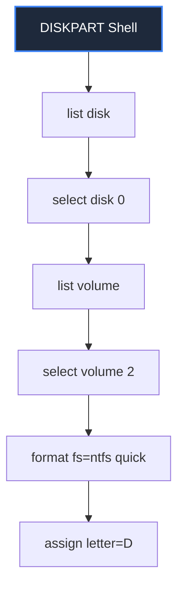

# Chapter 9: Disk Management

## 🛠️ Disk Health Analysis & Auditing

System administrators use dedicated CLI tools to check file system integrity, retrieve storage tags, and manage physical storage volumes in 🪟 Windows 11.

### 💾 The `vol` Command
Retrieves the volume disk label (name) and the 8-character Volume Serial Number of the active partition:
```cmd
vol
```
*Outputs: `Volume in drive C has no label.` and `Volume Serial Number is A4B2-79F8`.*

### ⚙️ The `chkdsk` Command
The **Check Disk** utility scans filesystem metadata for corruptions and disk sector errors:
* **`chkdsk`**: Runs a read-only scan of the current partition.
* **`chkdsk /f`**: Fixes file system index structure errors on the disk.
* **`chkdsk /r`**: Locates physical bad sectors on the drive and recovers readable text/data (implies `/f`).

---

## 💿 Advanced Partitioning with `diskpart`

The **Disk Partition Utility (`diskpart`)** is a powerful command-line tool used to configure drives, format partitions, and assign drive letters.

To launch the utility, run:
```cmd
diskpart
```
*(Requires administrative privileges. The prompt changes to `DISKPART>` indicating you are inside the interactive partitioning shell).*



### Essential `diskpart` Commands:
1. **`list disk`**: Lists all physical storage drives connected to the system.
2. **`select disk [number]`**: Focuses the utility on a specific disk (e.g. `select disk 0`).
3. **`list volume`** / **`list partition`**: Displays active volumes and formatting.
4. **`select volume [number]`**: Selects the target partition (e.g. `select volume 2`).
5. **`clean`**: Erases all partition tables and data from the selected disk.
6. **`create partition primary`**: Allocates raw unallocated space as a primary bootable partition.
7. **`format fs=ntfs quick`**: Formats the selected partition using the **NTFS** filesystem layout.
8. **`assign letter=D`**: Maps the partition to an active drive letter (so it appears in File Explorer).
9. **`exit`**: Exits the `diskpart` shell back to standard CMD.

> [!CAUTION]
> **Data Loss Risk:**
> Running the `clean` command inside `diskpart` instantly deletes all partition layouts on the selected disk! Always verify which disk is selected using `list disk` before executing.

> 🔊 **Developer Joke:** Why was the disk volume always so loud? Because it had a very high volume disk label! 💾🔊

---

## 💻 Practice Terminal Drill

Choose how you want to complete your practice drill:

### ⚡ Option A: Quick-Run Simulator (Recommended)
Click the pills below to execute the drill commands automatically:

<CommandLineRunner
  commands={[
    { input: "vol", output: " Volume in drive C has no label.\n Volume Serial Number is 17A3-B9E5", explanation: "Displays the disk volume label and serial number." },
    { input: "chkdsk", output: "The type of the file system is NTFS.\n\nWARNING!  /F parameter not specified.\nRunning CHKDSK in read-only mode.\n\nStage 1: Examining basic file system structure ...\n  256000 file records processed.                                                         \nFile verification completed.\n\nWindows has scanned the file system and found no problems.\nNo further action is required.", explanation: "Checks the active file system disk structure and metadata." }
  ]}
/>

### 🛠️ Option B: Open-Ended Terminal Sandbox
If you want to manually type these commands yourself, launch the full system simulator below:

<TabbedOS />

---

## 🏆 Lesson Check
Check your understanding of disk audit utilities below:

<DragDropQuestion
  questionId="cmd-vol"
  text="To quickly format a selected disk partition with the NTFS file system inside the DISKPART utility, run __________."
  correctOption="format fs=ntfs quick"
  options="format fs=ntfs quick, chkdsk /f, clean disk, format C:"
  explanation="Inside the diskpart interactive utility, format fs=ntfs quick formats the active partition with the NTFS structure."
/>
